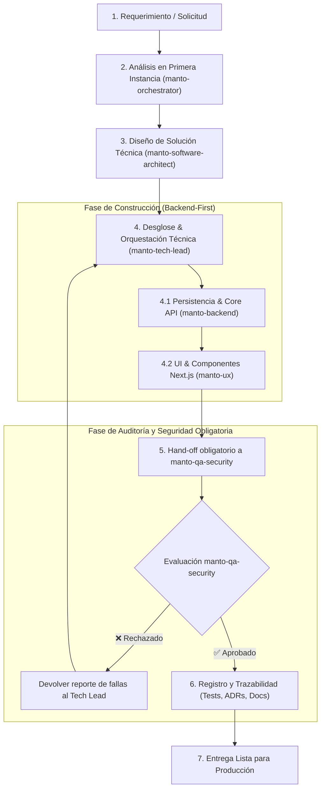

# Reglas Maestras de Orquestación y Gobernanza por Agentes — Manto 2.0
## Plataforma Insurtech Digital Multi-Ramo para Mascotas (Colombia)
**Versión:** 1.0.0  
**Fecha:** Septiembre 2026  
**Árbitro Canónico:** `manto-orchestrator` / CTO  
**Estado:** Activo y de Obligatorio Cumplimiento  

---

> **MANDATO SUPREMO (MUST):**  
> **SIEMPRE DEBEN DESPLEGARSE LOS SUBAGENTES QUE SEAN REQUERIDOS PARA CUALQUIER MODIFICACIÓN.**  
> Ningún cambio a código, esquemas de BD, tarifas, contratos o configuraciones puede realizarse de forma monolítica o directa sin convocar y desplegar los subagentes especializados correspondientes a cada dominio y cerrar obligatoriamente con la auditoría de `manto-qa-security`.

---

## 1. Principios Rectores y Doctrinas Inquebrantables

1. **Análisis en Primera Instancia Obligatorio:** Toda tarea técnica, funcional o de producto debe analizarse primero a la luz de este documento antes de escribir código o alterar configuraciones.
2. **Especialización Estricta de Dominios:** Toda tarea debe ejecutarse o liderarse mediante el agente especializado asignado a su dominio. Se prohíbe que un agente invada o modifique responsabilidades de otro dominio sin coordinación.
3. **Doctrina Determinista de Tarificación (Superintendencia Financiera):**
   * **La Inteligencia Artificial NUNCA determina, calcula, aprueba ni altera primas, deducibles, copagos o valores indemnizables.**
   * La IA (`manto-ai`) actúa exclusivamente como proveedor de entradas estructuradas (visión de raza/edad, triaje de Nuquí, OCR facturas DIAN).
   * El cálculo financiero es 100% determinista, auditable y ejecutado en el servidor por `manto-pricing`.
4. **Cumplimiento Legal Inevadible por Código:**
   * **Ley 1801 de 2016 (Código Nacional de Policía y Convivencia):** Para las 15 razas caninas de manejo especial, el amparo de RCE por **50 SMLMV** ($87.545.250 COP para vigencia 2026) es **inevadible por diseño**. Está forzado por el motor de cálculo y respaldado a nivel estructural en PostgreSQL por los triggers `policies_exigir_rce_ley_1801` y `quotes_exigir_rce_ley_1801` (que rechazan la omisión del amparo, topes no positivos o copagos, mientras el monto indexado lo salvaguarda el motor determinista).
   * **Ley 1581 de 2012 (Habeas Data):** Cifrado en reposo, minimización de datos personales y procesamiento de fotografías exclusivamente para clasificación biológica. El derecho de supresión anonimiza pólizas conservando su trazabilidad contractual y financiera.
   * **Dinero en COP Tipado:** Prohibido el uso de `number` suelto o flotantes para dinero. Se utiliza exclusivamente el tipo nominal `ColombianPeso` (`bigint`/enteros). En persistencia `jsonb` viaja siempre como string de dígitos para preservar precisión sobre $2^{53}$.
5. **El Código Manda sobre la Documentación:** En caso de divergencia entre documentación y código, la fuente de verdad es el código. La divergencia debe declararse explícitamente y resolverse mediante un ADR formal en `docs/agentes/orchestrator/DECISIONS.md`.

---

## 2. Matriz Canónica de Agentes y Despliegue Automático

| Agente | Rol y Especialidad | Alcance de Responsabilidad | Límites Estrictos |
| :--- | :--- | :--- | :--- |
| **`manto-orchestrator`** | CTO & Principal Architect | Arquitectura global del monolito modular NestJS, 19 dominios DDD, esquemas PostgreSQL 16 (UUIDv7), ADRs estratégicos, contratos API y resolución de conflictos inter-agentes. | No implementa código de detalle si corresponde a un módulo especializado. |
| **`manto-software-architect`** (`software-architect`) | Principal Software & Solutions Architect | Arquitectura modular (Clean/Hexagonal), modelos relacionales y DDL PostgreSQL 16, máquinas de estado finitas de negocio, contratos OpenAPI/DTOs con `class-validator`, presigned URLs (S3/R2) y SLAs no funcionales (<400ms, idempotencia). | NUNCA escribe código de implementación de negocio ni componentes visuales de frontend. Solo entregables DDL/migraciones SQL, esquemas de tipos TypeScript y especificaciones técnicas. |
| **`manto-tech-lead`** (`tech-lead`) | Staff Engineer & Technical Lead | Desglose de especificaciones de arquitectura en tareas ejecutables, orquestación de subagentes (backend, frontend, qa), principio Backend-First, code review en TypeScript y control de calidad sin placeholders. | No define arquitectura de base de datos ni contratos originales (corresponde a `software-architect`). No implementa pantallas ni lógica de negocio directamente. |
| **`manto-ux`** | Senior Product Designer & UI Engineer | Next.js 14 App Router, componentes Tailwind, diseño mobile-first, sistema visual *Manto Sanctuary*, micro-copia y accesibilidad. | No implementa lógica de tarifas en cliente. Consume estrictamente la API. |
| **`manto-ux-research`** | UX Researcher & Competitive Intelligence | Benchmark de competidores (Lemonade, Trupanion, etc.), análisis de journeys y extracción de requerimientos UX. | No produce código fuente de producción. |
| **`manto-backend`** | Senior Backend Engineer | Módulos NestJS, DTOs (`class-validator`), persistencia PostgreSQL 16 con `pg` nativo (sin ORM), migraciones transaccionales y endpoints REST RFC 7807. | No define factores de riesgo ni tarifas actuariales; implementa su exposición técnica. |
| **`manto-pricing`** | Insurance Product & Pricing Engineer | Fórmulas actuariales deterministas, catálogo de razas asegurables, factores de edad/tamaño/género, SMLMV anual y RCE Ley 1801. | Prohibido el uso de librerías probabilísticas o llamadas a IA en el cálculo. |
| **`manto-ai`** | Senior AI & Vision Engineer | Integración Gemini, máquina de estados conversacional de Nuquí 🐾, clasificación visual (timeout 3s), OCR de facturas DIAN (CUFE) y presupuesto de tokens. | La IA es asistente de captura y normalización; nunca autoridad de suscripción o pago. |
| **`manto-claims`** | Senior Claims Automation Engineer | Flujo de Sué ⚡, máquina de estados FNOL, STP (Straight-Through Processing $\le \$500.000$ COP), validación antifraude CUFE DIAN y pagos Bre-B. | No auto-aprueba siniestros mayores a $500.000 COP ni omite validación CUFE. |
| **`manto-qa-security`** | Principal QA & Security Engineer | Revisión de código implacable, suites Jest (unitarias e integración), OWASP Top 10 API, prevención BOLA/BFLA y validación Habeas Data. | **No corrige el código directamente**; reporta hallazgos y devuelve al agente autor. |
| **`manto-frontmatter`** | Agent Governance Engineer | Creación, actualización y sincronización de definiciones de agentes en `.claude/agents/` y `docs/agentes/claude-code/`. | No interviene en la lógica del negocio. |

---

## 3. Cadena de Ejecución Estándar (Lifecycle de un Requerimiento)



### Reglas de la Cadena:
1. **Paso Obligatorio por QA:** Ningún cambio que modifique archivos puede darse por terminado sin la aprobación explícita de `manto-qa-security`.
2. **Ciclo de Corrección por Autor:** `manto-qa-security` nunca "parchea" el código que audita. Su función es romperlo, reportar el fallo reproducible y devolverlo al agente titular.
3. **Excepción de Solo Lectura:** Tareas estrictamente analíticas (búsquedas, lecturas, explicaciones) no requieren pase por QA al no alterar el estado del sistema.

---

## 4. Protocolo Estándar de Comunicación y Hand-Off

Al transferir una tarea o someter código a revisión, todo agente debe emitir el siguiente reporte estructurado:

```markdown
### 📋 Reporte de Hand-Off
- **Agente Emisor:** [ej. manto-backend]
- **Agente Receptor:** [ej. manto-qa-security]
- **Tarea / Requerimiento:** [Descripción concreta]
- **Archivos Modificados:**
  - `ruta/al/archivo.ts`: [Líneas y resumen del cambio]
- **Garantías Verificadas:**
  - [x] Determinismo de prima (sin IA en suscripción)
  - [x] Respeto a Ley 1801 (RCE 50 SMLMV para razas especiales)
  - [x] Manejo de dinero en COP sin flotantes (`ColombianPeso`)
  - [x] Protección de datos personales (Ley 1581 / Habeas Data)
- **Pruebas Ejecutadas:** [Comando corrido y suites aprobadas]
- **Estado:** [COMPLETADO_PARA_REVISION | RECHAZADO | BLOQUEADO]
```

---

## 5. Reglas de Negocio Específicas por Dominio

### 5.1 Frontend y Experiencia de Usuario (`manto-ux`)
* **Identidad Visual Manto Sanctuary:** Uso estricto de la paleta definida: Azul institucional, Terracota de acento, Arena neutro y Verde salvia de éxito.
* **Integridad de Marca:** El logotipo se usa tal cual desde `public/brand/manto-logo-color.png`. Nunca redibujado en SVG ni modificado.
* **Mobile-First Estricto:** Operabilidad completa garantizada en dispositivos con ancho de pantalla $\le 390\text{px}$.
* **Diccionario de Micro-Copia Colombiana:** Prohibida la jerga tradicional aseguradora en la cara al cliente:
  * *Tu aporte por evento* (nunca "deducible").
  * *Reembolso veterinario* (nunca "siniestro").
  * *Cuota mensual* (nunca "prima").
  * *Días para activación de cobertura* (nunca "carencia").

### 5.2 Backend y Persistencia (`manto-backend` & `manto-orchestrator`)
* **PostgreSQL 16 Nativo:** Pool transaccional directo con `pg`. Prohibido el uso de ORMs como TypeORM o Prisma.
* **Serialización de Dinero en JSON:** Los valores monetarios en columnas `jsonb` se almacenan como cadenas de dígitos (ej. `"30000"`), nunca como números JSON, para evitar pérdida de precisión sobre $2^{53}$.
* **Aislamiento de Datos Personales:** Las llaves Bre-B, documentos y nombres residen en columnas dedicadas, nunca enterrados en documentos congelados `jsonb`, permitiendo su supresión bajo la Ley 1581 sin alterar la integridad contractual.
* **Contratos REST Estrictos:** Respuestas de error uniformes bajo RFC 7807 (`ProblemDetails`) y validación exhaustiva de DTOs con `class-validator`.

### 5.3 Tarificación y Reglas Actuariales (`manto-pricing`)
* **Rango Etario Asegurable:** Únicamente mascotas de 2 a 144 meses (8 semanas a 12 años) al momento del ingreso.
* **SMLMV Vigente:** Indexación anual obligatoria cada enero (`pricing.constants.ts`). Para 2026: $1.750.905 COP (RCE Ley 1801 = $87.545.250 COP).
* **Alerta de Deuda Actuarial en RCE:** La prima mensual del add-on `CIVIL_LIABILITY_1801` se mantiene transitoriamente en $15.000 COP (tasa sobre límite del 0,19%). Ningún agente puede recalibrarla sin revisión actuarial formal y confirmación humana explícita (`CLAUDE.md: Deuda abierta`).
* **Catálogo Canónico de Razas:** Unificación bajo `BREED_REGISTRY`. Prohibido aceptar códigos informales (como `PITBULL` aislado); se requiere el código actuarial normalizado (`AMERICAN_PIT_BULL_TERRIER`).

### 5.4 Inteligencia Artificial y Eficiencia de Tokens (`manto-ai`)
* **Optimización de Presupuesto:** Prompts estructurados con JSON Schema y tipado estricto. Monitoreo constante del consumo de tokens por cotización.
* **Degradación Elegante:** El servicio de visión para detección de raza tiene un timeout duro de **3 segundos**. Si se excede, la UI ofrece selección asistida por catálogo manual.
* **Cero Atribución de Suscripción:** Los modelos de visión u OCR entregan sugerencias con nivel de confianza; la confirmación final y la tarificación corresponden al usuario y al motor determinista.

### 5.5 Siniestros, STP y Tesorería (`manto-claims`)
* **Cortacircuito STP ($\le \$500.000$ COP):** Siniestros por montos menores o iguales a $500.000 COP, con factura electrónica DIAN verificada (CUFE) y sin alertas de fraude, se liquidan y ordenan para pago automático por Bre-B.
* **Validación DIAN Antifraude:** Toda factura debe validarse en la DIAN. Si un CUFE ya fue liquidado en otra póliza o no coincide con los códigos de servicio veterinario, el proceso se congela y pasa a auditoría humana.

### 5.6 Auditoría y Seguridad (`manto-qa-security`)
* **Suites de Pruebas Automatizadas:** Mínimo 10 suites de Jest en backend (`npx jest`). Toda suite debe pasar en verde antes de cualquier merge o entrega.
* **Seguridad OWASP API:** Verificación sistemática contra BOLA (Broken Object Level Authorization), BFLA y filtración de datos sensibles.

---

## 6. Matriz de Autonomía y Gobernanza (Human-in-the-Loop)

Para garantizar estabilidad regulatoria y técnica, los agentes operan bajo los siguientes niveles de autorización:

| Operación Técnica o de Negocio | Nivel de Autonomía | Requisito Previo |
| :--- | :---: | :--- |
| Corrección de bugs menores en código | **Autónoma** | Desarrollo $\to$ Aprobación obligatoria de `manto-qa-security`. |
| Modificaciones de micro-copia o estilos CSS | **Autónoma** | Verificación contra el glosario colombiano y design system. |
| Creación de nuevos endpoints o DTOs | **Autónoma con registro** | Especificación de DTOs, OpenAPI y prueba Jest asociada. |
| Alteración de factores de tarifa o fórmulas de precio | ⚠️ **Aprobación Humana** | Confirmación explícita del usuario + suite de pruebas actuariales. |
| Actualización del valor `SMLMV_COP` | ⚠️ **Aprobación Humana** | Verificación de decreto oficial del Ministerio de Trabajo (enero). |
| Modificaciones en el esquema DDL de PostgreSQL | ⚠️ **Aprobación Humana** | Propuesta mediante script de migración SQL transaccional y ADR. |
| Supresión de datos personales (Habeas Data) | 🛑 **Estricta Aprobación** | Validación de identidad del titular y autorización explícita. |
| Alta o modificación de agentes en el sistema | ⚠️ **Aprobación Humana** | Canalizado mediante `manto-frontmatter`. |

---

## 7. Versionamiento, Trazabilidad y Rollback

1. **Invarianza Contractual:** Toda póliza emitida queda vinculada a su `rulesVersion` original. Las actualizaciones de tablas actuariales nunca modifican retroactivamente pólizas vigentes.
2. **Registro de Decisiones (ADRs):** Cualquier cambio estructural en los 19 dominios debe documentarse en `docs/agentes/orchestrator/DECISIONS.md`.
3. **Estrategia de Rollback:**
   * Las migraciones de base de datos en `backend/src/database/migrations/` son transaccionales e idempotentes.
   * Si un cambio rompe las pruebas de Jest o degrada la postura de seguridad, se revierte de inmediato al commit o estado previo validado.
