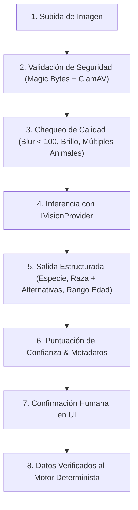

# Especificación de Visión Computacional e IA (AI Vision Specification)
## Plataforma Insurtech Digital Multi-Ramo (Manto 2.0)
**Agente:** Agente 5 - Senior AI Engineer / Computer Vision Engineer  
**Versión:** 1.0.0  
**Fecha:** Septiembre 2026  
**Estado:** Aprobado para Implementación  

---

## 1. Misión del Subsistema de IA

El subsistema de Inteligencia Artificial actúa como un **sensor acelerador del onboarding** para reducir el tiempo de cotización a menos de 60 segundos. Infiere especie, raza y edad aproximada a partir de una foto de la mascota.

```
┌─────────────────────────────────────────────────────────────────────────────┐
│                          LÍMITES DUROS DE LA IA                             │
│                                                                             │
│ • La IA es probabilística y asistiva; NUNCA es autoridad de suscripción.   │
│ • CERO falsa precisión en edad: se devuelven rangos honestos de edad.       │
│ • Si hay múltiples animales en la foto: NUNCA elige uno al azar. Detiene el │
│   flujo y solicita foto individual.                                         │
│ • La IA NUNCA calcula precios ni aprueba siniestros de forma autónoma.      │
└─────────────────────────────────────────────────────────────────────────────┘
```

---

## 2. Pipeline de Visión en 8 Etapas



---

## 3. Abstracción del Proveedor (`IVisionProvider`)

```typescript
export interface PetVisionInput {
  readonly imageBuffer: Buffer;
  readonly mimeType: 'image/jpeg' | 'image/png' | 'image/webp';
  readonly originalFileName: string;
  readonly fileSizeBytes: number;
}

export interface DetectedBreedCandidate {
  readonly breedId: string;
  readonly breedName: string;
  readonly confidence: number;
  readonly isSpecialHandlingBreed: boolean;
}

export interface PetVisionOutput {
  readonly species: {
    readonly detected: 'DOG' | 'CAT' | 'UNKNOWN';
    readonly confidence: number;
  };
  readonly primaryBreed: DetectedBreedCandidate;
  readonly alternativeBreeds: DetectedBreedCandidate[];
  readonly estimatedAge: {
    readonly bracket: 'PUPPY_KITTEN' | 'ADULT_YOUNG' | 'ADULT_MATURE' | 'SENIOR';
    readonly minMonths: number;
    readonly maxMonths: number;
    readonly confidence: number;
    readonly formattedDisplay: string; // e.g. "3 a 4 años"
  };
  readonly qualityAudit: {
    readonly isAccepted: boolean;
    readonly warnings: string[];
  };
  readonly providerMetadata: {
    readonly provider: string;      // 'GEMINI', 'OPENAI', 'MOCK'
    readonly model: string;
    readonly inferenceLatencyMs: number;
    readonly timestampUtc: string;
  };
}

export interface IVisionProvider {
  readonly providerName: string;
  readonly modelName: string;
  analyzePetImage(input: PetVisionInput): Promise<PetVisionOutput>;
}
```

---

## 4. Gestión de Incertidumbre y Fallback

* **Estimación de Edad sin Falsa Precisión**:
  * Alta Confianza ($\ge 80\%$): *"3 a 4 años"*
  * Baja Confianza ($< 80\%$): *"2 a 6 años"*
* **Circuit Breaker y Fallback de 3 Segundos**:
  * Si la llamada a la IA excede los 3.000 ms o falla la red, el sistema redirige automáticamente a la selección manual en un clic. **La IA nunca es un punto único de falla (SPOF)**.
* **Seguridad de Archivos**:
  * Validación de *Magic Bytes* (JPEG, PNG, WebP) antes de decodificar.
  * Límites de dimensiones: $300\text{px} \le w, h \le 4096\text{px}$.
  * Cifrado en reposo (AES-256) y cumplimiento estricto de Habeas Data (**Ley 1581 de 2012**).
