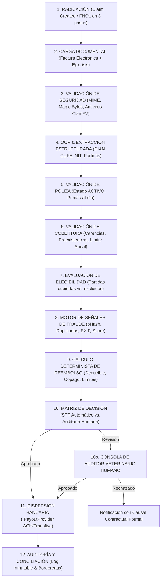

# Especificación de Automatización de Siniestros y Reembolsos (Claims & Settlement Specification)
## Plataforma Insurtech Digital Multi-Ramo (Manto 2.0)
**Agente:** Agente 6 - Senior Claims Automation Engineer  
**Versión:** 2.0.0  
**Fecha:** Septiembre 2026  
**Mercado Objetivo:** Colombia (Moneda: COP)  
**Estado:** Aprobado para Implementación  

---

## 1. Misión y Filosofía de Siniestros

El momento de la reclamación es el "momento de la verdad" de una aseguradora. La experiencia de radicación y reembolso en Manto 2.0 está diseñada para ser **radicalmente veloz, empática, transparente y automatizada**, liquidando siniestros legítimos en cuestión de horas mientras se blindan las reservas financieras mediante cortacircuitos deterministas y detección temprana de anomalías.

```
┌─────────────────────────────────────────────────────────────────────────────┐
│                          PRINCIPIOS FUNDAMENTALES                           │
│                                                                             │
│ 1. La IA es un sensor de extracción y alerta; NUNCA el juez de liquidación. │
│ 2. Reglas deterministas gobiernan el 100% del cálculo de reembolso.        │
│ 3. Todo siniestro dudoso, de alto monto o con alerta de riesgo se enruta a  │
│    auditores veterinarios humanos (Human-in-the-Loop).                      │
│ 4. Ningún cliente es acusado automáticamente de fraude: se marcan alertas. │
│ 5. Toda decisión financiera o médica queda registrada en auditoría inmutable│
└─────────────────────────────────────────────────────────────────────────────┘
```

---

## 2. El Pipeline de Siniestros en 12 Etapas (End-to-End Pipeline)



---

## 3. Extracción Documental Estructurada (OCR y Facturación DIAN)

### 3.1 Soporte Fiscal Obligatorio en Colombia
En Colombia, la indemnización de gastos veterinarios requiere soporte fiscal conforme al Estatuto Tributario:
* **Factura Electrónica de Venta con Validación Previa DIAN**: Debe contener CUFE (Código Único de Facturación Electrónica), NIT de la clínica veterinaria, numeración autorizada y desglose de IVA.
* **Historia Clínica / Epicrisis**: Documento emitido por el médico veterinario tratante con matrícula profesional (COMVEZCOL) detallando anamnesis, diagnóstico y tratamiento.

### 3.2 Esquema de Extracción con Confianza por Campo

```typescript
export interface ExtractedField<T> {
  readonly value: T;
  readonly confidence: number; // 0.00 a 1.00
  readonly boundingBox?: {
    readonly x: number;
    readonly y: number;
    readonly width: number;
    readonly height: number;
  };
}

export interface DianInvoiceExtractedData {
  readonly invoiceNumber: ExtractedField<string>;
  readonly issueDate: ExtractedField<string>;       // YYYY-MM-DD
  readonly providerNit: ExtractedField<string>;      // NIT verificado ante DIAN/RUES
  readonly providerName: ExtractedField<string>;     // Razón social de la veterinaria
  readonly dianCufe: ExtractedField<string>;         // Código CUFE
  readonly currency: ExtractedField<'COP'>;
  readonly items: Array<{
    readonly description: string;
    readonly quantity: number;
    readonly unitPriceCop: number;
    readonly totalPriceCop: number;
    readonly category: 'CONSULTATION' | 'SURGERY' | 'DIAGNOSTIC_EXAM' | 'MEDICATION' | 'HOSPITALIZATION' | 'EXCLUDED';
    readonly confidence: number;
  }>;
  readonly subtotalCop: ExtractedField<number>;
  readonly taxIvaCop: ExtractedField<number>;
  readonly totalInvoiceCop: ExtractedField<number>;
  readonly overallExtractionConfidence: number;      // Promedio ponderado
}
```

> [!IMPORTANT]
> **REGLA DE CONFIANZA DE OCR**:
> Nunca se asume que la extracción es 100% exacta. Si `overallExtractionConfidence < 0.90` o si la suma de las partidas más el IVA difiere en más de COP $1 del `totalInvoiceCop`, el siniestro **se inhabilita automáticamente para STP** y se enruta a revisión humana con los campos dudosos resaltados en amarillo.

---

## 4. Validación de Póliza, Coberturas y Carencias

El motor determinista evalúa secuencialmente:

1. **Estado de la Póliza**:
   * Debe estar en estado `ACTIVE`. Pólizas en `SUSPENDED` (por mora en prima) o `CANCELLED` rechazan automáticamente la radicación.
2. **Fecha del Incidente vs. Periodo de Carencia**:
   * Si la fecha del evento ocurrió dentro del periodo de carencia correspondiente:
     * *Accidentes*: 48 horas desde la emisión.
     * *Enfermedades generales*: 14 días calendario.
     * *Condiciones osteoarticulares complejas*: 180 días calendario.
   * Si el siniestro ocurrió durante la carencia, se marca como no cubierto por causal contractual objetiva.
3. **Control de Saldo Remanente de Cobertura**:
   * Se consulta el consumo acumulado de la vigencia anual:
     $$\text{SaldoDisponible} = \text{LimiteAnualPlan} - \sum \text{ReembolsosPagadosEnElAño}$$

---

## 5. Matriz de Decisión Configurable (STP vs. Human Review)

```
                       ┌────────────────────────────────────────────────────────┐
                       │                   MATRIZ DE DECISIÓN                   │
                       └────────────────────────────────────────────────────────┘
                                                    │
                                                    ▼
                       ┌────────────────────────────────────────────────────────┐
                       │  ¿Confianza OCR >= 0.90 Y FraudRiskScore < 20.0        │
                       │   Y Monto Neto <= $500.000 COP Y Carencias Superadas?  │
                       └────────────────────────────────────────────────────────┘
                                      │                           │
                                     SÍ                           NO
                                      │                           │
                                      ▼                           ▼
                       ┌────────────────────────┐  ┌────────────────────────────┐
                       │   APROBACIÓN DIRECTA   │  │   REVISIÓN POR AUDITOR     │
                       │        (STP)           │  │     VETERINARIO HUMANO     │
                       │ Pago emitido en <6 hrs │  │ SLA: máx 48 horas hábiles  │
                       └────────────────────────┘  └────────────────────────────┘
```

### Parámetros Configurables del Motor (Config Table)
* `STP_MAX_AMOUNT_COP`: Default **COP $500.000** (Configurable por plan).
* `OCR_MIN_CONFIDENCE_THRESHOLD`: Default **0.90**.
* `FRAUD_MAX_RISK_SCORE`: Default **20.00 / 100.00**.
* `MAX_CLAIMS_PER_30_DAYS`: Default **2 eventos**.

---

## 6. Algoritmo Determinista de Liquidación (Settlement Math)

El cálculo del reembolso final se desglosa y almacena de forma inmutable con todos sus componentes:

```typescript
export interface ReimbursementCalculationResult {
  readonly totalBilledCop: number;
  readonly eligibleExpensesCop: number;
  readonly excludedExpensesCop: number;
  readonly appliedDeductiblePercentage: number;
  readonly calculatedDeductibleCop: number;
  readonly minimumDeductibleEnforced: boolean;
  readonly effectiveDeductibleCop: number;
  readonly netPayableBeforeLimitCop: number;
  readonly remainingAnnualLimitCop: number;
  readonly finalApprovedReimbursementCop: number;
  readonly calculationBreakdown: string;
}

export function calculateDeterministicReimbursement(
  billedItems: Array<{ amount: number; isCovered: boolean }>,
  deductiblePercentage: number, // e.g. 15
  minDeductibleCop: number,     // e.g. 40000
  remainingAnnualLimitCop: number
): ReimbursementCalculationResult {
  const eligibleExpensesCop = billedItems
    .filter(i => i.isCovered)
    .reduce((sum, i) => sum + i.amount, 0);

  const excludedExpensesCop = billedItems
    .filter(i => !i.isCovered)
    .reduce((sum, i) => sum + i.amount, 0);

  const rawDeductible = Math.round(eligibleExpensesCop * (deductiblePercentage / 100));
  const effectiveDeductibleCop = Math.min(eligibleExpensesCop, Math.max(rawDeductible, minDeductibleCop));
  const minDeductibleEnforced = rawDeductible < minDeductibleCop && eligibleExpensesCop > 0;

  const netPayableBeforeLimitCop = Math.max(0, eligibleExpensesCop - effectiveDeductibleCop);
  const finalApprovedReimbursementCop = Math.min(netPayableBeforeLimitCop, remainingAnnualLimitCop);

  return {
    totalBilledCop: eligibleExpensesCop + excludedExpensesCop,
    eligibleExpensesCop,
    excludedExpensesCop,
    appliedDeductiblePercentage: deductiblePercentage,
    calculatedDeductibleCop: rawDeductible,
    minimumDeductibleEnforced: minDeductibleEnforced,
    effectiveDeductibleCop,
    netPayableBeforeLimitCop,
    remainingAnnualLimitCop,
    finalApprovedReimbursementCop,
    calculationBreakdown: `Eligible: $${eligibleExpensesCop} - Deducible ($${effectiveDeductibleCop}) = $${netPayableBeforeLimitCop} -> Topado a saldo remanente ($${remainingAnnualLimitCop}) = $${finalApprovedReimbursementCop} COP`
  };
}
```

---

## 7. Motor de Señales de Riesgo y Detección de Fraude (Fraud Signals)

El sistema genera una lista de banderas de advertencia (*Risk Flags*), calculando un puntaje consolidado de $0.00$ a $100.00$:

| Señal de Riesgo | Método de Detección | Impacto en Fraud Score | Acción Disparada |
| :--- | :--- | :---: | :--- |
| **Factura Duplicada (CUFE)** | Búsqueda relacional exacta de CUFE en `claims.claims` | $+80$ pts | **Bloqueo Inmediato de STP** $\to$ SIU |
| **Foto Reutilizada (pHash)** | Distancia de Hamming $\le 5$ en hash perceptual | $+60$ pts | **Bloqueo Inmediato de STP** $\to$ SIU |
| **Metadatos EXIF Editados** | Presencia de firmas de Photoshop o software de edición en imagen | $+35$ pts | Enrutamiento a Auditor Humano |
| **Inconsistencia de Fechas** | Fecha EXIF de captura $>30$ días anterior a la fecha declarada | $+30$ pts | Enrutamiento a Auditor Humano |
| **Monto Anómalo por Patología** | Gasto $>3\times$ la desviación estándar de aranceles veterinarios para el diagnóstico | $+25$ pts | Auditoría veterinaria obligatoria |
| **Clínica Veterinaria Sospechosa**| NIT no activo en DIAN/RUES o marcado en lista de advertencia | $+50$ pts | Auditoría de proveedor |

> [!CAUTION]
> **POLÍTICA DE TRATO AL CLIENTE**:
> Bajo ninguna circunstancia el sistema acusa al usuario de fraude mediante mensajes en la aplicación. Si el puntaje es alto, el sistema simplemente indica: *"Estamos revisando los detalles médicos de tu solicitud. Te confirmaremos la resolución en menos de 24 horas."*

---

## 8. Consola de Auditoría y Ajuste Humano (Reviewer Workflow)

Los auditores veterinarios disponen de una interfaz optimizada en pantalla dividida:
* **Panel Izquierdo**: Documento digitalizado con cajas delimitadoras sobre los campos fiscales y diagnósticos.
* **Panel Central**: Datos estructurados extraídos por OCR (con opción de corrección manual de valores).
* **Panel Derecho**: Historial médico de la mascota, saldo de póliza, banderas de riesgo detectadas y desglose de liquidación matemática en tiempo real.
* **Acciones Resolutivas**:
  1. **Aprobar Totalidad**: Despacha la orden de pago inmediata a tesorería.
  2. **Aprobar Parcialmente**: Excluye partidas no cubiertas (ej. vacunas de rutina en plan de urgencias) con justificación al cliente.
  3. **Solicitar Información Adicional**: Envía notificación al usuario solicitando historia clínica detallada o fórmula.
  4. **Objetar / Rechazar**: Exige asociar la cláusula formal del contrato de seguro y fundamentar la decisión técnica.

---

## 9. Abstracción del Proveedor de Pagos y Dispersiones (Payment Provider Pattern)

Para desacoplar el motor de siniestros de la pasarela o riel bancario específico (ACH Colombia, Transfiya, Bancolombia Payouts, Nequi):

```typescript
export interface PayoutRecipient {
  readonly identificationType: 'CC' | 'CE' | 'NIT';
  readonly identificationNumber: string;
  readonly fullName: string;
  readonly bankCode: string;          // Código de compensación bancaria SFC
  readonly accountType: 'AHORROS' | 'CORRIENTE' | 'NEQUI' | 'DAVIPLATA';
  readonly accountNumber: string;
}

export interface PayoutRequest {
  readonly claimId: string;
  readonly claimNumber: string;
  readonly amountCop: number;
  readonly recipient: PayoutRecipient;
  readonly description: string;
  readonly idempotencyKey: string;    // UUIDv4 para evitar pagos dobles
}

export interface PayoutResult {
  readonly payoutId: string;
  readonly status: 'PENDING' | 'SETTLED' | 'REJECTED' | 'PROCESSING';
  readonly trackingReference: string;
  readonly settledAt?: string;
  readonly rawProviderResponse?: Record<string, any>;
}

export interface IPayoutProvider {
  readonly providerName: string;
  initiatePayment(request: PayoutRequest): Promise<PayoutResult>;
  getPaymentStatus(payoutId: string): Promise<PayoutResult>;
}
```

---

## 10. Seguridad, Retención y Marco Legal en Colombia

1. **Control de Acceso Riguroso (RBAC)**:
   * Solo usuarios con rol `POLICYHOLDER` pueden ver sus propios siniestros (`WHERE claim.user_id = current_user.id`).
   * Los roles `ADJUSTER` y `AUDITOR` tienen acceso de lectura/escritura auditado en `audit.audit_logs`.
2. **Cifrado de Documentos Médicos**:
   * Las facturas e historias clínicas se almacenan en S3 con cifrado en reposo **AES-256 (SSE-KMS)**.
   * La descarga y visualización se realiza mediante **URLs prefirmadas de vida corta (15 minutos)**.
3. **Retención Legal según el Código de Comercio de Colombia**:
   * **Artículo 1080 del Código de Comercio**: Plazo máximo legal de 1 mes para pago de indemnizaciones (Manto opera con SLA de 6 a 48 horas).
   * **Artículo 1077**: Exige conservar el acervo probatorio formal durante un mínimo de **10 años** para atender posibles controversias judiciales o auditorías de la SFC.
