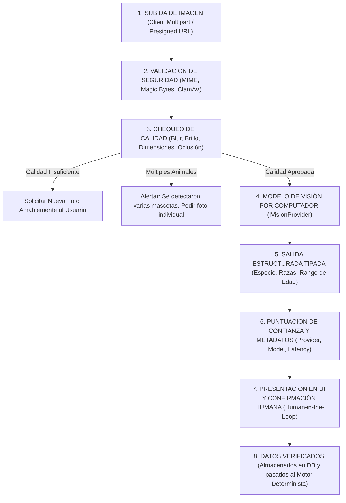
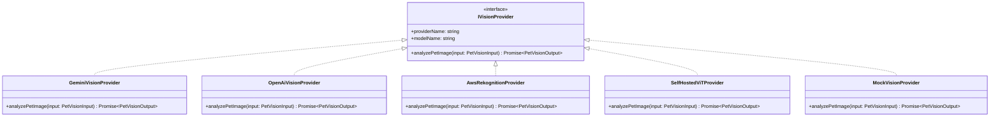

# Especificación del Subsistema de Inteligencia Artificial y Visión Computacional (AI & Computer Vision Specification)
## Plataforma Insurtech Digital Multi-Ramo (Manto 2.0)
**Rol:** Senior AI Engineer / Computer Vision Engineer  
**Versión:** 2.0.0  
**Fecha:** Septiembre 2026  
**Mercado Objetivo:** Colombia  
**Estado:** Especificación Aprobada para Implementación  

---

## 1. Declaración Doctrinal: La Regla de Oro y Límites Críticos

```
┌────────────────────────────────────────────────────────────────────────────────┐
│                           LA REGLA DE ORO DE LA IA                             │
│                                                                                │
│ La Inteligencia Artificial es un subsistema sensor de percepción, extracción   │
│ y asistencia probabilística.                                                   │
│                                                                                │
│   LOS RESULTADOS DE LA IA NUNCA DETERMINAN DE FORMA AUTÓNOMA O DIRECTA:        │
│   ✖ La prima final (precio mensual o anual).                                   │
│   ✖ La aprobación, rechazo o monto de liquidación de un siniestro.             │
│   ✖ La condena o bloqueo por sospecha de fraude.                               │
│   ✖ El perfeccionamiento o cancelación del estado de una póliza.               │
│                                                                                │
│ Todos estos sistemas consumen exclusivamente información estructurada y        │
│ verificada por el usuario o auditores, gobernada por reglas deterministas.     │
└────────────────────────────────────────────────────────────────────────────────┘
```

---

## 2. Caso de Uso Primario: Onboarding Visual de la Mascota

### 2.1 El Flujo de Trabajo (Pipeline de 8 Etapas)



---

## 3. Limitación Biológica Fundamental: Estimación de Edad Sin Falsa Precisión

> [!WARNING]
> **REGLA TÉCNICA OBLIGATORIA (NO FALSA PRECISIÓN)**:
> Una fotografía 2D de un animal doméstico **NO puede determinar con certeza matemática la edad biológica exacta** (esta requiere inspección dental in situ, cristalino ocular y desgaste óseo).
> El sistema tiene **estrictamente prohibido** arrojar estimaciones absolutas (ej. *"Tu perro tiene exactamente 3 años y 2 meses"*).
> 
> La IA debe comunicar siempre **incertidumbre mediante rangos** adaptados al nivel de confianza:
> * **Alta Confianza ($\ge 80\%$)**: Rango estrecho (ej. *"Rango estimado: 3 a 4 años | Confianza: 84%"*).
> * **Confianza Media/Baja ($< 80\%$)**: Rango amplio (ej. *"Rango estimado: 2 a 6 años | Confianza: 52%"*).
> * El usuario **siempre** tiene el control para confirmar o corregir la fecha de nacimiento en el selector.

---

## 4. Matriz de Control de Calidad de Imagen (Image Quality Heuristics)

Antes de invocar inferencias de visión pesadas, la imagen pasa por un filtro de pre-procesamiento local rápido:

| Condición Detectada | Métrica Algorítmica / Umbral | Acción del Sistema | Mensaje de UX al Usuario |
| :--- | :--- | :--- | :--- |
| **Imagen Borrosa** | Varianza del Laplaciano $< 100$ | Rechazo Preventivo | *"La foto se ve un poco movida o borrosa. Intenta con una toma más quieta."* |
| **Muy Oscura (Subexpuesta)**| Brillo medio de píxeles $< 40$ (escala 0-255) | Rechazo Preventivo | *"La foto está muy oscura. Busca un lugar con mejor luz para ver bien a tu mascota."* |
| **Muy Clara (Sobreexpuesta)**| Brillo medio de píxeles $> 220$ | Rechazo Preventivo | *"La foto tiene demasiada luz directa o reflejo. Prueba en la sombra."* |
| **Resolución Demasiado Baja** | Dimensiones menores a $300 \times 300 \text{ px}$ | Rechazo Preventivo | *"La imagen es muy pequeña. Sube una foto de mejor resolución."* |
| **Múltiples Animales** | Detección de $\ge 2$ cajas delimitadoras (*bounding boxes*) de animales con conf $> 0.60$ | **DETENCIÓN OBLIGATORIA** | *"¡Detectamos más de un consentido en la foto! Por favor sube una foto donde aparezca únicamente la mascota que vas a asegurar."* |
| **Cuerpo/Rostro Obstruido** | Rostro de la mascota tapado $> 50\%$ | Alerta / Sugerencia | *"No distinguimos bien su carita. Puedes continuar, pero te pediremos confirmar la raza manualmente."* |
| **No es un Animal** | Inferencia de clase animal $< 0.30$ (objeto, persona, auto) | Rechazo Inmediato | *"No encontramos ningún perrito o gatito en esta foto. Sube una foto de tu consentido."* |

---

## 5. Abstracción del Proveedor de IA (Pluggable Vision Provider Pattern)

Para evitar el acoplamiento a un proveedor propietario específico (evitando *vendor lock-in* con Google, OpenAI o AWS), el sistema utiliza el patrón **Strategy / Provider Adapter**:



### 5.1 Contratos TypeScript de la Abstracción

```typescript
// packages/ai-engine/src/interfaces/vision-provider.interface.ts

export interface PetVisionInput {
  readonly imageBuffer: Buffer;
  readonly mimeType: 'image/jpeg' | 'image/png' | 'image/webp';
  readonly originalFileName: string;
  readonly fileSizeBytes: number;
}

export interface DetectedBreedCandidate {
  readonly breedId: string;
  readonly breedName: string;
  readonly confidence: number; // 0.00 a 1.00
  readonly isSpecialHandlingBreed: boolean; // Alerta Ley 1801 de 2016 en Colombia
}

export interface PetVisionOutput {
  readonly species: {
    readonly detected: 'DOG' | 'CAT' | 'UNKNOWN';
    readonly confidence: number;
  };
  readonly primaryBreed: DetectedBreedCandidate;
  readonly alternativeBreeds: DetectedBreedCandidate[]; // Top 2 a 3 alternativas
  readonly estimatedAge: {
    readonly bracket: 'PUPPY_KITTEN' | 'ADULT_YOUNG' | 'ADULT_MATURE' | 'SENIOR';
    readonly minMonths: number;
    readonly maxMonths: number;
    readonly confidence: number;
    readonly formattedDisplay: string; // e.g. "3 a 4 años" o "2 a 6 años"
  };
  readonly visibleCharacteristics: {
    readonly dominantColors: string[];
    readonly furLength?: 'SHORT' | 'MEDIUM' | 'LONG';
    readonly distinctFeatures?: string[];
  };
  readonly qualityAudit: {
    readonly isAccepted: boolean;
    readonly brightnessScore: number;
    readonly sharpnessScore: number;
    readonly multipleAnimalsDetected: boolean;
    readonly warnings: string[];
  };
  readonly providerMetadata: {
    readonly provider: string;      // e.g. 'GEMINI', 'OPENAI', 'SELF_HOSTED_VIT'
    readonly model: string;         // e.g. 'gemini-1.5-pro', 'vit-pet-v2'
    readonly modelVersion?: string;
    readonly inferenceLatencyMs: number;
    readonly timestampUtc: string;
  };
}

export interface IVisionProvider {
  readonly providerName: string;
  readonly modelName: string;
  analyzePetImage(input: PetVisionInput): Promise<PetVisionOutput>;
}
```

---

## 6. Mecanismo de Tolerancia a Fallos y Modo de Respaldo (Graceful Fallback)

> [!IMPORTANT]
> **LA IA NUNCA ES UN PUNTO ÚNICO DE FALLO (NO SPOF)**:
> Si el proveedor de IA:
> * Falla por corte de red o error de API externa (5xx / 429),
> * Tarda más del umbral límite de **3.000 ms** (*circuit breaker timeout*),
> * O el usuario decide explícitamente no subir una foto,
> 
> El flujo de cotización **continúa de forma 100% transparente** redirigiendo al usuario a la selección manual estructurada de especie, raza y edad.

```typescript
async function processPetImageWithFallback(
  input: PetVisionInput, 
  primaryProvider: IVisionProvider
): Promise<PetVisionResultOrFallback> {
  try {
    const result = await Promise.race([
      primaryProvider.analyzePetImage(input),
      timeoutAfter(3000) // Timeout de 3 segundos
    ]);

    if (!result.qualityAudit.isAccepted) {
      return { 
        status: 'QUALITY_REJECTED', 
        warnings: result.qualityAudit.warnings 
      };
    }

    return { status: 'AI_SUCCESS', data: result };
  } catch (error) {
    // Registrar incidente en logs de observabilidad
    logger.warn('AI Vision provider failed or timed out. Engaging manual fallback.', { error });
    
    // Retornar fallback estructurado sin romper la experiencia del cliente
    return {
      status: 'FALLBACK_REQUIRED',
      reason: 'PROVIDER_TIMEOUT_OR_ERROR',
      userMessage: 'No pudimos analizar la foto automáticamente, pero puedes seleccionar la raza en un clic.'
    };
  }
}
```

---

## 7. Seguridad de Archivos de Imagen y Mitigación de Amenazas

Las imágenes aportadas por los usuarios se tratan rigurosamente como **datos no confiables (*Untrusted Input*)**:

1. **Inspección de Firmas Binarias (*Magic Bytes*)**:
   * No se confía en la extensión del archivo (`.jpg`, `.png`). Se leen los primeros bytes en memoria:
     * JPEG: `FF D8 FF`
     * PNG: `89 50 4E 47 0D 0A 1A 0A`
     * WebP: `52 49 46 46 ... 57 45 42 50`
   * Si los magic bytes no coinciden con un formato de imagen genuino, el archivo se descarta inmediatamente antes de tocar el disco o la GPU.
2. **Límites Físicos y Cuarentena**:
   * Tamaño máximo: **10 MB**.
   * Dimensiones máximas: **$4096 \times 4096 \text{ px}$** (previene ataques de descompresión de bombas de píxeles / *Pixel Flood DoS*).
3. **Escaneo Antivirus Asíncrono**:
   * Los archivos se suben a un bucket S3 en prefijo `/quarantine/` y pasan por un contenedor de escaneo **ClamAV** antes de habilitarse como válidos (`CLEAN`).

---

## 8. Privacidad, Retención y Habeas Data (Ley 1581 de 2012)

* **Propiedad de la Información**: La fotografía de la mascota es tratada como dato del titular asociado a su contrato de seguro.
* **Cero Retención por Proveedores de IA**: Todos los contratos con proveedores de APIs de visión deben exigir la modalidad *Zero Data Retention* (la imagen no se almacena en los servidores del proveedor de IA ni se utiliza para re-entrenar modelos públicos).
* **Cifrado**:
  * En tránsito: TLS 1.3 con suites de cifrado modernas.
  * En reposo: Cifrado del lado del servidor en S3 con claves maestras administradas (SSE-KMS / AES-256).
* **Derecho de Supresión**: Si el titular ejerce su derecho de eliminación de datos de Habeas Data, las fotos asociadas a cotizaciones no vinculadas se eliminan en un plazo máximo de **30 días**.
