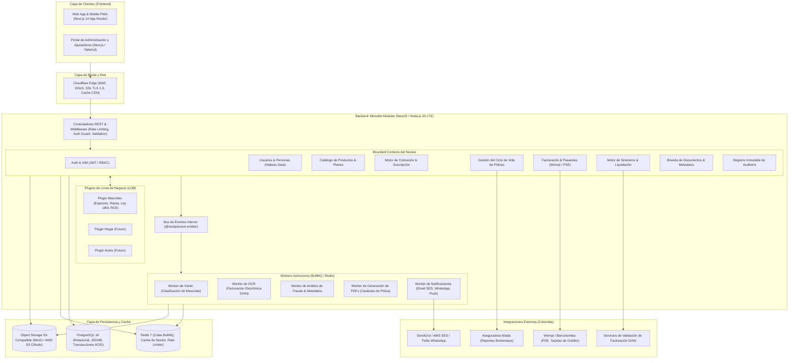
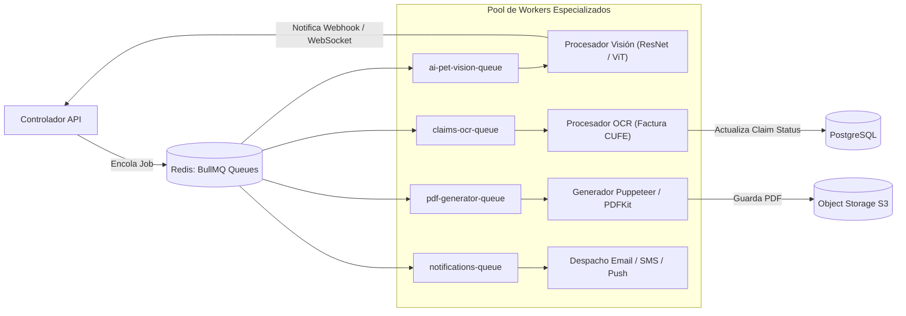

# Arquitectura del Sistema (Architecture Specification)
## Plataforma Insurtech Digital Multi-Ramo (Manto 2.0)
**Versión:** 1.0.0  
**Fecha:** Septiembre 2026  
**Estado:** Aprobado para Implementación  
**Autor:** CTO / Principal Software Architect  

---

## 1. Principios Arquitectónicos Fundamentales

1. **Monolito Modular con DDD (Domain-Driven Design)**:
   * Evitar la complejidad accidental de microservicios prematuros (latencia de red, fallos parciales, transacciones distribuidas 2PC).
   * Organizar el backend como un monolito modular con límites de dominio (*Bounded Contexts*) estrictos en TypeScript/NestJS, compartiendo una base de datos PostgreSQL pero con esquemas y tablas aisladas por dominio.
   * La comunicación sincrónica entre módulos se realiza exclusivamente mediante interfaces de servicio fuertemente tipadas; la comunicación asincrónica desacoplada se realiza mediante un bus de eventos en memoria (`@nestjs/event-emitter`) y colas de trabajo persistentes (`BullMQ` sobre Redis).
2. **Núcleo de Seguros Agnóstico + Plugins de Línea de Negocio (LOB)**:
   * El núcleo transaccional gestiona conceptos universales: Clientes (`Parties`), Cotizaciones (`Quotes`), Pólizas (`Policies`), Facturación (`Billing`), Siniestros (`Claims`), Documentos (`Documents`) y Auditoría (`Audit`).
   * Cada ramo asegurador se modela como un módulo que implementa la interfaz genérica `InsurableRiskSubject`. El módulo `PetLOB` es la primera implementación, encapsulando la lógica biológica y veterinaria sin contaminar el núcleo.
3. **Principio Inquebrantable de la IA (AI Guardrail Principle)**:
   * La Inteligencia Artificial es un **sensor y asistente probabilístico**, jamás la autoridad financiera o jurídica.
   * La IA extrae texto (OCR), clasifica imágenes (raza/edad) y puntúa anomalías de fraude.
   * Todas las transiciones de estado, cálculos de primas, verificaciones de elegibilidad, aplicación de deducibles/copagos y dispersiones de dinero están gobernadas por **código determinista puro, auditable y sujeto a pruebas unitarias rigurosas**.
4. **Resiliencia y Paridad de Entornos**:
   * Contenerización completa con Docker y Docker Compose para desarrollo local idéntico a producción.
   * Manejo idempotente de operaciones críticas (pagos, emisiones, radicaciones de siniestros) mediante encabezados `Idempotency-Key`.

---

## 2. Diagrama de Arquitectura de Alto Nivel



---

## 3. Descomposición de Módulos (Bounded Contexts)

### 3.1 Módulos del Núcleo (Core Modules)

| Módulo | Responsabilidad Principal | Dependencias Directas |
| :--- | :--- | :--- |
| **`AuthModule`** | Autenticación, generación de tokens JWT (Access Token 15 min, Refresh Token rotativo HttpOnly), hashing Argon2id, guardas RBAC. | `UserModule` |
| **`UserModule`** | Gestión de usuarios, identificación (Cédula de Ciudadanía/Extranjería), consentimiento de Habeas Data (Ley 1581), direcciones en Colombia. | `AuditModule` |
| **`ProductModule`** | Catálogo paramétrico de ramos, productos, planes, coberturas, deducibles, copagos y asistencias. | Ninguna |
| **`QuoteModule`** | Orquestación de la cotización, invocación del motor de tarificación determinista, aplicación de descuentos y emisión de ofertas temporales (validez 15 días). | `ProductModule`, `LOBModule` |
| **`PolicyModule`** | Perfeccionamiento del contrato de seguro, emisión de carátula con firma electrónica (Ley 527 de 1999), cancelaciones, renovaciones y endosos. | `QuoteModule`, `BillingModule`, `DocumentModule` |
| **`BillingModule`** | Gestión de intenciones de pago, integración con Wompi (PSE y tokenización de tarjetas), conciliación de webhooks, suscripciones recurrentes y facturas. | `PolicyModule`, `AuditModule` |
| **`ClaimsModule`** | Radicación de siniestros (FNOL), orquestación de análisis documental, ejecución de reglas deterministas de liquidación, gestión de pagos/transferencias. | `PolicyModule`, `DocumentModule`, `AuditModule` |
| **`DocumentModule`** | Generación de URLs prefirmadas de subida a S3, verificación de firmas MIME/Magic Bytes, aislamiento de cuarentena y generación de PDFs (Carátulas). | `AuditModule` |
| **`AuditModule`** | Registro inmutable de eventos de negocio, cambios de estado en pólizas/siniestros, accesos a datos sensibles y eventos regulatorios. | Base de datos `audit.audit_logs` |

### 3.2 Patrón de Extensibilidad LOB: Abstracción de Sujeto Asegurable

Para garantizar que podamos agregar **Hogar, Autos, Viajes o Vida** sin tocar el núcleo de pólizas ni de siniestros, definimos el contrato TypeScript:

```typescript
// packages/core-domain/src/interfaces/insurable-subject.interface.ts

export interface InsurableRiskSubject {
  readonly subjectId: string;
  readonly lobType: 'PET' | 'HOME' | 'AUTO' | 'TRAVEL' | 'LIFE';
  
  // Validación de reglas duras de suscripción (ej. edad mínima/máxima, raza prohibida)
  evaluateEligibility(rulesContext: EligibilityContext): Promise<EligibilityResult>;
  
  // Cálculo de factores de recargo o descuento actuarial
  calculateRiskFactors(): Promise<RiskFactorResult>;
  
  // Serialización normalizada para almacenamiento y emisión en carátula
  toCertificateSummary(): Record<string, any>;
}
```

Implementación concreta para Mascotas:
```typescript
// modules/lob-pet/src/domain/pet-risk-subject.ts

export class PetRiskSubject implements InsurableRiskSubject {
  readonly lobType = 'PET';

  constructor(
    public readonly subjectId: string,
    public readonly species: 'DOG' | 'CAT',
    public readonly breedId: string,
    public readonly birthDate: Date,
    public readonly isSterilized: boolean,
    public readonly isSpecialHandlingBreed: boolean, // Ley 1801 de 2016
    public readonly postalCodeOrCity: string,
  ) {}

  async evaluateEligibility(context: EligibilityContext): Promise<EligibilityResult> {
    const ageInMonths = this.calculateAgeInMonths();
    if (ageInMonths < 2) {
      return { eligible: false, reason: 'Edad mínima requerida: 8 semanas (2 meses).' };
    }
    if (ageInMonths > 96) { // 8 años
      return { eligible: false, reason: 'Edad máxima para nueva suscripción: 8 años.' };
    }
    return { eligible: true };
  }

  async calculateRiskFactors(): Promise<RiskFactorResult> {
    // Factores calculados determinísticamente desde tablas actuariales en DB
    return {
      speciesFactor: this.species === 'CAT' ? 0.90 : 1.00,
      breedRiskFactor: await this.getBreedActuarialFactor(this.breedId),
      ageTierFactor: this.getAgeTierFactor(),
      sterilizationDiscount: this.isSterilized ? 0.05 : 0.00,
      mandatorySpecialHandlingRCE: this.isSpecialHandlingBreed, // Dispara add-on obligatorio
    };
  }

  toCertificateSummary(): Record<string, any> {
    return {
      nombreMascota: this.subjectId,
      especie: this.species,
      raza: this.breedId,
      edadMeses: this.calculateAgeInMonths(),
      requiereRceLey1801: this.isSpecialHandlingBreed,
    };
  }

  private calculateAgeInMonths(): number {
    const now = new Date();
    const diffMonths = (now.getFullYear() - this.birthDate.getFullYear()) * 12 + (now.getMonth() - this.birthDate.getMonth());
    return Math.max(0, diffMonths);
  }

  private getAgeTierFactor(): number {
    const months = this.calculateAgeInMonths();
    if (months <= 12) return 1.05; // Cachorros (mayor frecuencia de urgencias menores)
    if (months <= 48) return 1.00; // Adulto joven (riesgo base)
    if (months <= 84) return 1.25; // Adulto maduro
    return 1.60; // Senior
  }

  private async getBreedActuarialFactor(breedId: string): Promise<number> {
    // Consulta a la tabla paramétrica actuarial de razas
    return 1.0; 
  }
}
```

---

## 4. Pipeline Asíncrono de Tareas (BullMQ + Redis)

Las operaciones intensivas en cómputo, dependientes de servicios de red externos o de IA nunca bloquean el hilo principal de las solicitudes HTTP de los usuarios.



### Configuración de Reintentos y Dead-Letter Queues (DLQ)
* **Reintentos**: Estrategia exponencial (*Exponential Backoff*): 3 reintentos espaciados (2s, 8s, 30s).
* **DLQ**: Todos los trabajos que agotan reintentos se mueven automáticamente a la cola `{queue_name}-failed` para inspección técnica y alerta en tiempo real en Slack/PagerDuty.

---

## 5. Integración con el Ecosistema Colombiano

### 5.1 Rieles de Pago: Wompi (Bancolombia)
* **PSE (Pagos Seguros en Línea)**: Canal preferido para pagos en Colombia. Se orquesta mediante creación de transacción asíncrona con redirección al banco del usuario y recepción de confirmación vía webhook con validación de firma criptográfica SHA-256 (`checksum`).
* **Tarjetas de Crédito / Débito (Tokenizadas)**: La aplicación web utiliza el SDK de Wompi para tokenizar los datos sensibles del plástico directamente en el navegador del cliente; el backend **nunca almacena ni procesa PAN, CVV ni fechas de expiración**, eliminando el alcance pesado de PCI-DSS.

### 5.2 Facturación Electrónica DIAN en Siniestros
* Para liquidar un siniestro de salud veterinaria, el cliente aporta la factura electrónica.
* El worker de OCR extrae:
  1. **CUFE** (Código Único de Facturación Electrónica).
  2. **NIT del Proveedor** (Clínica Veterinaria).
  3. **Fecha de Emisión** y **Valor Total**.
* El sistema verifica la consistencia fiscal y valida que el NIT de la veterinaria esté activo ante el RUES / DIAN.

### 5.3 Modelo de Aseguradora Aliada (MGA Bordereaux)
* La plataforma genera un reporte diario consolidado (*Bordereau de Emisión y Recaudo*) y mensual (*Bordereau de Siniestros*) formateado conforme a las especificaciones de la aseguradora titular de la póliza matriz vigilada por la SFC.

---

## 6. Alta Disponibilidad, Escalabilidad y Recuperación ante Desastres (HA/DR)

* **RPO (Recovery Point Objective)**: $\le 1$ minuto (PostgreSQL con replicación en streaming continua y backups WAL archivados en S3 con versionado).
* **RTO (Recovery Time Objective)**: $\le 15$ minutos (Contenedores orquestados con Kubernetes / ECS / Docker Swarm con reinicio automático de servicios con fallo de healthcheck).
* **Idempotencia**: Todas las mutaciones financieras exigen el encabezado `Idempotency-Key` (UUIDv4) con TTL de 24 horas en Redis para prevenir cobros dobles o duplicidad de emisión ante reintentos de red.
