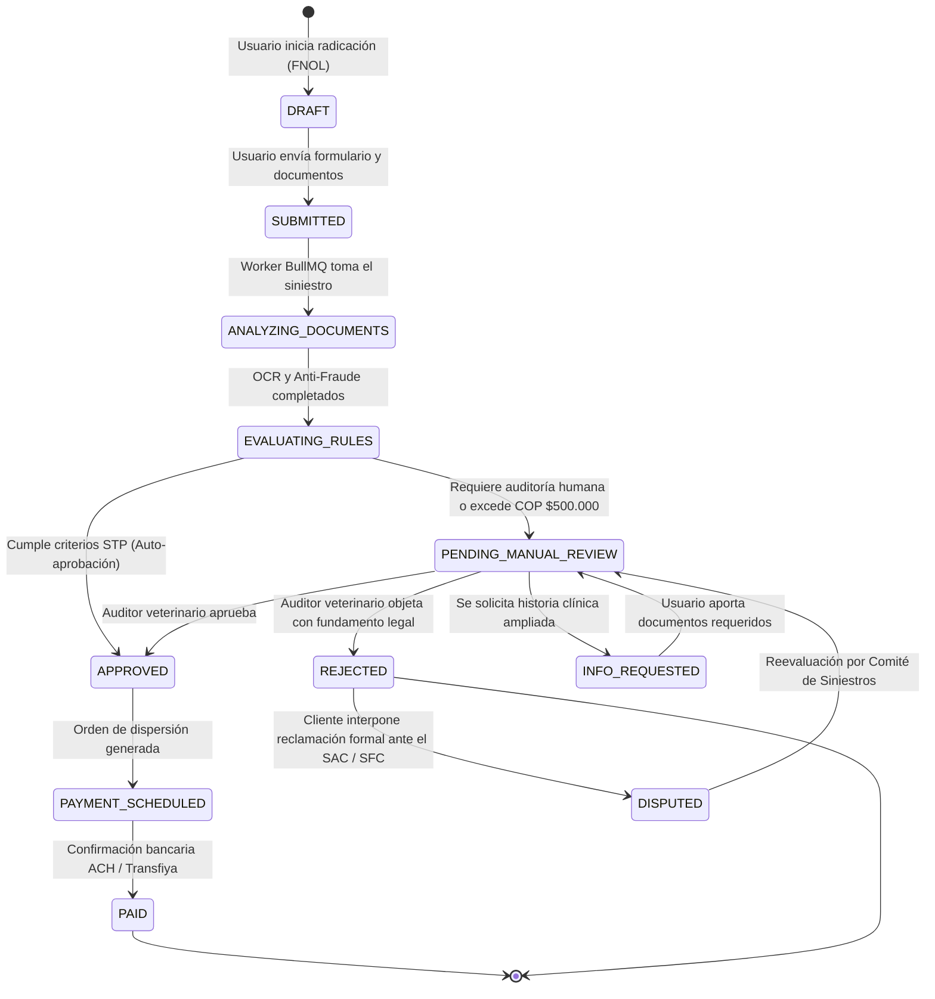

# Especificación del Motor de Siniestros y Liquidación (Claims & Settlement Engine)
## Plataforma Insurtech Digital Multi-Ramo (Manto 2.0)
**Versión:** 1.0.0  
**Fecha:** Septiembre 2026  
**Estado:** Aprobado para Implementación  
**Autor:** CTO / Principal Software Architect  

---

## 1. Contexto Legal y Regulatorio de Siniestros en Colombia

| Dimensión | Requisito Técnico (Technical Requirement) | Requisito Legal / Regulatorio en Colombia (Legal Requirement) |
| :--- | :--- | :--- |
| **Acreditación del Siniestro** | Carga de facturas electrónicas con CUFE y epicrisis digital en formatos PDF o JPG. | **Código de Comercio de Colombia (Art. 1077)**: Corresponde al asegurado demostrar la ocurrencia del siniestro y la cuantía de la pérdida mediante medios de prueba idóneos. |
| **Plazo de Pago de Indemnización** | La plataforma liquida reclamos STP en menos de 6 horas y reclamos manuales en $\le 48$ horas hábiles. | **Código de Comercio (Art. 1080)**: La aseguradora está obligada a pagar el siniestro dentro del mes siguiente a la fecha en que el asegurado acredite su reclamación formal. Vencido este plazo, se causan intereses moratorios a la tasa máxima legal. |
| **Soporte Fiscal de Pagos** | Validación de facturas electrónicas contra servidores de la DIAN o formatos estándar con CUFE. | **Estatuto Tributario & Resoluciones DIAN**: Los pagos por reembolso solo son deducibles y legalmente soportados si el emisor cumple con el régimen de facturación electrónica vigente. |

---

## 2. Máquina de Estados Finita de Siniestros (Claims State Machine)



### Tabla de Transiciones y Permisos

| Estado Origen | Estado Destino | Actor / Trigger | Guardas y Validaciones |
| :--- | :--- | :--- | :--- |
| `DRAFT` | `SUBMITTED` | `POLICYHOLDER` | Póliza activa, fecha de evento dentro de vigencia, al menos una factura adjunta. |
| `SUBMITTED` | `ANALYZING_DOCUMENTS` | Sistema (BullMQ) | Documentos escaneados por antivirus y limpios de malware. |
| `ANALYZING_DOCUMENTS` | `EVALUATING_RULES` | Worker de OCR | Extracción completada o timeout controlado. |
| `EVALUATING_RULES` | `APPROVED` (STP) | Motor Determinista | **Cortacircuitos STP**: Monto neto $\le$ COP $500,000$, carencias superadas, primas al día, FraudScore $< 20.00$, Confianza OCR $\ge 0.90$. |
| `EVALUATING_RULES` | `PENDING_MANUAL_REVIEW` | Motor Determinista | Monto neto $>$ COP $500,000$ o FraudScore $\ge 20.00$ o patología compleja o carencia dudosa. |
| `PENDING_MANUAL_REVIEW` | `APPROVED` | `ADJUSTER` / `ADMIN` | Verificación humana de epicrisis vs. factura y balance de cobertura disponible. |
| `PENDING_MANUAL_REVIEW` | `REJECTED` | `ADJUSTER` / `ADMIN` | Causal contractual explícita (preexistencia, exclusión, mora en prima). |
| `APPROVED` | `PAID` | Worker de Pagos ACH | Transacción bancaria confirmada exitosa. |

---

## 3. Algoritmo de Liquidación y Descuentos (Settlement Mathematics)

Para cada partida individual aprobada en la factura veterinaria:
1. **Validación de Cobertura de la Partida**:
   Se determina si el ítem (consulta, cirugía, examen, medicamento) pertenece a una cobertura activa en el plan de la póliza.
2. **Cálculo del Gasto Elegible**:
   $$\text{GastoElegibleTotal} = \sum_{i \in \text{ItemsCubiertos}} \text{ValorAprobado}_i$$
3. **Aplicación del Deducible y Copago**:
   $$\text{DeducibleAplicable} = \max(\text{GastoElegibleTotal} \times \%_{\text{deducible\_plan}}, \text{MinDeducibleCOP})$$
   $$\text{BaseLiquidada} = \max(0, \text{GastoElegibleTotal} - \text{DeducibleAplicable})$$
   $$\text{CopagoMonto} = \text{BaseLiquidada} \times \%_{\text{copago}}$$
   $$\text{LiquidacionNeta} = \text{BaseLiquidada} - \text{CopagoMonto}$$
4. **Validación contra Sublímites y Saldo Anual**:
   $$\text{SaldoDisponibleCobertura} = \text{LimiteAnualCobertura} - \text{SumaSiniestrosPagadosAno}$$
   $$\text{ReembolsoFinalCOP} = \min(\text{LiquidacionNeta}, \text{SaldoDisponibleCobertura})$$

---

## 4. Criterios Heurísticos para Procesamiento Directo (STP: Straight-Through Processing)

Para que un siniestro sea aprobado de forma 100% automática sin intervención humana, DEBE satisfacer la totalidad de las siguientes condiciones booleanas:

```typescript
function evaluateStpEligibility(claim: ClaimContext): boolean {
  return (
    // 1. Condición financiera de límite seguro
    claim.netCalculatedPayableAmountCop <= 500000 &&
    
    // 2. Estado de la póliza y pago de primas
    claim.policy.status === 'ACTIVE' &&
    claim.policy.hasZeroOutstandingBalance &&
    
    // 3. Periodos de carencia superados estrictamente
    claim.waitingPeriodsSatisfied === true &&
    
    // 4. Saldo remanente suficiente en la cobertura
    claim.netCalculatedPayableAmountCop <= claim.policy.getRemainingBalance(claim.coverageId) &&
    
    // 5. Validación de la Clínica Veterinaria (NIT registrado en RUES/DIAN)
    claim.vetClinic.isVerifiedNit === true &&
    claim.vetClinic.isBlacklisted === false &&
    
    // 6. Confianza de extracción de la factura DIAN
    claim.ocrExtraction.confidenceScore >= 0.90 &&
    claim.ocrExtraction.arithmeticCheckPassed === true &&
    
    // 7. Motor Anti-Fraude
    claim.antiFraud.fraudRiskScore < 20.00 &&
    claim.antiFraud.duplicateInvoiceDetected === false &&
    claim.antiFraud.duplicateImageHashDetected === false &&
    
    // 8. Frecuencia de siniestralidad dentro de parámetros normales
    claim.policy.claimsCountLast30Days <= 1
  );
}
```

Si **una sola** de estas condiciones falla, el siniestro se etiqueta con la razón técnica correspondiente y se coloca en la cola prioritaria de los auditores veterinarios humanos.

---

## 5. Consola del Auditor Veterinario y Ajustador de Siniestros

Para los casos derivados a revisión manual, el backoffice proporciona una interfaz optimizada:
1. **Visor Comparativo Dividido (Side-by-Side Split View)**:
   * Lado Izquierdo: Documento original (factura / historia clínica) con cajas delimitadoras (*bounding boxes*) resaltando campos clave.
   * Lado Derecho: Datos extraídos estructurados, campos editables para corrección de valores, y cálculo de liquidación en tiempo real.
2. **Calculadora de Cobertura Integrada**:
   * Muestra visualmente el consumo acumulado de la bolsa anual de cobertura de la mascota.
3. **Acciones con Un Solo Clic**:
   * **Aprobar**: Genera de inmediato la orden de pago bancario y notifica al cliente por correo y WhatsApp.
   * **Solicitar Información Adicional**: Plantillas pre-redactadas (ej. *"Se requiere epicrisis con diagnóstico definitivo del médico tratante"*).
   * **Objetar / Rechazar**: Exige selección obligatoria del artículo de las condiciones generales aplicable y redacción del sustento técnico para el cliente.

---

## 6. Rieles de Dispersión y Pago de Reembolsos en Colombia

Una vez que el siniestro pasa a estado `APPROVED`, el subsistema de tesorería ejecuta la dispersión:
* **Canal Primario**: Transferencia electrónica interbancaria vía **ACH Colombia / Transfiya** utilizando la API corporativa de nuestro banco aliado (Bancolombia / Davivienda).
* **Tipos de Cuentas Admitidas**:
  * Cuentas de Ahorros o Corrientes de cualquier entidad bancaria en Colombia vigilada por la SFC.
  * Billeteras Digitales de bajo monto: **Nequi** y **DaviPlata** (identificadas por número de celular del titular de la póliza).
* **Conciliación**: El webhook de respuesta del banco actualiza el estado de la dispersión a `PAID` y registra la referencia de comprobante de transferencia ante la auditoría inmutable.
