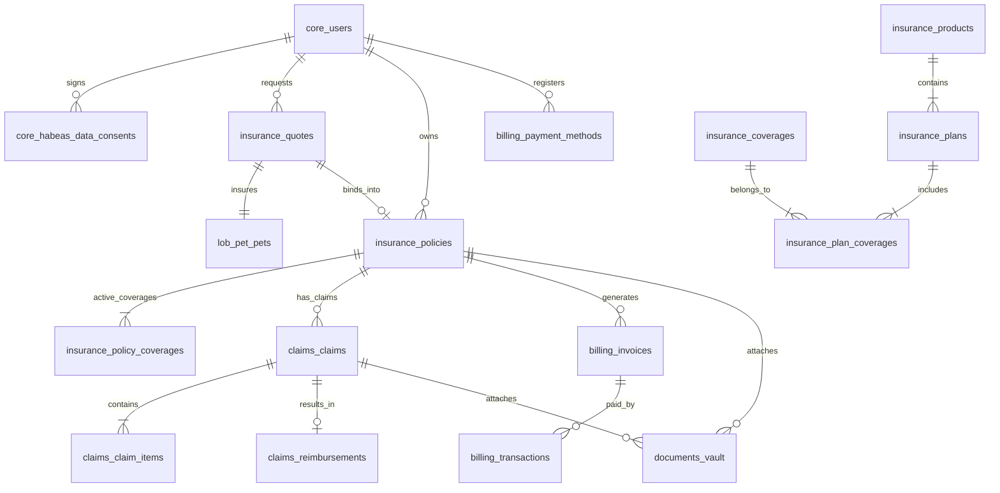

# Especificación de Base de Datos (Database Specification)
## Plataforma Insurtech Digital Multi-Ramo (Manto 2.0)
**Motor:** PostgreSQL 16+  
**Versión:** 1.0.0  
**Fecha:** Septiembre 2026  
**Estado:** Aprobado para Implementación  
**Autor:** CTO / Principal Software Architect  

---

## 1. Principios de Diseño de Persistencia

1. **Separación Lógica por Esquemas (PostgreSQL Schemas)**:
   * Para garantizar el aislamiento de dominios dentro del monolito modular, la base de datos se particiona en esquemas relacionales bien diferenciados:
     * `core`: Usuarios, autenticación, consentimiento de Habeas Data, roles y organizaciones.
     * `insurance`: Catálogo agnóstico de productos, planes, coberturas, cotizaciones y pólizas.
     * `billing`: Pasarelas, transacciones financieras, métodos de pago tokenizados y facturación.
     * `claims`: Radicación de siniestros, partidas reclamadas, deducciones y órdenes de reembolso.
     * `documents`: Bóveda de metadatos de archivos, estados de cuarentena y resultados de escaneo.
     * `audit`: Registro inmutable y de solo anexado (*append-only*) para eventos de auditoría y cumplimiento SFC.
     * `lob_pet`: Entidades especializadas de la línea de negocio de Mascotas (especies, razas, mascotas aseguradas, clínicas veterinarias).
2. **Identificadores Primarios UUIDv7**:
   * Se utiliza el estándar **UUIDv7** para todas las claves primarias. UUIDv7 combina una marca de tiempo Unix de 48 bits con entropía aleatoria, garantizando ordenamiento cronológico natural, evitando la fragmentación severa de árboles B-Tree en índices primarios y eliminando la enumerabilidad secuencial de UUIDs autoincrementales.
3. **Manejo Monetario sin Punto Flotante**:
   * Los valores monetarios en Pesos Colombianos (COP) se almacenan de forma estricta como **`BIGINT`** representando centavos (o pesos enteros sin decimales si la moneda es COP pura, con precisión matemática fija) para erradicar errores de redondeo IEEE 754.
4. **Control de Concurrencia Optimista (OCC)**:
   * Las tablas transaccionales de pólizas (`policies`) y siniestros (`claims`) incorporan una columna `version INTEGER NOT NULL DEFAULT 1` para prevenir condiciones de carrera durante modificaciones concurrentes de reservas o estados de cobertura.

---

## 2. Diagrama Entidad-Relación Conceptual (ERD)



---

## 3. Definición DDL Exhaustiva de Tablas

### 3.1 Esquema `core` (Identidad y Cumplimiento)

```sql
CREATE SCHEMA IF NOT EXISTS core;

-- Tabla de Usuarios y Clientes
CREATE TABLE core.users (
    id UUID PRIMARY KEY, -- UUIDv7
    email VARCHAR(255) NOT NULL UNIQUE,
    password_hash VARCHAR(255) NOT NULL,
    first_name VARCHAR(100) NOT NULL,
    last_name VARCHAR(100) NOT NULL,
    identification_type VARCHAR(20) NOT NULL CHECK (identification_type IN ('CC', 'CE', 'NIT', 'PASSPORT')),
    identification_number VARCHAR(50) NOT NULL,
    phone_country_code VARCHAR(5) NOT NULL DEFAULT '+57',
    phone_number VARCHAR(20) NOT NULL,
    city VARCHAR(100) NOT NULL,
    department VARCHAR(100) NOT NULL,
    address VARCHAR(255) NULL,
    role VARCHAR(30) NOT NULL DEFAULT 'POLICYHOLDER' CHECK (role IN ('POLICYHOLDER', 'ADJUSTER', 'UNDERWRITER', 'ADMIN', 'AUDITOR')),
    is_active BOOLEAN NOT NULL DEFAULT TRUE,
    is_email_verified BOOLEAN NOT NULL DEFAULT FALSE,
    is_phone_verified BOOLEAN NOT NULL DEFAULT FALSE,
    created_at TIMESTAMPTZ NOT NULL DEFAULT NOW(),
    updated_at TIMESTAMPTZ NOT NULL DEFAULT NOW(),
    deleted_at TIMESTAMPTZ NULL,
    CONSTRAINT uq_user_identification UNIQUE (identification_type, identification_number)
);

-- Tabla de Consentimiento de Tratamiento de Datos (Ley 1581 de 2012 / Habeas Data)
CREATE TABLE core.habeas_data_consents (
    id UUID PRIMARY KEY,
    user_id UUID NOT NULL REFERENCES core.users(id) ON DELETE RESTRICT,
    policy_version VARCHAR(20) NOT NULL, -- Versión del aviso legal aceptado
    consent_granted BOOLEAN NOT NULL,
    purpose VARCHAR(100) NOT NULL, -- ej. 'INSURANCE_UNDERWRITING_AND_MARKETING'
    ip_address INET NOT NULL,
    user_agent TEXT NOT NULL,
    consent_timestamp TIMESTAMPTZ NOT NULL DEFAULT NOW()
);
```

### 3.2 Esquema `insurance` (Catálogo, Cotización y Pólizas)

```sql
CREATE SCHEMA IF NOT EXISTS insurance;

-- Catálogo de Productos (Multi-Ramo)
CREATE TABLE insurance.products (
    id UUID PRIMARY KEY,
    code VARCHAR(50) NOT NULL UNIQUE, -- 'PET_HEALTH', 'HOME_BASIC', etc.
    lob_type VARCHAR(30) NOT NULL CHECK (lob_type IN ('PET', 'HOME', 'AUTO', 'TRAVEL', 'LIFE')),
    name VARCHAR(150) NOT NULL,
    description TEXT NOT NULL,
    carrier_code VARCHAR(50) NOT NULL, -- Código de aseguradora aliada ante la SFC
    is_active BOOLEAN NOT NULL DEFAULT TRUE,
    created_at TIMESTAMPTZ NOT NULL DEFAULT NOW(),
    updated_at TIMESTAMPTZ NOT NULL DEFAULT NOW()
);

-- Planes Comerciales dentro de un Producto
CREATE TABLE insurance.plans (
    id UUID PRIMARY KEY,
    product_id UUID NOT NULL REFERENCES insurance.products(id) ON DELETE RESTRICT,
    code VARCHAR(50) NOT NULL, -- 'PET_ESSENTIAL', 'PET_TRANQUILITY', 'PET_TOTAL'
    name VARCHAR(100) NOT NULL,
    description TEXT NOT NULL,
    base_monthly_premium_cop BIGINT NOT NULL, -- En pesos colombianos enteros
    base_annual_premium_cop BIGINT NOT NULL,
    deductible_percentage NUMERIC(5, 2) NOT NULL DEFAULT 10.00, -- ej. 10.00%
    min_deductible_cop BIGINT NOT NULL DEFAULT 40000, -- Mínimo COP $40,000
    is_active BOOLEAN NOT NULL DEFAULT TRUE,
    created_at TIMESTAMPTZ NOT NULL DEFAULT NOW(),
    updated_at TIMESTAMPTZ NOT NULL DEFAULT NOW(),
    CONSTRAINT uq_plan_product_code UNIQUE (product_id, code)
);

-- Catálogo Maestro de Coberturas
CREATE TABLE insurance.coverages (
    id UUID PRIMARY KEY,
    code VARCHAR(50) NOT NULL UNIQUE, -- 'ACCIDENT_EMERGENCY', 'ILLNESS', 'RCE_LEY_1801'
    lob_type VARCHAR(30) NOT NULL,
    name VARCHAR(150) NOT NULL,
    description TEXT NOT NULL,
    waiting_period_days INTEGER NOT NULL DEFAULT 0, -- Periodo de carencia en días
    is_optional_addon BOOLEAN NOT NULL DEFAULT FALSE,
    created_at TIMESTAMPTZ NOT NULL DEFAULT NOW()
);

-- Matriz de Coberturas por Plan con Límites
CREATE TABLE insurance.plan_coverages (
    id UUID PRIMARY KEY,
    plan_id UUID NOT NULL REFERENCES insurance.plans(id) ON DELETE CASCADE,
    coverage_id UUID NOT NULL REFERENCES insurance.coverages(id) ON DELETE RESTRICT,
    annual_limit_cop BIGINT NOT NULL, -- Límite máximo asegurable al año
    event_limit_cop BIGINT NULL,     -- Límite por evento
    co-pay_percentage NUMERIC(5, 2) NOT NULL DEFAULT 0.00,
    created_at TIMESTAMPTZ NOT NULL DEFAULT NOW(),
    CONSTRAINT uq_plan_coverage UNIQUE (plan_id, coverage_id)
);

-- Cotizaciones (Quotes)
CREATE TABLE insurance.quotes (
    id UUID PRIMARY KEY,
    user_id UUID NULL REFERENCES core.users(id) ON DELETE SET NULL,
    plan_id UUID NOT NULL REFERENCES insurance.plans(id) ON DELETE RESTRICT,
    lob_type VARCHAR(30) NOT NULL,
    subject_id UUID NOT NULL, -- ID polimórfico del sujeto (ej. lob_pet.pets.id)
    calculated_monthly_premium_cop BIGINT NOT NULL,
    calculated_annual_premium_cop BIGINT NOT NULL,
    applied_risk_factors JSONB NOT NULL, -- Factores actuariales aplicados
    selected_addons JSONB NOT NULL DEFAULT '[]', -- Array de IDs de add-ons seleccionados
    status VARCHAR(30) NOT NULL DEFAULT 'DRAFT' CHECK (status IN ('DRAFT', 'OFFERED', 'EXPIRED', 'BOUND', 'REJECTED')),
    expires_at TIMESTAMPTZ NOT NULL,
    created_at TIMESTAMPTZ NOT NULL DEFAULT NOW(),
    updated_at TIMESTAMPTZ NOT NULL DEFAULT NOW()
);

-- Pólizas Emitidas (Policies)
CREATE TABLE insurance.policies (
    id UUID PRIMARY KEY,
    policy_number VARCHAR(100) NOT NULL UNIQUE, -- Identificador visible al cliente
    carrier_policy_number VARCHAR(100) NULL,    -- Identificador del aliado asegurador
    quote_id UUID NOT NULL UNIQUE REFERENCES insurance.quotes(id) ON DELETE RESTRICT,
    user_id UUID NOT NULL REFERENCES core.users(id) ON DELETE RESTRICT,
    plan_id UUID NOT NULL REFERENCES insurance.plans(id) ON DELETE RESTRICT,
    lob_type VARCHAR(30) NOT NULL,
    subject_id UUID NOT NULL,
    premium_amount_cop BIGINT NOT NULL,
    billing_frequency VARCHAR(20) NOT NULL CHECK (billing_frequency IN ('MONTHLY', 'ANNUAL')),
    start_date TIMESTAMPTZ NOT NULL,
    end_date TIMESTAMPTZ NOT NULL,
    cancellation_date TIMESTAMPTZ NULL,
    cancellation_reason TEXT NULL,
    status VARCHAR(30) NOT NULL DEFAULT 'ACTIVE' CHECK (status IN ('ACTIVE', 'GRACE_PERIOD', 'SUSPENDED', 'CANCELLED', 'EXPIRED')),
    policy_document_id UUID NULL, -- Documento carátula oficial en documents.vault
    version INTEGER NOT NULL DEFAULT 1, -- Bloqueo optimista
    created_at TIMESTAMPTZ NOT NULL DEFAULT NOW(),
    updated_at TIMESTAMPTZ NOT NULL DEFAULT NOW()
);
```

### 3.3 Esquema `lob_pet` (Línea de Negocio: Mascotas)

```sql
CREATE SCHEMA IF NOT EXISTS lob_pet;

-- Catálogo de Razas Caninas y Felinas con Ponderaciones Actuariales
CREATE TABLE lob_pet.breeds (
    id UUID PRIMARY KEY,
    species VARCHAR(10) NOT NULL CHECK (species IN ('DOG', 'CAT')),
    name VARCHAR(100) NOT NULL,
    actuarial_risk_factor NUMERIC(4, 2) NOT NULL DEFAULT 1.00,
    is_special_handling_breed BOOLEAN NOT NULL DEFAULT FALSE, -- Clasificación Ley 1801 de 2016
    average_lifespan_years INTEGER NOT NULL DEFAULT 12,
    common_predispositions JSONB NOT NULL DEFAULT '[]',
    is_active BOOLEAN NOT NULL DEFAULT TRUE,
    CONSTRAINT uq_species_breed_name UNIQUE (species, name)
);

-- Mascotas Registradas
CREATE TABLE lob_pet.pets (
    id UUID PRIMARY KEY,
    user_id UUID NOT NULL REFERENCES core.users(id) ON DELETE RESTRICT,
    name VARCHAR(100) NOT NULL,
    species VARCHAR(10) NOT NULL CHECK (species IN ('DOG', 'CAT')),
    breed_id UUID NOT NULL REFERENCES lob_pet.breeds(id) ON DELETE RESTRICT,
    gender VARCHAR(10) NOT NULL CHECK (gender IN ('MALE', 'FEMALE')),
    birth_date DATE NOT NULL,
    is_sterilized BOOLEAN NOT NULL DEFAULT FALSE,
    microchip_number VARCHAR(50) NULL UNIQUE,
    photo_document_id UUID NULL, -- Referencia a foto validada
    ai_vision_metadata JSONB NULL, -- Metadatos del análisis de imagen inicial
    preexisting_conditions JSONB NOT NULL DEFAULT '[]',
    created_at TIMESTAMPTZ NOT NULL DEFAULT NOW(),
    updated_at TIMESTAMPTZ NOT NULL DEFAULT NOW()
);

-- Directorio de Clínicas Veterinarias Verificadas en Colombia
CREATE TABLE lob_pet.vet_clinics (
    id UUID PRIMARY KEY,
    name VARCHAR(200) NOT NULL,
    nit VARCHAR(30) NOT NULL UNIQUE, -- Identificación tributaria verificada con DIAN
    city VARCHAR(100) NOT NULL,
    address VARCHAR(255) NOT NULL,
    phone VARCHAR(30) NOT NULL,
    email VARCHAR(255) NULL,
    is_network_partner BOOLEAN NOT NULL DEFAULT FALSE, -- ¿Convenio directo o reembolso?
    is_blacklisted BOOLEAN NOT NULL DEFAULT FALSE, -- Alerta de fraude
    created_at TIMESTAMPTZ NOT NULL DEFAULT NOW()
);
```

### 3.4 Esquema `claims` (Siniestros y Reembolsos)

```sql
CREATE SCHEMA IF NOT EXISTS claims;

-- Siniestros Radicados (FNOL)
CREATE TABLE claims.claims (
    id UUID PRIMARY KEY,
    claim_number VARCHAR(100) NOT NULL UNIQUE,
    policy_id UUID NOT NULL REFERENCES insurance.policies(id) ON DELETE RESTRICT,
    user_id UUID NOT NULL REFERENCES core.users(id) ON DELETE RESTRICT,
    incident_type VARCHAR(50) NOT NULL CHECK (incident_type IN ('ACCIDENT', 'ILLNESS', 'PREVENTIVE', 'THIRD_PARTY_LIABILITY', 'ASSISTANCE')),
    incident_date TIMESTAMPTZ NOT NULL,
    description TEXT NOT NULL,
    claimed_amount_cop BIGINT NOT NULL,
    approved_amount_cop BIGINT NOT NULL DEFAULT 0,
    deductible_applied_cop BIGINT NOT NULL DEFAULT 0,
    co-pay_applied_cop BIGINT NOT NULL DEFAULT 0,
    net_payable_amount_cop BIGINT NOT NULL DEFAULT 0,
    vet_clinic_id UUID NULL REFERENCES lob_pet.vet_clinics(id) ON DELETE SET NULL,
    dian_cufe VARCHAR(255) NULL, -- Código de factura electrónica DIAN
    status VARCHAR(30) NOT NULL DEFAULT 'SUBMITTED' CHECK (
        status IN ('SUBMITTED', 'ANALYZING_DOCUMENTS', 'PENDING_MANUAL_REVIEW', 'APPROVED', 'REJECTED', 'PAID', 'DISPUTED')
    ),
    is_stp_eligible BOOLEAN NOT NULL DEFAULT FALSE, -- Straight-Through Processing automático
    fraud_risk_score NUMERIC(5, 2) NOT NULL DEFAULT 0.00, -- Puntaje de 0 a 100
    adjuster_id UUID NULL REFERENCES core.users(id) ON DELETE SET NULL,
    rejection_reason TEXT NULL,
    version INTEGER NOT NULL DEFAULT 1, -- Bloqueo optimista
    created_at TIMESTAMPTZ NOT NULL DEFAULT NOW(),
    updated_at TIMESTAMPTZ NOT NULL DEFAULT NOW()
);

-- Detalle de Partidas Reclamadas por Factura
CREATE TABLE claims.claim_items (
    id UUID PRIMARY KEY,
    claim_id UUID NOT NULL REFERENCES claims.claims(id) ON DELETE CASCADE,
    coverage_id UUID NOT NULL REFERENCES insurance.coverages(id) ON DELETE RESTRICT,
    item_description VARCHAR(255) NOT NULL,
    requested_amount_cop BIGINT NOT NULL,
    approved_amount_cop BIGINT NOT NULL DEFAULT 0,
    is_covered BOOLEAN NOT NULL DEFAULT TRUE,
    exclusion_reason VARCHAR(255) NULL,
    created_at TIMESTAMPTZ NOT NULL DEFAULT NOW()
);

-- Órdenes de Dispersión de Reembolso
CREATE TABLE claims.reimbursements (
    id UUID PRIMARY KEY,
    claim_id UUID NOT NULL UNIQUE REFERENCES claims.claims(id) ON DELETE RESTRICT,
    user_id UUID NOT NULL REFERENCES core.users(id) ON DELETE RESTRICT,
    amount_cop BIGINT NOT NULL,
    bank_code VARCHAR(20) NOT NULL, -- Código ACH / Superintendencia Financiera
    account_type VARCHAR(20) NOT NULL CHECK (account_type IN ('AHORROS', 'CORRIENTE', 'NEQUI', 'DAVIPLATA')),
    account_number_masked VARCHAR(50) NOT NULL,
    payout_reference VARCHAR(100) NULL UNIQUE, -- Referencia de dispersión bancaria
    status VARCHAR(30) NOT NULL DEFAULT 'SCHEDULED' CHECK (status IN ('SCHEDULED', 'PROCESSING', 'SETTLED', 'FAILED')),
    settled_at TIMESTAMPTZ NULL,
    failure_reason TEXT NULL,
    created_at TIMESTAMPTZ NOT NULL DEFAULT NOW()
);
```

### 3.5 Esquemas `billing`, `documents` y `audit`

```sql
CREATE SCHEMA IF NOT EXISTS billing;
CREATE SCHEMA IF NOT EXISTS documents;
CREATE SCHEMA IF NOT EXISTS audit;

-- Bóveda de Documentos y Archivos Digitales
CREATE TABLE documents.vault (
    id UUID PRIMARY KEY,
    user_id UUID NOT NULL REFERENCES core.users(id) ON DELETE RESTRICT,
    file_key VARCHAR(500) NOT NULL UNIQUE, -- Ruta en S3/MinIO
    original_file_name VARCHAR(255) NOT NULL,
    mime_type VARCHAR(100) NOT NULL,
    size_bytes BIGINT NOT NULL,
    sha256_hash VARCHAR(64) NOT NULL,
    security_status VARCHAR(30) NOT NULL DEFAULT 'QUARANTINED' CHECK (security_status IN ('QUARANTINED', 'CLEAN', 'INFECTED', 'REJECTED')),
    ocr_extraction_data JSONB NULL, -- Extracción estructurada de factura o epicrisis
    created_at TIMESTAMPTZ NOT NULL DEFAULT NOW()
);

-- Métodos de Pago Tokenizados (Cero almacenamiento de PAN/CVV)
CREATE TABLE billing.payment_methods (
    id UUID PRIMARY KEY,
    user_id UUID NOT NULL REFERENCES core.users(id) ON DELETE RESTRICT,
    provider VARCHAR(30) NOT NULL DEFAULT 'WOMPI' CHECK (provider IN ('WOMPI', 'PAYU', 'MERCADOPAGO')),
    token VARCHAR(255) NOT NULL, -- Token provisto por la pasarela
    brand VARCHAR(30) NOT NULL, -- 'VISA', 'MASTERCARD', 'AMEX'
    last_four VARCHAR(4) NOT NULL,
    expiry_month VARCHAR(2) NOT NULL,
    expiry_year VARCHAR(4) NOT NULL,
    is_default BOOLEAN NOT NULL DEFAULT FALSE,
    created_at TIMESTAMPTZ NOT NULL DEFAULT NOW()
);

-- Registro de Auditoría Inmutable (Append-Only)
CREATE TABLE audit.audit_logs (
    id UUID PRIMARY KEY,
    actor_user_id UUID NULL,
    actor_role VARCHAR(30) NOT NULL,
    action VARCHAR(100) NOT NULL, -- ej. 'POLICY_ISSUED', 'CLAIM_AUTO_APPROVED', 'DATA_ACCESSED'
    entity_name VARCHAR(50) NOT NULL,
    entity_id UUID NOT NULL,
    ip_address INET NOT NULL,
    user_agent TEXT NOT NULL,
    payload_before JSONB NULL,
    payload_after JSONB NULL,
    created_at TIMESTAMPTZ NOT NULL DEFAULT NOW()
);
```

---

## 4. Estrategia Exhaustiva de Índices

```sql
-- Índices de alta cardinalidad y búsquedas operacionales frecuentes
CREATE INDEX idx_users_identification ON core.users(identification_type, identification_number);
CREATE INDEX idx_users_email ON core.users(email);

CREATE INDEX idx_quotes_user_id ON insurance.quotes(user_id);
CREATE INDEX idx_quotes_expires_at ON insurance.quotes(expires_at) WHERE status = 'OFFERED';

CREATE INDEX idx_policies_user_id ON insurance.policies(user_id);
CREATE INDEX idx_policies_status ON insurance.policies(status);
CREATE INDEX idx_policies_number ON insurance.policies(policy_number);

CREATE INDEX idx_pets_user_id ON lob_pet.pets(user_id);
CREATE INDEX idx_pets_breed_id ON lob_pet.pets(breed_id);
CREATE INDEX idx_breeds_species_handling ON lob_pet.breeds(species, is_special_handling_breed);

CREATE INDEX idx_claims_policy_id ON claims.claims(policy_id);
CREATE INDEX idx_claims_user_id ON claims.claims(user_id);
CREATE INDEX idx_claims_status ON claims.claims(status);
CREATE INDEX idx_claims_dian_cufe ON claims.claims(dian_cufe) WHERE dian_cufe IS NOT NULL;

-- Índices GIN para consultas de atributos JSONB
CREATE INDEX idx_quotes_applied_factors_gin ON insurance.quotes USING GIN (applied_risk_factors);
CREATE INDEX idx_documents_ocr_data_gin ON documents.vault USING GIN (ocr_extraction_data);
CREATE INDEX idx_audit_logs_created_at ON audit.audit_logs(created_at DESC);
```

---

## 5. Estrategia de Migraciones y Versionamiento

* Las migraciones de base de datos se ejecutan en estricto modo secuencial usando el gestor de migraciones nativo de TypeORM / Prisma / Flyway con nomenclatura cronológica: `YYYYMMDDHHMMSS__nombre_descriptivo.sql`.
* Todas las migraciones en producción deben ser **no bloqueantes** (ej. creación de índices concurrentes `CREATE INDEX CONCURRENTLY` y adición de columnas opcionales con valores predeterminados seguros).
