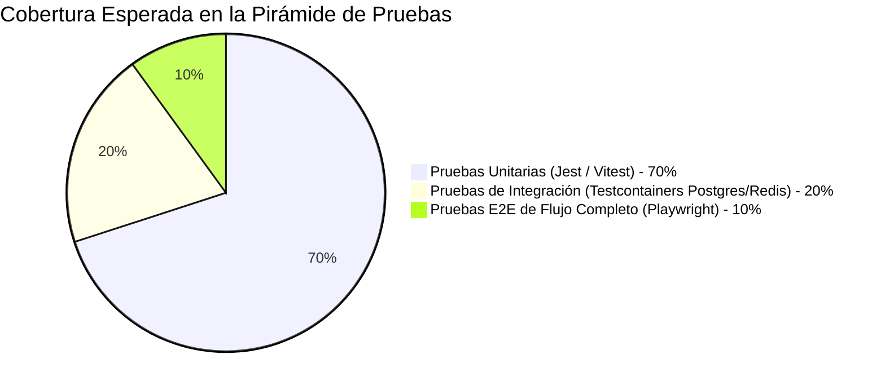

# Guías de Desarrollo y Protocolo de Coordinación (Development Guidelines)
## Plataforma Insurtech Digital Multi-Ramo (Manto 2.0)
**Versión:** 1.0.0  
**Fecha:** Septiembre 2026  
**Estado:** Aprobado para Implementación  
**Autor:** CTO / Principal Software Architect  

---

## 1. Protocolo de Coordinación entre Agentes y Desarrolladores

Para garantizar la integridad y coherencia técnica de la plataforma, múltiples agentes especializados y desarrolladores colaborarán en el proyecto bajo las siguientes responsabilidades y reglas:

| Rol / Agente Especializado | Alcance de Responsabilidad | Límites Estrictos |
| :--- | :--- | :--- |
| **CTO / Principal Architect** (Rol Actual) | Gobierna la arquitectura global, esquemas de BD, interfaces núcleo (`InsurableRiskSubject`), estándares de seguridad y resolución de conflictos. | Ningún agente puede modificar la estructura de esquemas o contratos de módulos sin actualizar la documentación de arquitectura. |
| **Frontend Agent (Next.js / UI)** | Desarrolla la aplicación web móvil-first, pantallas de onboarding visual, cotizador, checkout y dashboard del cliente. | No implementa lógica de cálculo de primas o deducibles en el cliente; consume exclusivamente las APIs de `/v1/quotes` y `/v1/claims`. |
| **Backend Agent (NestJS / Core)** | Implementa los módulos del núcleo (`Auth`, `Users`, `Products`, `Policies`, `Billing`), controladores REST, guardas RBAC y eventos de dominio. | No acopla lógica biológica o específica de mascotas en el módulo central de pólizas; utiliza la interfaz de extensión LOB. |
| **Insurance Engine Agent** | Codifica las matrices de suscripción, factores actuariales y reglas de negocio deterministas en `InsuranceRulesModule`. | Prohibido utilizar librerías de IA o llamadas externas probabilísticas dentro del motor de tarifas. |
| **AI / Computer Vision Agent** | Diseña los workers asíncronos de BullMQ para visión computacional (raza/edad) y OCR de facturas DIAN (CUFE). | Los resultados deben ser siempre sugerencias probabilísticas sujetas a validación de usuario o auditor humano. |
| **Claims Agent** | Implementa la máquina de estados de siniestros, motor de STP, consola de auditoría veterinaria y pagos ACH. | Aplica de forma estricta los cortacircuitos de auto-aprobación ($\le$ COP $500,000$). |
| **QA / Testing Agent** | Diseña pruebas unitarias, de integración con Testcontainers y pruebas E2E con Playwright. | Ningún feature se considera terminado si la cobertura de pruebas en motores financieros o de suscripción es inferior al $95\%$. |

### Protocolo de Resolución de Conflictos Arquitectónicos
Si un agente o desarrollador propone un cambio que contradice las decisiones de `/docs/ARCHITECTURE.md` o `/docs/DECISIONS.md`:
1. **No aceptar el cambio silenciosamente**.
2. Documentar el conflicto técnico, las implicaciones en seguridad, rendimiento o regulación colombiana.
3. Proponer una alternativa alineada con la arquitectura o elevar una propuesta de revisión de ADR al Arquitecto Principal.

---

## 2. Estándares de Código TypeScript y Calidad de Software

### 2.1 Reglas Obligatorias de TypeScript
* **Modo Estricto Total (`"strict": true`)**: Activado en `tsconfig.json`.
* **Prohibición del Tipo `any`**: El uso de `any` está prohibido y causará fallo en el linter (`@typescript-eslint/no-explicit-any: "error"`). Utilizar tipos genéricos, uniones discriminadas o `unknown` con guardas de tipo.
* **Tipado Nominal de Valores Monetarios**:
  Para evitar mezclar enteros comunes con dinero en Pesos Colombianos, se define un tipo nominal o valor de objeto de dominio:

```typescript
// packages/common/src/types/money.ts

export type ColombianPeso = number & { readonly __brand: unique symbol };

export function asCop(amount: number): ColombianPeso {
  if (!Number.isInteger(amount) || amount < 0) {
    throw new Error(`Valor monetario inválido en COP: ${amount}. Debe ser un entero positivo.`);
  }
  return amount as ColombianPeso;
}
```

* **Inmutabilidad por Defecto**:
  * Utilizar `readonly` en propiedades de clases de dominio, interfaces y tipos de datos (DTOs).

---

## 3. Estructura de Directorios del Repositorio (Monolito Modular)

```
manto-platform/
├── apps/
│   ├── web/                        # Frontend Next.js 14+ (App Router, Tailwind, shadcn/ui)
│   │   ├── app/                    # Rutas públicas y protegidas de clientes
│   │   ├── components/             # Componentes UI accesibles y reutilizables
│   │   └── lib/                    # Clientes API tipados y utilidades de estado
│   └── backoffice/                 # Portal administrativo para ajustadores y suscriptores
├── backend/                        # Backend NestJS (Monolito Modular)
│   ├── src/
│   │   ├── common/                 # Decoradores, filtros de excepción RFC 7807, interceptores
│   │   ├── config/                 # Validación de variables de entorno con Zod
│   │   ├── modules/
│   │   │   ├── auth/               # Autenticación, JWT, hashing Argon2id
│   │   │   ├── users/              # Usuarios, perfiles, Habeas Data Ley 1581
│   │   │   ├── products/           # Catálogo de productos, planes y coberturas
│   │   │   ├── quotes/             # Orquestación de cotizaciones
│   │   │   ├── policies/           # Ciclo de vida y carátulas de pólizas
│   │   │   ├── billing/            # Integración Wompi (PSE, tarjetas) y cobros
│   │   │   ├── claims/             # Siniestros, máquina de estados, liquidación
│   │   │   ├── documents/          # Bóveda S3, presigned URLs, ClamAV
│   │   │   ├── audit/              # Registro de auditoría inmutable
│   │   │   └── lobs/               # Plugins de Líneas de Negocio
│   │   │       └── pet/            # Especies, razas, mascotas, Ley 1801 RCE
│   │   └── workers/                # Workers asíncronos BullMQ (Visión, OCR, PDFs)
│   └── test/                       # Pruebas e2e y de integración
├── docs/                           # Documentación canónica de arquitectura y negocio
├── docker/                         # Dockerfiles y docker-compose para dev y producción
└── package.json                    # Monorepo con workspaces (pnpm / npm)
```

---

## 4. Pirámide de Pruebas Automatizadas



1. **Pruebas Unitarias (Unit Tests)**:
   * Aplican a toda la lógica de dominio, motores de tarificación, cálculo de deducibles, validadores de DTOs y formateadores de moneda.
   * **Objetivo de Cobertura**: $\ge 95\%$ en módulos de seguros, tarificación y liquidación de siniestros.
2. **Pruebas de Integración (Integration Tests)**:
   * Levantan instancias efímeras reales de PostgreSQL y Redis utilizando **Testcontainers**.
   * Prueban repositorios de base de datos, transacciones ACID, encolamiento en BullMQ y consultas complejas.
3. **Pruebas de Extremo a Extremo (E2E Tests)**:
   * Ejecutadas con **Playwright** simulando el recorrido del cliente: Carga de foto de mascota $\to$ Inferencia de raza $\to$ Cotización en $<60$ segundos $\to$ Checkout con simulación de Wompi Sandbox $\to$ Emisión de póliza digital.

---

## 5. Definición de Terminado (Definition of Done - DoD)

Una funcionalidad **NO está terminada** porque la interfaz visual se vea atractiva o responda localmente. Para considerarse `DONE` y fusionarse en la rama principal (`main`), debe cumplir rigurosamente:

* [ ] **Arquitectura Correcta**: Respeta los límites modulares de dominio y las interfaces establecidas en `/docs/ARCHITECTURE.md`.
* [ ] **Tipado Seguro**: Cero uso de `any`, validación estricta de DTOs en entrada con `class-validator` o `zod`.
* [ ] **Validaciones de Negocio**: Reglas deterministas ejecutadas y probadas; cumplimiento de normativas colombianas aplicables (ej. Ley 1801 de 2016 si involucra razas de manejo especial).
* [ ] **Pruebas Automatizadas**: Pruebas unitarias pasando exitosamente con cobertura mínima requerida; pruebas de integración para operaciones con base de datos o colas.
* [ ] **Manejo de Errores y Resiliencia**: Respuestas de error estandarizadas bajo RFC 7807 Problem Details; transacciones financieras idempotentes.
* [ ] **Seguridad**: Verificación de autorización RBAC y prevención de BOLA; sanitización de entradas; cero datos sensibles de tarjetas o contraseñas en texto claro.
* [ ] **Observabilidad y Auditoría**: Registro de logs estructurados con correlación (`traceId`); eventos críticos registrados en `audit.audit_logs`.
* [ ] **Documentación Actualizada**: Si la funcionalidad modifica contratos de API, tablas de BD o reglas de suscripción, los documentos correspondientes en `/docs/` deben actualizarse en el mismo Pull Request.

---

## 6. Flujo de Trabajo Git y Despliegue Continuo (CI/CD)

* **Estrategia de Ramas (GitHub Flow)**:
  * `main`: Código en producción, siempre desplegable.
  * `feature/{ramo-o-modulo}/{descripcion-corta}`: Ramas de trabajo efímeras creadas desde `main`.
* **Commits Semánticos (Conventional Commits)**:
  * `feat(quotes): implementar factor de recargo por raza braquicefala`
  * `fix(claims): corregir redondeo de copago en liquidacion de medicamentos`
  * `docs(architecture): actualizar diagrama de integracion con wompi`
* **Pipeline de Integración Continua (GitHub Actions)**:
  1. **Lint & Typecheck**: `pnpm lint && pnpm typecheck`.
  2. **Audit de Seguridad**: Escaneo de dependencias vulnerables (`pnpm audit`).
  3. **Ejecución de Pruebas**: Pruebas unitarias e integración sobre PostgreSQL en contenedor.
  4. **Build de Contenedores**: Construcción multi-stage de imágenes Docker optimizadas.
