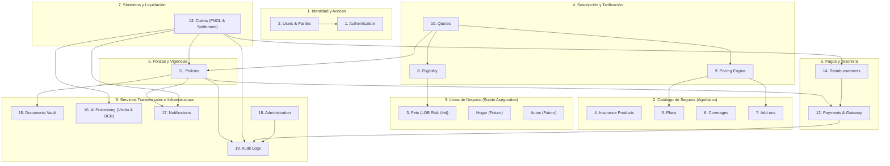

# Especificación Maestra de Dominios de Arquitectura (Master Domain Architecture Specification)
## Plataforma Insurtech Digital Multi-Ramo (Manto 2.0)
**Rol:** Principal Software Architect / CTO  
**Versión:** 1.0.0  
**Fecha:** Septiembre 2026  
**Estado:** Documento Canónico de Diseño - Fase Previa a Código  

---

## 1. Mapa de Contextos Delimitados (Bounded Context Map)

El sistema se estructura como un **Monolito Modular con Diseño Guiado por el Dominio (DDD)**. Cada uno de los 19 dominios requeridos cuenta con fronteras de contexto (*Bounded Contexts*) explícitas, un lenguaje ubicuo (*Ubiquitous Language*), agregados raíz (*Aggregate Roots*), entidades, objetos de valor (*Value Objects*), eventos de dominio y reglas de negocio invariantes.



---

## 2. Los 19 Dominios Fundamentales: Especificación Detallada

---

### DOMINIO 1: `Authentication` (Autenticación y Sesiones)
* **Contexto Delimitado**: Seguridad de acceso, generación/rotación de credenciales y tokens criptográficos.
* **Agregado Raíz**: `AuthSession`
* **Entidades / Objetos de Valor**: `AccessToken` (JWT 15m), `RefreshToken` (Token opaco en cookie HttpOnly Secure rotativo), `HashedPassword` (Argon2id), `SecurityRole`.
* **Invariantes del Dominio**:
  1. Las contraseñas se almacenan exclusivamente con algoritmo Argon2id (mínimo 64MB memoria, t=3, p=4).
  2. Un Refresh Token solo puede ser canjeado una sola vez; si se detecta reuso de un token ya consumido, se revocan todas las sesiones activas del usuario (*Refresh Token Reuse Detection*).
  3. Cero credenciales de acceso registradas en texto plano en logs o persistencia.
* **Eventos de Dominio Emitidos**:
  * `auth.logged_in`: `{ userId, ipAddress, userAgent, timestamp }`
  * `auth.suspicious_login_blocked`: `{ userId, reason, ipAddress, timestamp }`
  * `auth.password_reset_requested`: `{ userId, resetTokenHash, expiresAt }`

---

### DOMINIO 2: `Users` (Usuarios, Partes y Consentimiento)
* **Contexto Delimitado**: Gestión de personas naturales/jurídicas (Tomadores, Asegurados, Beneficiarios) y cumplimiento de Habeas Data en Colombia.
* **Agregado Raíz**: `User`
* **Entidades / Objetos de Valor**: `IdentificationNumber` (Cédula de Ciudadanía CC, Extranjería CE, NIT, Pasaporte), `HabeasDataConsent`, `ContactInformation` (Email, Teléfono +57, Dirección física, Ciudad, Departamento).
* **Invariantes del Dominio**:
  1. La Cédula/NIT es única en el sistema (`uq_identification_type_number`).
  2. Todo usuario nuevo debe poseer un registro firmado de consentimiento de Habeas Data conforme a la **Ley 1581 de 2012** antes de autorizar cualquier cotización o pago.
  3. El correo electrónico se almacena normalizado en minúsculas y validado bajo RFC 5322.
* **Eventos de Dominio Emitidos**:
  * `user.registered`: `{ userId, email, identificationNumber, timestamp }`
  * `user.habeas_data_granted`: `{ userId, policyVersion, ipAddress, timestamp }`
  * `user.profile_updated`: `{ userId, changedFields, timestamp }`

---

### DOMINIO 3: `Pets` (Línea de Negocio: Sujeto Asegurable Mascota)
* **Contexto Delimitado**: Entidad especializada que implementa la interfaz genérica `InsurableRiskSubject`.
* **Agregado Raíz**: `Pet`
* **Entidades / Objetos de Valor**: `Species` (`DOG` | `CAT`), `Breed` (Catálogo actuarial), `BirthDate` (con cálculo de edad en meses exactos), `SpecialHandlingClassification` (Bandera Ley 1801 de 2016), `MicrochipNumber`, `PreexistingCondition`.
* **Invariantes del Dominio**:
  1. Únicamente caninos y felinos son admitidos en este LOB.
  2. La fecha de nacimiento no puede ser futura ni superior a 20 años en el pasado.
  3. Si la raza pertenece a las 15 razas de manejo especial de la Ley 1801, la propiedad `isSpecialHandlingBreed` es inmutablemente `true`.
* **Eventos de Dominio Emitidos**:
  * `pet.registered`: `{ petId, userId, species, breedId, birthDate, isSpecialHandlingBreed }`
  * `pet.medical_condition_appended`: `{ petId, conditionCode, diagnosedDate }`

---

### DOMINIO 4: `Insurance Products` (Catálogo de Productos y Ramos)
* **Contexto Delimitado**: Definición agnóstica de ramos de seguro y productos parametrizados ante la Superintendencia Financiera de Colombia.
* **Agregado Raíz**: `Product`
* **Entidades / Objetos de Valor**: `ProductCode` (ej. `PET_HEALTH_COL`), `LOBType` (`PET`, `HOME`, `AUTO`, `TRAVEL`, `LIFE`), `CarrierCode` (Aseguradora aliada SFC), `ProductStatus` (`ACTIVE`, `DEPRECATED`).
* **Invariantes del Dominio**:
  1. Cada producto debe estar vinculado a un código de aseguradora vigilada por la SFC o registro en Sandbox.
  2. Un producto en estado `DEPRECATED` no permite nuevas cotizaciones pero mantiene la vigencia de pólizas emitidas.
* **Eventos de Dominio Emitidos**:
  * `product.created`: `{ productId, code, lobType, carrierCode }`
  * `product.status_changed`: `{ productId, oldStatus, newStatus }`

---

### DOMINIO 5: `Plans` (Plan Base Dinámico y Paquetes de Protección a la Medida)
* **Contexto Delimitado**: Generación dinámica de la **Protección Base Personalizada** a partir del análisis de la IA validado por el usuario y calibrado por el motor actuarial de tarificación, en sustitución de tiers comerciales estáticos rígidos.
* **Agregado Raíz**: `TailoredPlan`
* **Entidades / Objetos de Valor**: `BaseProtectionPackage`, `MinimumBaselineCoverages` (coberturas mínimas asignadas por raza, tamaño, especie, edad y ubicación), `SizeCategory` (`TOY` [$\le 5$kg], `SMALL` [$5-10$kg], `MEDIUM` [$10-25$kg], `LARGE` [$25-45$kg], `GIANT` [$>45$kg]), `TailoredBaseRateCop`, `DeductibleOptions` (10%, 15%, 20%).
* **Invariantes del Dominio**:
  1. El plan base no es un paquete genérico cerrado, sino un **núcleo de protección esencial calculado determinísticamente** según la combinación de los 5 factores de riesgo de la mascota (Especie, Raza, Tamaño, Edad y Ubicación).
  2. El plan base incluye siempre un conjunto de **coberturas mínimas no negociables** (Urgencias por accidente, estabilización vital, consultas de emergencia y, si aplica por Ley 1801, RCE obligatoria).
  3. A partir de esta tarifa base personalizada, el cliente tiene total libertad de expandir su cobertura mediante el ecosistema modular de **Add-ons** (Dominio 7) y ajustar deducibles.
* **Eventos de Dominio Emitidos**:
  * `plan.tailored_base_generated`: `{ subjectId, baseRateCop, sizeCategory, minimumCoverages, rulesVersion }`
  * `plan.customized_with_addons`: `{ quoteId, baseRateCop, attachedAddons, totalMonthlyPremiumCop }`

---

### DOMINIO 6: `Coverages` (Coberturas Maestras y Sublímites)
* **Contexto Delimitado**: Definición granular de amparos médicos, accidentales o de responsabilidad civil.
* **Agregado Raíz**: `Coverage`
* **Entidades / Objetos de Valor**: `CoverageCode` (`ACCIDENT_EMERGENCY`, `ILLNESS`, `MEDICATION`, `EXAMS`, `RCE_LEY_1801`), `WaitingPeriodDays` (Carencia), `AnnualLimitCop`, `EventLimitCop`.
* **Invariantes del Dominio**:
  1. El periodo de carencia no puede ser negativo.
  2. Las coberturas de accidentes tienen carencias máximas de 48 horas.
  3. Toda cobertura pertenece a un catálogo maestro reutilizable en múltiples planes.
* **Eventos de Dominio Emitidos**:
  * `coverage.defined`: `{ coverageId, code, waitingPeriodDays }`

---

### DOMINIO 7: `Add-ons` (Coberturas Opcionales y Asistencias)
* **Contexto Delimitado**: Amparos modulares configurables que el cliente puede anexar a su plan base.
* **Agregado Raíz**: `Addon`
* **Entidades / Objetos de Valor**: `AddonCode` (`RCE_LEY_1801`, `FUNERAL_ASSISTANCE`, `TELEMEDICINE`, `PET_HOTEL`), `MonthlyPriceCop`, `IsMandatoryRule` (Función que evalúa si una condición de riesgo lo hace obligatorio).
* **Invariantes del Dominio**:
  1. El add-on `RCE_LEY_1801` tiene regla obligatoria si `isSpecialHandlingBreed == true`.
  2. El precio de un add-on se suma íntegramente a la prima mensual calculada.
* **Eventos de Dominio Emitidos**:
  * `addon.attached_to_quote`: `{ quoteId, addonCode, priceCop }`

---

### DOMINIO 8: `Eligibility` (Motor Determinista de Elegibilidad)
* **Contexto Delimitado**: Evaluación sin IA de las reglas duras de suscripción técnica.
* **Agregado Raíz**: `EligibilityAssessment`
* **Entidades / Objetos de Valor**: `EligibilityCriteria`, `IneligibilityReason`, `UnderwritingBoundary`.
* **Invariantes del Dominio**:
  1. Edad mínima: $\ge 8$ semanas (56 días de vida cumplidos).
  2. Edad máxima nueva suscripción: $\le 8$ años y 364 días (107 meses).
  3. No se admiten animales no pertenecientes a la taxonomía canina o felina.
  4. La evaluación es determinista y no depende de llamadas externas.
* **Eventos de Dominio Emitidos**:
  * `eligibility.evaluated`: `{ subjectId, isEligible, reasonCode, timestamp }`

---

### DOMINIO 9: `Pricing` (Motor Actuarial de Tarificación)
* **Contexto Delimitado**: Cálculo determinista de la prima mensual y anual en Pesos Colombianos.
* **Agregado Raíz**: `PricingCalculation`
* **Entidades / Objetos de Valor**: `BaseRate`, `SpeciesFactor`, `BreedFactor`, `AgeTierFactor`, `LocationFactor`, `SterilizationDiscount`, `DeductibleFactor`, `CalculationTrace`.
* **Invariantes del Dominio**:
  1. La IA tiene prohibido intervenir o calcular primas.
  2. La fórmula actuarial es estricta:
     $$\text{Prima} = \text{Base} \times F_{\text{especie}} \times F_{\text{raza}} \times F_{\text{edad}} \times F_{\text{ubicación}} \times (1 - D) \times F_{\text{deducible}} + \sum \text{Addons}$$
  3. El resultado monetario siempre se redondea al peso entero más cercano (`BIGINT`).
  4. Se incluye la traza completa de factores aplicados para reproducibilidad forense.
* **Eventos de Dominio Emitidos**:
  * `pricing.calculated`: `{ calculationId, totalMonthlyCop, totalAnnualCop, rulesVersion, trace }`

---

### DOMINIO 10: `Quotes` (Cotizaciones y Ofertas Vinculantes)
* **Contexto Delimitado**: Ciclo de vida de la cotización comercial y trazabilidad de ofertas.
* **Agregado Raíz**: `Quote`
* **Entidades / Objetos de Valor**: `QuoteNumber`, `QuoteStatus` (`DRAFT`, `OFFERED`, `EXPIRED`, `BOUND`, `REJECTED`), `ExpirationDate` (15 días de vigencia fija), `SelectedOptions`.
* **Invariantes del Dominio**:
  1. Una vez pasada a estado `OFFERED`, el precio y factores quedan congelados de forma inmutable.
  2. No se puede vincular (`bind`) una cotización cuya fecha actual sea posterior a `expiresAt`.
  3. Toda cotización vinculada genera una única póliza formal.
* **Eventos de Dominio Emitidos**:
  * `quote.created`: `{ quoteId, userId, planId, monthlyPremiumCop, expiresAt }`
  * `quote.bound`: `{ quoteId, policyId, timestamp }`
  * `quote.expired`: `{ quoteId, timestamp }`

---

### DOMINIO 11: `Policies` (Pólizas y Perfeccionamiento de Contratos)
* **Contexto Delimitado**: El contrato de seguro, su vigencia legal y sus transiciones de estado.
* **Agregado Raíz**: `Policy`
* **Entidades / Objetos de Valor**: `PolicyNumber` (`MTO-PET-YYYY-XXXXXX`), `CarrierPolicyNumber`, `PolicyStatus` (`DRAFT`, `PENDING_PAYMENT`, `ACTIVE`, `SUSPENDED`, `CANCELLED`, `EXPIRED`), `TermDates` (Inicio y Fin a las 23:59:59), `PolicyCertificateHash` (Firma digital Ley 527 de 1999), `Version` (Bloqueo optimista).
* **Invariantes del Dominio**:
  1. Solo una cotización en estado `BOUND` con pago confirmado puede emitir una póliza `ACTIVE`.
  2. Una póliza activa no puede cambiar su número, su fecha de inicio ni la versión de reglas bajo la cual fue emitida.
  3. La cancelación exige causa justificada documentada y fecha efectiva.
* **Eventos de Dominio Emitidos**:
  * `policy.issued`: `{ policyId, policyNumber, userId, planId, startDate, endDate }`
  * `policy.suspended`: `{ policyId, reason, suspendedAt }`
  * `policy.reinstated`: `{ policyId, reinstatedAt }`
  * `policy.cancelled`: `{ policyId, reason, cancelledAt }`
  * `policy.expired`: `{ policyId, expiredAt }`

---

### DOMINIO 12: `Payments` (Pasarelas, Recaudo y Cobros Recurrentes)
* **Contexto Delimitado**: Orquestación de transacciones con pasarelas (Wompi), PSE y tokenización.
* **Agregado Raíz**: `PaymentTransaction`
* **Entidades / Objetos de Valor**: `TransactionReference`, `Provider` (`WOMPI`), `PaymentMethod` (`PSE`, `TOKENIZED_CARD`), `TransactionStatus` (`PENDING`, `APPROVED`, `DECLINED`, `ERROR`), `IdempotencyKey`.
* **Invariantes del Dominio**:
  1. Descope total de PCI-DSS: Cero almacenamiento de PAN, CVV o fechas de expiración en bases de datos de Manto.
  2. Todas las intenciones de cobro requieren encabezado `Idempotency-Key` (UUIDv4) con verificación en Redis.
  3. Todo webhook de pasarela exige validación de firma criptográfica SHA-256 (`checksum`).
* **Eventos de Dominio Emitidos**:
  * `payment.initiated`: `{ transactionId, reference, amountCop, idempotencyKey }`
  * `payment.approved`: `{ transactionId, policyId, providerReference, timestamp }`
  * `payment.declined`: `{ transactionId, reason, timestamp }`

---

### DOMINIO 13: `Claims` (Radicación y Máquina de Estados de Siniestros)
* **Contexto Delimitado**: Primer aviso de siniestro (FNOL), evaluación de partidas, auditoría y resolución.
* **Agregado Raíz**: `Claim`
* **Entidades / Objetos de Valor**: `ClaimNumber` (`CLM-YYYY-XXXXXX`), `IncidentType` (`ACCIDENT`, `ILLNESS`, `PREVENTIVE`, `RCE`), `ClaimStatus` (`DRAFT`, `SUBMITTED`, `PROCESSING`, `APPROVED`, `PARTIALLY_APPROVED`, `REJECTED`, `PAID`, `HUMAN_REVIEW`, `DISPUTED`), `ClaimItem`, `FraudRiskScore`, `Version` (Bloqueo optimista).
* **Invariantes del Dominio**:
  1. No se puede radicar un siniestro sobre una póliza inactiva o con fecha de incidente fuera de vigencia.
  2. La IA nunca aprueba ni rechaza de forma autónoma.
  3. El STP automático está estrictamente limitado a montos netos $\le$ COP $500.000$ con FraudScore $< 20.00$ y carencias superadas.
  4. Todo rechazo exige invocación de la cláusula contractual aplicable.
* **Eventos de Dominio Emitidos**:
  * `claim.submitted`: `{ claimId, claimNumber, policyId, claimedAmountCop }`
  * `claim.auto_approved_stp`: `{ claimId, approvedAmountCop, timestamp }`
  * `claim.routed_to_human_review`: `{ claimId, reasons, riskScore }`
  * `claim.adjudicated`: `{ claimId, status, approvedAmountCop, adjusterId }`

---

### DOMINIO 14: `Reimbursements` (Órdenes de Dispersión y Transferencias Bancarias)
* **Contexto Delimitado**: Gestión de pagos indemnizatorios a cuentas bancarias del asegurado.
* **Agregado Raíz**: `ReimbursementOrder`
* **Entidades / Objetos de Valor**: `BankAccountDetails` (Código Banco SFC, Tipo de Cuenta, Número enmascarado), `DisbursementChannel` (`ACH_COLOMBIA`, `TRANSFIYA`, `NEQUI`), `ReimbursementStatus` (`SCHEDULED`, `PROCESSING`, `SETTLED`, `FAILED`).
* **Invariantes del Dominio**:
  1. Solo un siniestro en estado `APPROVED` o `PARTIALLY_APPROVED` puede generar una orden de reembolso.
  2. El monto a dispersar debe ser exactamente igual a `claim.netPayableAmountCop`.
  3. La orden es inmutable y cuenta con clave de idempotencia bancaria para evitar dispersiones duplicadas.
* **Eventos de Dominio Emitidos**:
  * `reimbursement.scheduled`: `{ reimbursementId, claimId, amountCop, bankCode }`
  * `reimbursement.settled`: `{ reimbursementId, bankingReference, settledAt }`
  * `reimbursement.failed`: `{ reimbursementId, failureReason }`

---

### DOMINIO 15: `Documents` (Bóveda de Archivos, Cuarentena y Firmas)
* **Contexto Delimitado**: Almacenamiento seguro en S3/MinIO, verificación de integridad y prevención de malware.
* **Agregado Raíz**: `DocumentVaultItem`
* **Entidades / Objetos de Valor**: `FileKey` (Ruta S3), `MimeType`, `MagicBytesSignature`, `Sha256Hash`, `SecurityStatus` (`QUARANTINED`, `CLEAN`, `INFECTED`, `REJECTED`), `PresignedUrl`.
* **Invariantes del Dominio**:
  1. Todo archivo subido se deposita inicialmente en `/quarantine/` y no puede ser accedido por el usuario.
  2. Solo tras la validación de Magic Bytes y escaneo con ClamAV se traslada a `/clean/`.
  3. Las URLs de descarga son prefirmadas con caducidad máxima de 15 minutos.
* **Eventos de Dominio Emitidos**:
  * `document.uploaded`: `{ documentId, fileKey, mimeType, sizeBytes }`
  * `document.scanned_clean`: `{ documentId, sha256Hash }`
  * `document.quarantine_rejected`: `{ documentId, reason }`

---

### DOMINIO 16: `AI Processing` (Visión Computacional y OCR Aislados)
* **Contexto Delimitado**: Subsistema periférico de percepción sin atribuciones financieras.
* **Agregado Raíz**: `AiJob`
* **Entidades / Objetos de Valor**: `JobType` (`PET_VISION_CLASSIFICATION`, `DIAN_INVOICE_OCR`), `ProviderType` (`GEMINI`, `OPENAI`, `TRITON_VIT`, `MOCK`), `ConfidenceScore`, `ExtractedPayload`, `ExecutionLatencyMs`.
* **Invariantes del Dominio**:
  1. La IA es un sensor probabilístico; sus respuestas son sugerencias sujetas a confirmación humana.
  2. Si la latencia supera los 3.000 ms, se activa el fallback a formulario manual sin interrumpir el flujo.
  3. Se almacena el snapshot exacto de la inferencia, versión del modelo y nivel de confianza en metadatos de auditoría.
* **Eventos de Dominio Emitidos**:
  * `ai.vision_completed`: `{ jobId, species, primaryBreed, confidence, ageRange }`
  * `ai.ocr_completed`: `{ jobId, dianCufe, nit, confidence, totalAmountCop }`
  * `ai.job_timed_out`: `{ jobId, fallbackTriggered: true }`

---

### DOMINIO 17: `Notifications` (Comunicaciones Transaccionales y Alertas)
* **Contexto Delimitado**: Despacho de mensajes por correo (SES), WhatsApp y notificaciones push.
* **Agregado Raíz**: `NotificationDispatch`
* **Entidades / Objetos de Valor**: `Channel` (`EMAIL`, `SMS`, `WHATSAPP`), `TemplateId`, `RecipientAddress`, `DeliveryStatus` (`QUEUED`, `SENT`, `DELIVERED`, `FAILED`).
* **Invariantes del Dominio**:
  1. Los envíos se encolan asíncronamente en Redis/BullMQ para no bloquear solicitudes HTTP.
  2. Toda notificación de emisión de póliza o liquidación de siniestro incluye los soportes legales requeridos.
* **Eventos de Dominio Emitidos**:
  * `notification.dispatched`: `{ notificationId, channel, recipient, templateId }`

---

### DOMINIO 18: `Administration` (Consola de Operaciones, Ajuste y Suscripción)
* **Contexto Delimitado**: Operación del Backoffice para ajustadores veterinarios, suscriptores y cumplimiento.
* **Agregado Raíz**: `AdminOperation`
* **Entidades / Objetos de Valor**: `AdminUser`, `PermissionScope`, `AdjudicationAction`, `AuditJustification`.
* **Invariantes del Dominio**:
  1. Acceso protegido por MFA y RBAC estricto (`ADJUSTER`, `UNDERWRITER`, `ADMIN`, `AUDITOR`).
  2. Toda acción de aprobación manual, rechazo de siniestro o cambio en parámetros actuariales exige justificación en texto y queda vinculada al ID del operador.
* **Eventos de Dominio Emitidos**:
  * `admin.claim_adjudicated`: `{ claimId, adjusterId, resolution, justification }`
  * `admin.rules_updated`: `{ rulesVersion, updatedBy, diff }`

---

### DOMINIO 19: `Audit Logs` (Registro Inmutable y Evidencia Regulatoria)
* **Contexto Delimitado**: Libro contable y de eventos append-only para supervisión de la SFC y SARO.
* **Agregado Raíz**: `AuditEntry`
* **Entidades / Objetos de Valor**: `ActorUserId`, `ActorRole`, `ActionType`, `EntityName`, `EntityId`, `IpAddress`, `UserAgent`, `PayloadBefore`, `PayloadAfter`, `TimestampUtc`.
* **Invariantes del Dominio**:
  1. La tabla `audit.audit_logs` es estrictamente de **solo anexado (*append-only*)**: no se permiten sentencias `UPDATE` ni `DELETE` a nivel de base de datos (con triggers de rechazo si se intentan).
  2. Todo cambio de estado de póliza, siniestro, pago o acceso a datos de Habeas Data debe escribir una entrada de auditoría síncrona dentro de la misma transacción.
* **Eventos de Dominio Emitidos**:
  * `audit.entry_persisted`: `{ auditId, entityName, entityId, actionType, actorId }`

---

## 3. Matriz de Contratos e Interacciones entre Dominios

```
┌────────────────────────────────────────────────────────────────────────────────────────┐
│                          MATRIZ DE INTERACCIÓN DE DOMINIOS                             │
├───────────────────┬─────────────────────────┬──────────────────────┬───────────────────┤
│ Dominio Origen    │ Evento / Llamada        │ Dominio Destino      │ Mecanismo         │
├───────────────────┼─────────────────────────┼──────────────────────┼───────────────────┤
│ Quotes            │ evaluateEligibility()   │ Eligibility          │ Síncrono (Method) │
│ Quotes            │ calculatePricing()      │ Pricing              │ Síncrono (Method) │
│ Quotes            │ quote.bound             │ Policies             │ Evento (Bus)      │
│ Policies          │ initiatePayment()       │ Payments             │ Síncrono (Method) │
│ Payments          │ payment.approved        │ Policies             │ Webhook + Evento  │
│ Policies          │ policy.issued           │ Documents (PDF Kit)  │ BullMQ Queue      │
│ Policies          │ policy.issued           │ Notifications        │ Evento (Bus)      │
│ Claims            │ processDocument()       │ AI Processing (OCR)  │ BullMQ Queue      │
│ AI Processing     │ ai.ocr_completed        │ Claims               │ BullMQ Callback   │
│ Claims            │ claim.auto_approved_stp │ Reimbursements       │ Evento (Bus)      │
│ Reimbursements    │ initiateDisbursement()  │ Payments (ACH Rails) │ Síncrono (Method) │
│ Todos los Dominios│ Mutaciones de Estado    │ Audit Logs           │ Transacción DB    │
└───────────────────┴─────────────────────────┴──────────────────────┴───────────────────┘
```

---

## 4. Patrón de Extensibilidad Multi-Ramo (LOB Extensibility Guarantee)

Para garantizar que la adición de **Hogar, Autos, Viajes o Vida** no requiera reescribir el sistema:

1. **Núcleo Agnóstico Inmutable**:
   * Los dominios `Auth`, `Users`, `Products`, `Plans`, `Coverages`, `Quotes`, `Policies`, `Payments`, `Claims`, `Reimbursements`, `Documents`, `Notifications`, `Admin` y `Audit` operan exclusivamente con la abstracción:
     ```typescript
     export interface InsurableRiskSubject {
       readonly subjectId: string;
       readonly lobType: 'PET' | 'HOME' | 'AUTO' | 'TRAVEL' | 'LIFE';
       evaluateEligibility(ctx: EligibilityContext): Promise<EligibilityResult>;
       calculateRiskFactors(): Promise<RiskFactorResult>;
       toCertificateSummary(): Record<string, any>;
     }
     ```
2. **Inyección de Línea de Negocio como Plugin**:
   * Para añadir **Hogar (Home)**:
     * Se crea el submódulo `modules/lobs/home/` implementando `HomeRiskSubject` (número catastral, estrato socioeconómico, tipo de vivienda, sismo/incendio).
     * Se registra en la fábrica de sujetos asegurables (`RiskSubjectFactory`).
     * **Cero líneas de código alteradas en Pólizas, Facturación, Pasarelas, Siniestros o Auditoría.**
