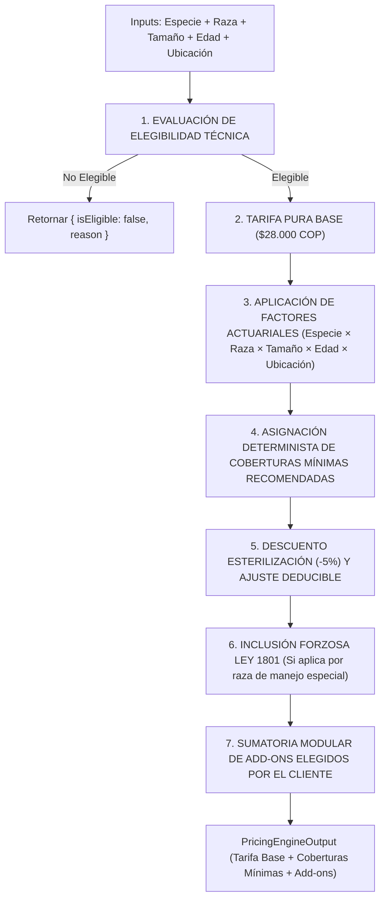

# Motor de Reglas de Seguros y Tarificación Determinista (Insurance Rules & Pricing Engine)
## Plataforma Insurtech Digital Multi-Ramo (Manto 2.0)
**Rol:** Insurance Product + Pricing Engineer  
**Versión de Reglas:** `PET_RULES_v1.0.0`  
**Fecha:** Septiembre 2026  
**Mercado Objetivo:** Colombia (COP)  
**Estado:** Especificación Aprobada para Implementación  

---

## 1. El Principio Fundamental de Determinismo

> [!CRITICAL]
> **DOCTRINA DETERMINISTA INQUEBRANTABLE**:
> **La Inteligencia Artificial NUNCA debe determinar, alterar o inferir autónomamente primas, deducibles, copagos o valores de indemnización.**
> 
> * **Rol de la IA**: Actúa únicamente como proveedor de **entradas estructuradas** (ej. especie detectada, raza inferida con puntaje de confianza, edad aparente, datos extraídos de una factura DIAN vía OCR).
> * **Rol del Motor de Reglas**: Aplica reglas matemáticas, matrices de riesgo y tablas actuariales explícitas, versionadas e inmutables.
> * **Reproducibilidad Garantizada**:
>   $$\text{ENTRADAS} + \text{VERSIÓN\_PRODUCTO} + \text{VERSIÓN\_REGLAS} \equiv \text{MISMO RESULTADO FINANCIERO}$$

---

## 2. Versionamiento de Productos y Reglas (Product & Rules Versioning)

Para garantizar la estabilidad contractual y regulatoria en Colombia:
1. **Identificadores Inmutables de Versión**:
   * Cada producto y conjunto de reglas se versiona formalmente (ej. `PET_STANDARD_v1`, `PET_STANDARD_v2`, `PET_PREMIUM_v1`).
2. **Principio de No Retroactividad**:
   * Toda póliza emitida queda asociada de por vida a la versión exacta del producto y reglas bajo la cual fue perfeccionada:
     $$\text{Policy.rulesVersion} = \text{Quote.rulesVersion}$$
   * La actualización de tablas actuariales, factores de raza o tarifas base para nuevos clientes **NUNCA modifica retroactivamente las pólizas vigentes**.
3. **Vigencia Temporal de Cotizaciones**:
   * Las cotizaciones (`Quotes`) congelan la versión de las reglas y los valores calculados durante **15 días calendario**. Pasado este tiempo, la cotización expira y debe recalcularse con la versión vigente.

---

## 3. Interfaces de Tipos del Motor de Tarificación (TypeScript Engine Contracts)

```typescript
### 3. Interfaces de Tipos del Motor de Tarificación Dinámica (TypeScript Engine Contracts)

```typescript
// packages/insurance-engine/src/interfaces/pricing-engine.interface.ts

export type ColombianPeso = number & { readonly __brand: unique symbol };

export type SizeCategory = 'TOY' | 'SMALL' | 'MEDIUM' | 'LARGE' | 'GIANT';

export interface PricingEngineInput {
  readonly productId: string;               // e.g. 'PET_CARE'
  readonly productVersion: string;         // e.g. 'PET_STANDARD_v1'
  readonly species: 'DOG' | 'CAT';
  readonly breedId: string;                 // ID normalizado en catálogo actuarial
  readonly sizeCategory: SizeCategory;      // Clasificación por peso/talla
  readonly ageInMonths: number;            // Edad confirmada por el usuario
  readonly gender?: 'MALE' | 'FEMALE';
  readonly locationCity: string;           // 'BOGOTA', 'MEDELLIN', 'CALI', 'OTHER'
  readonly isSterilized: boolean;          // Aplica descuento preventivo del 5%
  readonly selectedDeductiblePercentage: 10 | 15 | 20; // 10%, 15% o 20%
  readonly billingFrequency: 'MONTHLY' | 'ANNUAL';
  readonly selectedAddonCodes?: string[];  // Add-ons modulares elegidos por el usuario
}

export interface MinimumBaselineCoverage {
  readonly code: string;
  readonly name: string;
  readonly annualLimitCop: ColombianPeso;
  readonly eventLimitCop?: ColombianPeso;
  readonly waitingPeriodDays: number;
  readonly isMandatoryLegal: boolean;       // true si es Ley 1801 RCE
  readonly rationale: string;              // Justificación actuarial por raza/tamaño/edad
}

export interface CalculationTraceMetadata {
  readonly rulesVersion: string;
  readonly pureBaseRateCop: number;
  readonly speciesFactor: number;
  readonly breedFactor: number;
  readonly sizeFactor: number;             // Factor según categoría de peso
  readonly ageFactor: number;
  readonly locationFactor: number;
  readonly sterilizationDiscountApplied: number; // e.g. 0.05
  readonly deductibleAdjustmentFactor: number;   // 10%: 1.15, 15%: 1.00, 20%: 0.88
  readonly netTailoredBasePremiumCop: number;
  readonly minimumCoveragesAssigned: MinimumBaselineCoverage[];
  readonly addonsBreakdown: Array<{
    readonly code: string;
    readonly name: string;
    readonly monthlyPriceCop: number;
    readonly isMandatory: boolean;
  }>;
  readonly totalAddonsMonthlyCop: number;
  readonly annualDiscountMonthsFree: number;    // 1 mes gratis en pago anual
  readonly timestamp: string;                   // ISO 8601 UTC
}

export interface PricingEngineOutput {
  readonly isEligible: boolean;
  readonly ineligibilityReason?: string;
  readonly currency: 'COP';
  readonly tailoredBaseMonthlyPremiumCop: ColombianPeso; // Tarifa base calculada
  readonly totalMonthlyPremiumCop: ColombianPeso;        // Tarifa base + Add-ons seleccionados
  readonly totalAnnualPremiumCop: ColombianPeso;
  readonly appliedDeductiblePercentage: number;
  readonly minDeductibleCop: ColombianPeso;
  readonly baselineAnnualCoverageLimitCop: ColombianPeso;
  readonly minimumBaselineCoverages: MinimumBaselineCoverage[];
  readonly selectedAddons: Array<{
    readonly code: string;
    readonly name: string;
    readonly monthlyPriceCop: ColombianPeso;
    readonly isMandatory: boolean;
  }>;
  readonly availableAddonsForExpansion: Array<{
    readonly code: string;
    readonly name: string;
    readonly monthlyPriceCop: ColombianPeso;
    readonly description: string;
  }>;
  readonly waitingPeriodsSummary: Record<string, number>;
  readonly explicitExclusionsReference: string[];
  readonly productVersion: string;
  readonly rulesVersion: string;
  readonly calculationMetadata: CalculationTraceMetadata;
}
```

---

## 4. Pipeline de Evaluación de Cotización a la Medida (Tailored Baseline Pipeline)



### 4.1 Paso 1: Evaluación de Elegibilidad
* Especie admitida (`DOG` | `CAT`).
* Edad biológica: $\ge 8$ semanas (56 días) y $\le 8$ años (107 meses).

### 4.2 Paso 2 y 3: Tarifa Pura y Factores de Riesgo Multiplicativos

$$\text{TarifaBaseNeta} = \text{TasaPura} \times F_{\text{especie}} \times F_{\text{raza}} \times F_{\text{tamaño}} \times F_{\text{edad}} \times F_{\text{ubicación}} \times (1 - D_{\text{esterilizado}}) \times F_{\text{deducible}}$$

* **Tasa Pura Base**: COP $28.000$ / mes.
* **1. Factor Especie ($F_{\text{especie}}$)**:
  * Perro (`DOG`): $1.00$
  * Gato (`CAT`): $0.90$
* **2. Factor Raza ($F_{\text{raza}}$)**:
  * Nivel 1 (Criollos / Mestizos): $0.95$
  * Nivel 2 (Labrador, Golden, Schnauzer): $1.00$
  * Nivel 3 (Braquicéfalos / Bulldog Francés, Pug, Gato Persa): $1.35$
  * Nivel 4 (Razas Gigantes / Gran Danés, San Bernardo): $1.40$
* **3. Factor Tamaño / Peso ($F_{\text{tamaño}}$)**:
  * `TOY` ($\le 5\text{ kg}$): $0.95$ (Menor dosis farmacológica, menor costo de anestesia)
  * `SMALL` ($5-10\text{ kg}$): $1.00$ (Peso de referencia estándar)
  * `MEDIUM` ($10-25\text{ kg}$): $1.05$
  * `LARGE` ($25-45\text{ kg}$): $1.15$ (Mayor exposición a displasia y aranceles quirúrgicos)
  * `GIANT` ($>45\text{ kg}$): $1.30$ (Alta frecuencia de torsión gástrica y costos de hospitalización)
* **4. Factor Edad ($F_{\text{edad}}$)**:
  * $2 \text{ a } 11 \text{ meses}$ (Cachorro/Gatito): $1.08$
  * $12 \text{ a } 48 \text{ meses}$ (Adulto joven): $1.00$
  * $49 \text{ a } 84 \text{ meses}$ (Adulto maduro): $1.25$
  * $85 \text{ a } 107 \text{ meses}$ (Senior): $1.65$
* **5. Factor Geográfico ($F_{\text{ubicación}}$)**:
  * Bogotá D.C.: $1.05$ | Medellín y Cali: $1.00$ | Otras ciudades de Colombia: $0.95$
* **6. Descuento por Esterilización**: Si `isSterilized == true`: Descuento del $5\%$ ($0.05$).
* **7. Ajuste por Deducible**: 10% ($1.15$) | 15% ($1.00$) | 20% ($0.88$).

### 4.3 Paso 4: Asignación Determinista de Coberturas Mínimas
El actuario calibra el paquete de protección base esencial que se entrega a este precio:
1. **Accidentes y Urgencias Vitales**: Hasta COP $3.500.000$ / año (Carencia: 48h).
2. **Consultas de Urgencia**: 3 eventos al año (Carencia: 48h).
3. **Estabilización y Cirugía de Urgencia**: Cubierto dentro del límite de accidentes.
4. **Sublímite Específico de Raza/Tamaño**:
   * Razas Braquicéfalas $\to$ Sublímite respiratorio de emergencia activado.
   * Razas Grandes / Gigantes $\to$ Sublímite de torsión gástrica y fracturas activado.
   * Razas de Manejo Especial (Ley 1801) $\to$ **RCE obligatoria de 50 SMLMV anexada por ley**.

### 4.4 Paso 5: Expansión Modular mediante Add-ons
A partir de su tarifa base personalizada, el cliente añade libremente:
* **Asistencia Exequial y Cremación**: +$9.900 / mes.
* **Telemedicina Veterinaria 24/7**: +$6.900 / mes.
* **Cobertura de Enfermedades Comunes**: +$24.900 / mes (Ampliación integral).
* **Medicamentos Ambulatorios**: +$12.900 / mes.
* **Guardería Canina por Hospitalización del Tomador**: +$4.900 / mes.

---

## 5. Algoritmo Determinista de Liquidación de Siniestros (Claim Reimbursement Engine)

### 5.1 Flujo Matemático de Liquidación
Toda orden de reembolso se calcula de forma reproducible bajo el siguiente flujo:

```
[Gasto Facturado] 
       │
       ▼ (1. Filtrar partidas no cubiertas y validar CUFE DIAN)
[Gasto Elegible] 
       │
       ▼ (2. Aplicar Deducible = max(GastoElegible * %deducible, MinDeducible))
[Base Liquidada = max(0, GastoElegible - Deducible)]
       │
       ▼ (3. Aplicar Copago si aplica)
[Neto Previo Límite]
       │
       ▼ (4. Validar saldo disponible de la póliza = LimiteAnual - ConsumoPrevio)
[Reembolso Final Aprobado COP] = min(Neto Previo Límite, SaldoDisponible)
```

### 5.2 Contratos TypeScript del Motor de Siniestros

```typescript
export interface ClaimCalculationInput {
  readonly claimedItems: Array<{
    readonly itemDescription: string;
    readonly category: 'CONSULTA' | 'CIRUGIA' | 'EXAMEN' | 'MEDICAMENTO' | 'EXCLUIDO';
    readonly billedAmountCop: number;
    readonly isExplicitlyCovered: boolean;
  }>;
  readonly policyPlanDeductiblePercentage: number; // e.g. 10, 15, 20
  readonly policyMinDeductibleCop: number;         // e.g. 40000 COP
  readonly remainingAnnualCoverageLimitCop: number;// Saldo disponible en bolsa anual
  readonly eventSublimitCop?: number;             // Sublímite por evento si aplica
}

export interface ClaimCalculationOutput {
  readonly totalClaimedAmountCop: ColombianPeso;
  readonly eligibleAmountCop: ColombianPeso;
  readonly nonEligibleAmountCop: ColombianPeso;
  readonly appliedDeductibleCop: ColombianPeso;
  readonly netPayableAmountCop: ColombianPeso;
  readonly remainingLimitAfterClaimCop: ColombianPeso;
  readonly calculationTrace: {
    readonly itemsEvaluated: number;
    readonly deductiblePercentageUsed: number;
    readonly wasMinDeductibleEnforced: boolean;
    readonly wasSublimitCapEnforced: boolean;
  };
}
```

---

## 6. Catálogo de Exclusiones Explícitas (Sin Invenciones de Modelos)

Las siguientes exclusiones están taxativamente codificadas y no pueden ser modificadas por sugerencias de IA:

1. **Preexistencias (`EXC_PREEXISTING`)**: Enfermedades, signos clínicos o anomalías congénitas diagnosticadas o evidentes antes del inicio de vigencia de la póliza o durante el periodo de carencia.
2. **Cirugías Cosméticas o de Modificación (`EXC_COSMETIC`)**: Caudectomía (corte de cola), otectomía (corte de orejas), desungulación o cirugías sin fin reconstructivo o curativo.
3. **Reproducción y Gestación (`EXC_REPRODUCTION`)**: Inseminación artificial, fertilidad, partos electivos o cesáreas no accidentales.
4. **Alimentos y Dietas (`EXC_FOOD`)**: Concentrados medicados, dietas barf o suplementos nutricionales que no constituyan medicamentos intravenosos/intrahospitalarios de urgencia.
5. **Negligencia o Maltrato Probado (`EXC_NEGLECT`)**: Lesiones derivadas de peleas de perros clandestinas, maltrato animal tipificado en la Ley 1774 de 2016 o falta del esquema vacunal obligatorio.

---

## 7. Matriz Exhaustiva de Pruebas Unitarias Automatizadas (Test Plan)

El motor de reglas cuenta con las siguientes pruebas deterministas obligatorias:

| Categoría de Prueba | Caso de Entrada | Comportamiento Esperado |
| :--- | :--- | :--- |
| **Límite de Edad Inferior** | Cachorro de 7 semanas (49 días). | `isEligible === false`, Razón: edad mínima 8 semanas. |
| **Límite de Edad Superior** | Perro de 9 años y 1 mes (109 meses). | `isEligible === false`, Razón: edad máxima ingreso 8 años. |
| **Especie No Soportada** | Especie `'HORSE'` o `'PARROT'`. | `isEligible === false`, Razón: especie no admitida. |
| **Raza Manejo Especial Ley 1801** | Raza `'AMERICAN_PIT_BULL_TERRIER'`. | Inclusión forzosa de add-on `RCE_LEY_1801` con 50 SMLMV. |
| **Factor Braquicéfalo** | Bulldog Francés vs. Criollo. | Factor de raza = 1.35 para Bulldog Francés vs. 0.95 Criollo. |
| **Descuento Esterilización** | `isSterilized: true`. | Descuento exacto del 5% aplicado sobre prima neta. |
| **Doble Deducible** | Reclamo de $100.000 COP con deducible 15% (Mínimo $40.000). | Se aplica el mínimo legal ($40.000 COP), reembolso = $60.000 COP. |
| **Tope de Póliza** | Reclamo neto de $6.000.000 COP con saldo remanente de $3.000.000 COP. | Reembolso final topado exactamente a $3.000.000 COP. |
| **Invarianza de Cotización** | Mismas entradas con `PET_STANDARD_v1`. | Resultado numérico idéntico en el 100% de las ejecuciones. |
