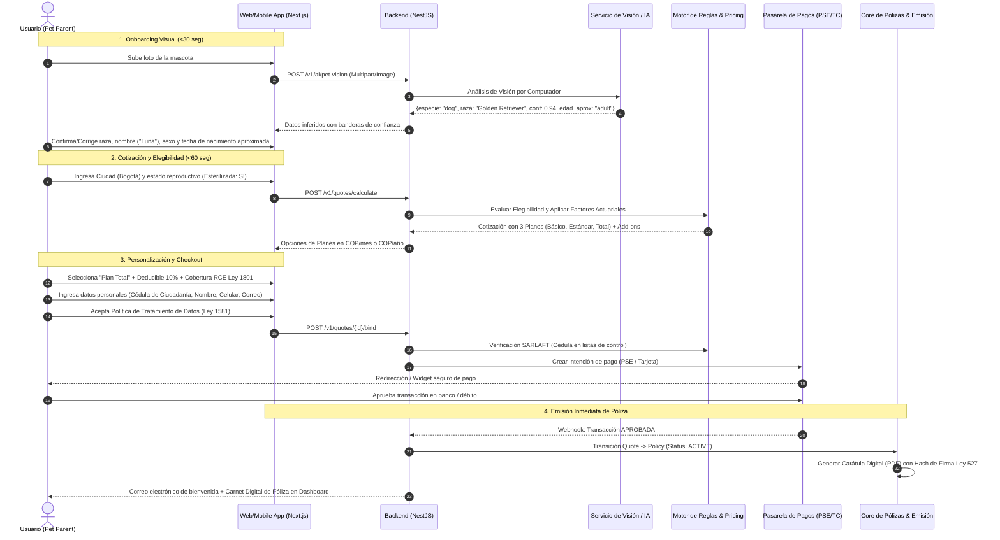

# Especificación de Producto (Product Specification)
## Plataforma Insurtech Digital Multi-Ramo (Manto 2.0)
**Versión:** 1.0.0  
**Fecha:** Septiembre 2026  
**Estado:** Aprobado para Arquitectura e Implementación  
**Autor:** CTO / Principal Software Architect  
**Mercado Inicial:** Colombia (Expansión Regional LatAm)  

---

## 1. Visión y Propuesta de Valor

### 1.1 Declaración de Misión
Construir la plataforma de seguros digitales líder en Colombia y América Latina, caracterizada por una experiencia de usuario radicalmente transparente, simple, móvil y veloz (cotización en menos de 60 segundos y liquidación de siniestros automatizada en minutos), inspirada en los estándares de excelencia de neoseguradoras globales pero adaptada a las particularidades socioeconómicas, de medios de pago y regulatorias del mercado local.

### 1.2 Principio de Arquitectura Multi-Ramo
Aunque el producto de lanzamiento es **Seguro para Mascotas (Perros y Gatos)**, la plataforma está diseñada desde el día cero como un motor desacoplado y extensible capaz de soportar múltiples líneas de negocio (LOBs) sin reescribir el núcleo transaccional ni el modelo de entidades:
1. **Mascotas (LOB 1 - MVP)**: Salud veterinaria, accidentes, enfermedades, responsabilidad civil extracontractual y asistencias.
2. **Hogar (LOB 2)**: Daños a la estructura, contenidos, hurto, responsabilidad civil familiar y asistencias domiciliarias.
3. **Autos / Movilidad (LOB 3)**: Pérdida total/parcial, RCE vehicular, asistencia en carretera y micro-movilidad.
4. **Viajes (LOB 4)**: Asistencia médica internacional, cancelación, pérdida de equipaje.
5. **Seguros Personales / Vida / Accidentes (LOB 5)**: Indemnización por accidentes personales, renta por hospitalización.

---

## 2. Contexto de Mercado: Colombia

### 2.1 Demografía y Oportunidad en Mascotas
* En Colombia, más del **60% de los hogares urbanos** (Bogotá, Medellín, Cali, Barranquilla, Bucaramanga) poseen al menos una mascota (estimado de más de 5 millones de perros y gatos en estratos 3, 4, 5 y 6).
* Menos del **3% de las mascotas en Colombia cuentan con una póliza de seguro formal**; la mayoría de propietarios asumen gastos veterinarios de bolsillo o contratan planes de asistencia limitados.
* El costo promedio de una urgencia veterinaria o procedimiento quirúrgico en ciudades principales oscila entre **COP $600,000 y COP $4,500,000**, representando un choque financiero significativo para las familias.

### 2.2 Separación Obligatoria: Requisitos Técnicos vs. Regulatorios

| Dimensión | Requisito Técnico (Technical Requirement) | Requisito Legal / Regulatorio en Colombia (Legal Requirement) |
| :--- | :--- | :--- |
| **Operación Aseguradora** | Integración por APIs y webhooks para sincronización de pólizas y reservas en tiempo real. | Requiere respaldo de una Compañía de Seguros vigilada por la **Superintendencia Financiera de Colombia (SFC)** o autorización en el Sandbox de la SFC. Nuestra figura inicial es **Agencia/Intermediario Digital de Seguros (MGA / Delegated Underwriting)**. |
| **Protección de Datos** | Cifrado AES-256 en reposo, TLS 1.3 en tránsito, logs inmutables de acceso y API de borrado de datos. | **Ley Estatutaria 1581 de 2012 (Habeas Data)**: Autorización previa, expresa e informada del titular; aviso de privacidad visible; registro ante el Registro Nacional de Bases de Datos (RNBD) de la SIC. |
| **Firma y Consentimiento** | Checkbox de aceptación de términos con captura de Hash SHA-256 de la carátula, IP, User-Agent y timestamp UTC. | **Ley 527 de 1999**: Validez probatoria de los mensajes de datos y firma electrónica no biométrica para perfeccionamiento del contrato de seguro. |
| **Razas de Manejo Especial** | Flag booleano `isSpecialHandlingBreed` en el modelo `Pet` y anexado forzoso de cobertura de RCE. | **Ley 1801 de 2016 (Código Nacional de Policía, Art. 127 y 128)**: Póliza obligatoria de Responsabilidad Civil Extracontractual para ejemplares caninos de manejo especial, con cobertura mínima legal de **50 SMLMV**. |
| **Facturación en Siniestros** | Extracción OCR de CUFE, NIT y valores en facturas electrónicas. | **Resolución DIAN**: La factura electrónica de venta con CUFE (Código Único de Facturación Electrónica) es el único soporte fiscalmente admisible para validar gastos y reembolsos en Colombia. |

---

## 3. Personas y Actores del Sistema

### 3.1 Clientes (Asegurados / Pet Parents)
* **Camila (28 años, Diseñadora UI, Bogotá)**: Vive con "Milo" (French Bulldog, 2 años). Valora la rapidez, la experiencia digital desde su celular y la cobertura de enfermedades respiratorias comunes en su raza. No quiere trámites en papel ni esperar 20 días por un reembolso.
* **Carlos (42 años, Ingeniero, Medellín)**: Dueño de "Apolo" (Rottweiler, 4 años). Necesita con urgencia la póliza de RCE obligatoria por la Ley 1801 de 2016 para inscribir a su perro en la Alcaldía, además de cobertura médica general.

### 3.2 Actores Internos (Operaciones y Negocio)
* **Underwriter / Suscriptor Técnico**: Define y ajusta tablas actuariales, factores de riesgo por raza, exclusiones y periodos de carencia en el Backoffice.
* **Claims Adjuster / Auditor Veterinario**: Revisa los siniestros que superan el umbral automático de STP (Straight-Through Processing) o que disparan alertas de fraude.
* **Compliance & Legal Officer**: Audita el cumplimiento de Habeas Data, SARLAFT (listas restrictivas) y reportes periódicos para la aseguradora aliada y la SFC.

---

## 4. Experiencia de Usuario de Punta a Punta (End-to-End User Journey)

---

## 5. El Producto de Seguro para Mascotas (MVP Scope)

### 5.1 Sujetos Asegurables
* **Especies Admitidas**: Caninos (*Canis lupus familiaris*) y Felinos (*Felis catus*).
* **Edad de Ingreso**: Desde las 8 semanas de vida hasta los 8 años y 364 días.
* **Permanencia / Renovación**: Renovación vitalicia garantizada sujeta a no fraude y pago oportuno de primas.

### 5.2 Estructura de Planes (Moneda: COP)

| Cobertura / Característica | Plan Esencial (Accidentes) | Plan Tranquilidad (Estándar) | Plan Total (Premium) |
| :--- | :--- | :--- | :--- |
| **Accidentes (Urgencias / Cirugías)** | Hasta COP $2,500,000 / año | Hasta COP $5,000,000 / año | Hasta COP $10,000,000 / año |
| **Enfermedades no preexistentes** | No cubierto | Hasta COP $3,500,000 / año | Hasta COP $7,000,000 / año |
| **Consultas Veterinarias** | 2 consultas por accidente | Hasta COP $300,000 / año | Hasta COP $600,000 / año |
| **Medicamentos Recetados** | No cubierto | Hasta COP $250,000 / año | Hasta COP $600,000 / año |
| **Exámenes Diagnósticos (Rayos X, Laboratorios)** | Cubierto dentro del límite de accidentes | Hasta COP $500,000 / año | Hasta COP $1,200,000 / año |
| **Deducible / Copago** | 20% o mín. COP $50,000 | 15% o mín. COP $50,000 | 10% o mín. COP $40,000 |
| **Periodo de Carencia (Accidentes)** | 48 horas | 48 horas | 24 horas |
| **Periodo de Carencia (Enfermedades)** | N/A | 15 días calendario | 14 días calendario |
| **Periodo de Carencia (Ligamento Cruzado / Osteoarticular)** | 6 meses | 6 meses | 6 meses |
| **Precio Base Estimado (Mes)** | Desde COP $29,900 / mes | Desde COP $59,900 / mes | Desde COP $99,900 / mes |

### 5.3 Coberturas Opcionales (Add-ons)
1. **Responsabilidad Civil Extracontractual (RCE) Mascotas (Ley 1801 de 2016)**:
   * Cobertura de daños a terceros (lesiones o muerte de personas, daños a bienes de terceros, ataques a otros animales).
   * Límite legal: 50 SMLMV (~COP $65,000,000) o 100 SMLMV.
   * Obligatorio y autoseleccionado si la raza es de manejo especial.
2. **Asistencia Exequial / Eutanasia / Cremación**:
   * Eutanasia humanitaria indicada por médico veterinario y servicio de cremación colectiva o individual con entrega de cenizas.
3. **Pérdida y Búsqueda de Mascota**:
   * Gastos de publicidad, carteles y recompensa hasta COP $500,000.
4. **Guardería Canina / Hotel Felino por Hospitalización del Propietario**:
   * Hasta COP $50,000 por noche (máximo 5 noches al año).

---

## 6. Flujo de Siniestros y Reembolsos (Claims & Reimbursements)

### 6.1 Modalidad de Atención: Reembolso Libre Elección + Red Aliada
* El cliente tiene **libertad absoluta** de atender a su mascota en cualquier clínica veterinaria legalmente constituida en Colombia.
* El cliente cancela el servicio en la clínica y solicita factura electrónica con su Cédula y CUFE.
* Presenta el reclamo digitalmente desde la plataforma en menos de 3 minutos.

### 6.2 Proceso de Reclamación en 3 Pasos
1. **Selección del Incidente**: Motivo (Accidente, Enfermedad, Chequeo de Bienestar, Terceros).
2. **Carga de Soportes**:
   * Factura Electrónica con CUFE (PDF o Foto).
   * Historia Clínica o Epicrisis detallando diagnóstico y tratamiento.
   * Fórmula médica (si aplica reembolso de medicamentos).
3. **Validación y Pago**:
   * El pipeline de IA ejecuta OCR y validación de campos fiscales en menos de 10 segundos.
   * Las reglas deterministas calculan el reembolso neto:
     $$\text{Reembolso} = (\text{Gasto Elegible} - \text{Deducible}) \times (1 - \text{Copago})$$
   * Si el monto es $\le$ COP $500,000 y el riesgo de fraude es bajo, se dispersa el dinero automáticamente vía transferencia interbancaria (ACH / Transfiya) en menos de 24 horas.

---

## 7. Métricas Clave de Rendimiento (KPIs)

* **Tiempo de Cotización (Time to Quote)**: $\le 60$ segundos desde la foto hasta ver el precio.
* **Tasa de Conversión de Cotización a Póliza (Quote-to-Bind)**: $\ge 12\%$.
* **Tasa de Procesamiento Directo de Siniestros (STP Claims Rate)**: $\ge 35\%$ de siniestros liquidados sin intervención humana manual.
* **Tiempo Promedio de Liquidación (Claims Turnaround Time)**:
  * Siniestros STP: $\le 6$ horas.
  * Siniestros con Auditoría Humana: $\le 48$ horas hábiles (muy inferior a los 30 días permitidos por el Código de Comercio de Colombia).
* **Net Promoter Score (NPS)**: $\ge 70$.
* **Siniestralidad Neta (Loss Ratio)**: Controlada entre $48\%$ y $56\%$.
