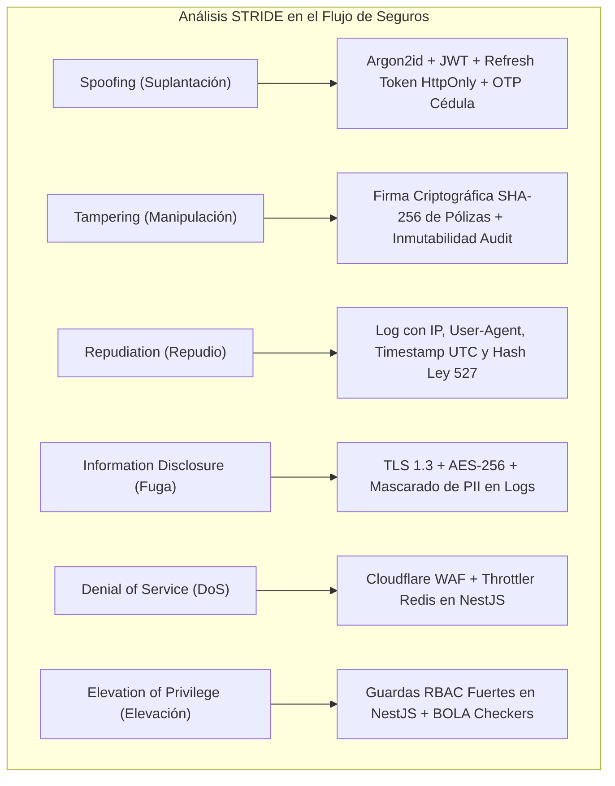
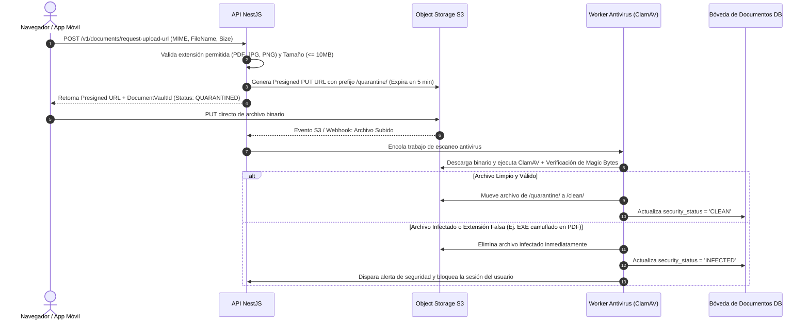

# Arquitectura de Seguridad y Cumplimiento (Security & Compliance)
## Plataforma Insurtech Digital Multi-Ramo (Manto 2.0)
**Versión:** 1.0.0  
**Fecha:** Septiembre 2026  
**Estado:** Aprobado para Implementación  
**Autor:** CTO / Principal Software Architect  

---

## 1. Marco Regulatorio y Legal de Seguridad en Colombia

| Requisito Técnico (Technical Requirement) | Requisito Legal / Regulatorio en Colombia (Legal Requirement) |
| :--- | :--- |
| **Cifrado de Base de Datos y Logs** | Cifrado en reposo AES-256 en PostgreSQL y S3; TLS 1.3 con HSTS en tránsito. | **Circular Básica Jurídica de la SFC (CE 029/2014, Parte I, Título II, Cap. I)**: Requisitos mínimos de seguridad y calidad en el manejo de información a través de medios electrónicos. |
| **Gestión de Consentimiento y Supresión** | Tabla `core.habeas_data_consents`, API de descarga de datos personales y proceso de anonimización post-vigencia. | **Ley Estatutaria 1581 de 2012 & Decreto 1377 de 2013 (Habeas Data)**: Principios de libertad, veracidad, transparencia, acceso y circulación restringida, seguridad y confidencialidad. |
| **Monitoreo de Listas Restrictivas** | Validación asíncrona de Cédula/NIT contra listas OFAC, Clinton, Contraloría y Procuraduría. | **Circular Externa 027 de 2020 de la SFC (SARLAFT 4.0)**: Sistema de Administración del Riesgo de Lavado de Activos y de la Financiación del Terrorismo. |
| **No Almacenamiento de Datos de Tarjetas** | Tokenización cliente-pasarela (Wompi) y almacenamiento exclusivo de tokens opacos y últimos 4 dígitos. | **PCI-DSS v4.0 & Estándares de Redes Financieras**: Exime a Manto del alcance SAQ D de PCI-DSS, reduciéndolo a SAQ A. |

---

## 2. Matriz de Control de Acceso Basado en Roles (RBAC)

La plataforma aplica el **Principio de Privilegio Mínimo (Least Privilege)** de forma rigurosa:

| Módulo / Recurso | `POLICYHOLDER` (Cliente) | `ADJUSTER` (Auditor) | `UNDERWRITER` (Suscriptor) | `ADMIN` (Operaciones) | `AUDITOR` (Cumplimiento) |
| :--- | :--- | :--- | :--- | :--- | :--- |
| **Mis Pólizas / Mascotas** | Lectura / Creación | Lectura | Lectura | Lectura | Lectura |
| **Pólizas Globales** | Denegado | Lectura | Lectura / Edición | Lectura / Gestión | Lectura |
| **Radicar Siniestro (FNOL)** | Creación (Propios) | Creación (Soporte) | Denegado | Denegado | Denegado |
| **Adjudicar / Liquidar Siniestro** | Denegado | Ejecución ($\le \$5M$) | Denegado | Ejecución (Ilimitado)| Denegado |
| **Configurar Tablas Actuariales** | Denegado | Denegado | Lectura / Edición | Aprobación | Lectura |
| **Dispersar Fondos Bancarios** | Denegado | Denegado | Denegado | Autorización | Denegado |
| **Logs de Auditoría Inmutables** | Denegado | Denegado | Denegado | Lectura | Lectura Completa |

---

## 3. Modelo de Amenazas (STRIDE Threat Model)

### Mitigaciones Críticas contra Vulnerabilidades Comunes
1. **Prevención de BOLA / IDOR (Broken Object Level Authorization)**:
   * Ningún controlador REST permite acceder o mutar una póliza o siniestro mediante su ID simple sin verificar que `entity.userId === currentUser.id` (excepto para roles administrativos autorizados).
2. **Inyección SQL**:
   * Uso exclusivo de ORM (TypeORM / Prisma) con consultas parametrizadas obligatorias. Prohibición estricta de concatenación de cadenas en sentencias SQL.
3. **Cross-Site Scripting (XSS) y CSRF**:
   * Encabezados de seguridad configurados con `Helmet` (Content Security Policy estricto, HSTS, X-Frame-Options: DENY).
   * Los tokens de sesión utilizan cookies con directiva `SameSite=Strict` y `Secure`.

---

## 4. Pipeline de Carga Segura de Documentos y Detección de Malware

Para evitar que actores maliciosos comprometan el backend mediante facturas o fotos infectadas:

---

## 5. Cumplimiento de Habeas Data (Ley Estatutaria 1581 de 2012)

### 5.1 Captura del Consentimiento Previo, Expreso e Informado
* En el momento del registro o cotización, el usuario debe marcar una casilla no pre-seleccionada aceptando la Política de Tratamiento de Datos Personales.
* La base de datos registra en `core.habeas_data_consents`:
  1. Identificador de usuario.
  2. Versión exacta del texto legal aceptado.
  3. Dirección IP y User-Agent.
  4. Marca de tiempo precisa (UTC).

### 5.2 Ejercicio del Derecho de Supresión vs. Deber Legal Asegurador
* **Regla Legal**: Si un usuario solicita la eliminación de sus datos ("Derecho de Supresión / Olvido"), pero mantiene una póliza activa o existen registros de siniestros sujetos a prescripción legal:
  * **No procede el borrado total inmediato**: El **Estatuto Orgánico del Sistema Financiero** y el **Código de Comercio de Colombia** obligan a conservar los registros contractuales y fiscales de seguros durante un mínimo de **10 años**.
  * **Respuesta Técnica**: Se desactiva la cuenta para fines de marketing y comunicaciones comerciales, se bloquea el acceso en la app y los datos se aíslan en estado archivado con acceso restringido exclusivo para requerimientos judiciales o de la SFC.
