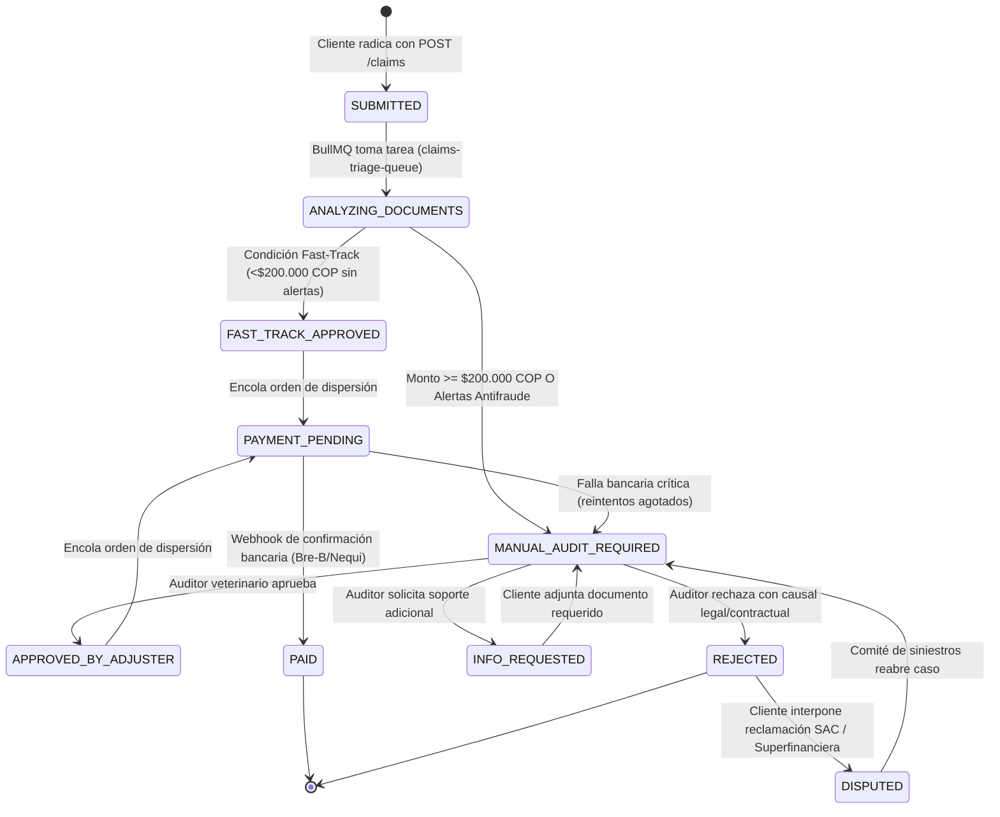

# Especificación Técnica Inmutable: Radicación, Triage y Pago de Siniestros (Claims & Payout Engine)
## Manto 2.0 — Plataforma Insurtech Multi-Ramo (Mascotas Colombia)
**Versión:** 1.1.0 — Blindada y Certificada por QA & Security (Fase 0)  
**Autor:** Principal Software & Solutions Architect (`software-architect`)  
**Auditor de Seguridad:** Principal QA + Security Engineer (Agente 7)  
**Receptor:** Multi-Agent Orchestrator (`orchestrator`) / Tech Lead (`tech-lead`)  
**Fecha:** Septiembre 2026  
**Estado:** CERTIFICADO PARA CONSTRUCCIÓN (FASE 0 COMPLETADA)  

---

## 1. Diagrama Conceptual de Componentes y Flujo de Datos (Architecture Flow)

Para cumplir con el SLA de **latencia < 400ms** en la API core y evitar congestión por transferencia de archivos binarios (imágenes de 5-15MB de celulares), la arquitectura aísla completamente la carga de archivos mediante **Presigned URLs directas a Cloudflare R2 / AWS S3**. La radicación del siniestro (`POST /claims`) encola el procesamiento asíncrono en **BullMQ + Redis**, permitiendo que la respuesta al cliente sea inmediata ($< 250\text{ms}$).

```mermaid
flowchart TD
    subgraph Cliente ["Frontend (Next.js 14 App Router)"]
        User["Asegurado (App Móvil / Web)"]
        Tracker["LiveClaimTracker (Polling / SSE)"]
    end

    subgraph Storage ["Almacenamiento Seguro de Objetos"]
        S3["Cloudflare R2 / AWS S3 (Bucket Privado)\nTiempo expiración Presigned URL: 15 min"]
    end

    subgraph APICore ["API Core (NestJS 10 Monolito Modular)"]
        DocController["ClaimsDocumentController\nPOST /claims/documents/presigned-url"]
        ClaimsController["ClaimsController\nPOST /claims\nGET /claims/:id/status"]
        ClaimsService["ClaimsService\n(Validación de Póliza, Carencias y Guardas)"]
        AuditLogger["AuditLogService\n(Append-Only Registro Inmutable)"]
    end

    subgraph AsyncPipeline ["Pipeline Asíncrono de Procesamiento"]
        Redis[("Redis 7.2 Cache & Queue")]
        BullMQ["BullMQ Queue: claims-triage-queue"]
        TriageWorker["ClaimsTriageWorker\n(Procesamiento Concurrente)"]
        AIService["AI Service (Gemini 3.6 Flash / OCR)\nExtracción NIT, Factura, Items y CUFE"]
        AntiFraud["AntiFraudEngine\n(Hash SHA-256, Duplicidad y Listas Negras)"]
        TriageEngine["TriageEngine (Motor Determinista)\nFast-Track (< $200.000) vs Manual"]
    end

    subgraph Database ["Persistencia Relacional Transaccional"]
        PG[("PostgreSQL 16\nEsquema: claims\nClaves: UUIDv7 | Moneda: ColombianPeso")]
    end

    subgraph PayoutGateways ["Canales de Dispersión Financiera"]
        PayoutService["PayoutService (Idempotente)"]
        BreB["Bre-B (Banco de la República)"]
        NequiDaviplata["Nequi / Daviplata / ACH"]
    end

    %% Flujo 1: Presigned URL
    User -->|1. Solicita URL de subida con checksum SHA-256| DocController
    DocController -->|2. Retorna Presigned URL efímera| User
    User -->|3. PUT directo binario (sin tocar memoria del backend)| S3

    %% Flujo 2: Radicación FNOL
    User -->|4. POST /claims con metadatos y IDs de soporte| ClaimsController
    ClaimsController --> ClaimsService
    ClaimsService -->|5. Valida vigencia, morosidad y carencia| PG
    ClaimsService -->|6. Inserta claim en estado SUBMITTED| PG
    ClaimsService -->|7. Encola tarea en Redis| BullMQ
    ClaimsService -->|8. Retorna 201 Created con claimId y hito inicial| User

    %% Flujo 3: Triage Asíncrono
    BullMQ --> TriageWorker
    TriageWorker -->|9. Lee metadatos e imagen de S3| S3
    TriageWorker -->|10. Ejecuta OCR y extracción estructurada| AIService
    TriageWorker -->|11. Calcula hash único y valida colisiones| AntiFraud
    TriageWorker -->|12. Ejecuta reglas de Triage| TriageEngine

    TriageEngine -->|13a. Fast-Track: Monto < $200k & 0 alertas| PG
    TriageEngine -->|13b. Manual Audit: Monto >= $200k o alerta| PG
    TriageWorker -->|14. Registra evento de auditoría inmutable| AuditLogger
    AuditLogger --> PG

    %% Flujo 4: Dispersión
    TriageEngine -->|15. Si es Fast-Track -> Desencadena pago automático| PayoutService
    PayoutService -->|16. Orden de dispersión vía Bre-B / Nequi| BreB
    PayoutService --> NequiDaviplata
    PayoutService -->|17. Registra payout_record| PG

    %% Flujo 5: Tracker en vivo
    Tracker -->|18. GET /claims/:id/status| ClaimsController
    ClaimsController -->|19. Retorna timeline en vivo y estado| Tracker
```

---

## 2. Modelo de Datos Relacional (DDL PostgreSQL 16)

### Principios del Modelo:
1. **Identificadores UUIDv7:** Claves primarias cronológicamente indexadas de alto rendimiento (orden natural B-Tree).
2. **Dinero Entero en COP (`BIGINT`):** Sin flotantes ni redondeos arbitrarios.
3. **Control de Concurrencia Optimista (OCC):** Columna `version` en `claims` y `payout_records`.
4. **Idempotencia Estructural:** Restricciones `UNIQUE` en `idempotency_key` y `invoice_sha256_hash`.
5. **Auditoría Append-Only:** Prohibido el `UPDATE` o `DELETE` en `claim_audit_logs`.

```sql
-- =============================================================================
-- MIGRACIÓN DDL: RADICACIÓN, TRIAGE Y PAGO DE SINIESTROS
-- Esquema: claims
-- Motor: PostgreSQL 16+
-- =============================================================================

CREATE SCHEMA IF NOT EXISTS claims;

-- -----------------------------------------------------------------------------
-- 1. ENUMS CANÓNICOS
-- -----------------------------------------------------------------------------
DO $$ BEGIN
    CREATE TYPE claims.claim_status_enum AS ENUM (
        'DRAFT',
        'SUBMITTED',
        'ANALYZING_DOCUMENTS',
        'FAST_TRACK_APPROVED',
        'MANUAL_AUDIT_REQUIRED',
        'APPROVED_BY_ADJUSTER',
        'REJECTED',
        'INFO_REQUESTED',
        'PAYMENT_PENDING',
        'PAID',
        'DISPUTED'
    );
EXCEPTION WHEN duplicate_object THEN NULL; END $$;

DO $$ BEGIN
    CREATE TYPE claims.triage_route_enum AS ENUM (
        'FAST_TRACK',
        'MANUAL_AUDIT'
    );
EXCEPTION WHEN duplicate_object THEN NULL; END $$;

DO $$ BEGIN
    CREATE TYPE claims.incident_type_enum AS ENUM (
        'ACCIDENT',
        'COMMON_ILLNESS',
        'EMERGENCY_CONSULTATION',
        'CIVIL_LIABILITY_1801',
        'PREVENTIVE_WELLNESS'
    );
EXCEPTION WHEN duplicate_object THEN NULL; END $$;

DO $$ BEGIN
    CREATE TYPE claims.document_type_enum AS ENUM (
        'DIAN_INVOICE',
        'MEDICAL_HISTORY_EPICRISIS',
        'LAB_RESULTS',
        'PRESCRIPTION',
        'INCIDENT_PHOTO'
    );
EXCEPTION WHEN duplicate_object THEN NULL; END $$;

DO $$ BEGIN
    CREATE TYPE claims.payout_channel_enum AS ENUM (
        'NEQUI',
        'DAVIPLATA',
        'BRE_B',
        'BANK_TRANSFER_ACH'
    );
EXCEPTION WHEN duplicate_object THEN NULL; END $$;

DO $$ BEGIN
    CREATE TYPE claims.payout_status_enum AS ENUM (
        'SCHEDULED',
        'PROCESSING',
        'SETTLED',
        'FAILED',
        'REVERSED'
    );
EXCEPTION WHEN duplicate_object THEN NULL; END $$;

DO $$ BEGIN
    CREATE TYPE claims.audit_actor_type_enum AS ENUM (
        'POLICYHOLDER',
        'SYSTEM_AI',
        'TRIAGE_ENGINE',
        'VET_ADJUSTER',
        'FINANCE_OPERATOR',
        'ADMIN'
    );
EXCEPTION WHEN duplicate_object THEN NULL; END $$;

-- -----------------------------------------------------------------------------
-- 2. TABLA: claims (Radicación principal del siniestro)
-- -----------------------------------------------------------------------------
CREATE TABLE IF NOT EXISTS claims.claims (
    id UUID PRIMARY KEY, -- UUIDv7
    claim_number VARCHAR(32) NOT NULL UNIQUE, -- Formato: CLM-YYYYMMDD-XXXX
    policy_id UUID NOT NULL REFERENCES insurance.policies(id) ON DELETE RESTRICT,
    user_id UUID NOT NULL REFERENCES core.users(id) ON DELETE RESTRICT,
    incident_type claims.incident_type_enum NOT NULL,
    incident_date TIMESTAMPTZ NOT NULL,
    description TEXT NOT NULL,
    vet_clinic_nit VARCHAR(20) NOT NULL,
    vet_clinic_name VARCHAR(150) NOT NULL,
    
    -- Montos en ColombianPeso (Enteros BIGINT sin decimales)
    claimed_amount_cop BIGINT NOT NULL CHECK (claimed_amount_cop > 0),
    approved_amount_cop BIGINT NOT NULL DEFAULT 0 CHECK (approved_amount_cop >= 0),
    deductible_cop BIGINT NOT NULL DEFAULT 0 CHECK (deductible_cop >= 0),
    copay_cop BIGINT NOT NULL DEFAULT 0 CHECK (copay_cop >= 0),
    net_payable_amount_cop BIGINT NOT NULL DEFAULT 0 CHECK (net_payable_amount_cop >= 0),
    
    -- Restricciones de Integridad Actuarial y Financiera
    CONSTRAINT chk_claims_approved_le_claimed CHECK (approved_amount_cop <= claimed_amount_cop),
    CONSTRAINT chk_claims_net_payable_le_approved CHECK (net_payable_amount_cop <= approved_amount_cop),
    
    -- Estados y Triage
    status claims.claim_status_enum NOT NULL DEFAULT 'SUBMITTED',
    triage_route claims.triage_route_enum NULL,
    triage_reasons JSONB NOT NULL DEFAULT '[]'::jsonb,
    fraud_risk_score NUMERIC(5, 2) NOT NULL DEFAULT 0.00 CHECK (fraud_risk_score >= 0 AND fraud_risk_score <= 100),
    
    -- Datos DIAN y Prevención Antifraude
    dian_cufe VARCHAR(255) NULL,
    invoice_number VARCHAR(50) NULL,
    invoice_sha256_hash CHAR(64) NULL, -- Hash único del archivo de factura
    
    -- Adjudicación Manual
    adjuster_id UUID NULL REFERENCES core.users(id) ON DELETE SET NULL,
    rejection_reason TEXT NULL,
    internal_notes TEXT NULL,
    
    -- Garantías de Concurrencia e Idempotencia
    version INTEGER NOT NULL DEFAULT 1,
    idempotency_key VARCHAR(128) NOT NULL UNIQUE,
    
    -- Trazabilidad Temporal
    created_at TIMESTAMPTZ NOT NULL DEFAULT NOW(),
    updated_at TIMESTAMPTZ NOT NULL DEFAULT NOW()
);

-- Índices de alto rendimiento y unicidad estricta para claims
CREATE INDEX IF NOT EXISTS idx_claims_policy_id ON claims.claims (policy_id);
CREATE INDEX IF NOT EXISTS idx_claims_user_id ON claims.claims (user_id);
CREATE INDEX IF NOT EXISTS idx_claims_status ON claims.claims (status);
CREATE INDEX IF NOT EXISTS idx_claims_created_at_desc ON claims.claims (created_at DESC);

-- Blindaje BUG-CRIT-02: Unicidad global de CUFE DIAN (excluyendo siniestros rechazados/disputados)
CREATE UNIQUE INDEX IF NOT EXISTS uq_claims_dian_cufe_global 
ON claims.claims (dian_cufe) 
WHERE dian_cufe IS NOT NULL AND status NOT IN ('REJECTED', 'DISPUTED');

-- Blindaje Antifraude: Hash único de archivo permitiendo reintentos en siniestros rechazados
CREATE UNIQUE INDEX IF NOT EXISTS uq_claims_invoice_hash 
ON claims.claims (invoice_sha256_hash) 
WHERE invoice_sha256_hash IS NOT NULL AND status NOT IN ('REJECTED', 'DISPUTED');

-- -----------------------------------------------------------------------------
-- 3. TABLA: claim_documents (Bóveda de soportes y facturas)
-- -----------------------------------------------------------------------------
CREATE TABLE IF NOT EXISTS claims.claim_documents (
    id UUID PRIMARY KEY, -- UUIDv7
    claim_id UUID NULL REFERENCES claims.claims(id) ON DELETE CASCADE,
    user_id UUID NOT NULL REFERENCES core.users(id) ON DELETE RESTRICT, -- Blindaje BOLA/IDOR (Habeas Data)
    session_id VARCHAR(64) NULL, -- UUID de sesión temporal antes de radicación formal
    document_type claims.document_type_enum NOT NULL,
    
    -- Ubicación en Almacenamiento Seguro (Cloudflare R2 / AWS S3)
    s3_bucket VARCHAR(100) NOT NULL,
    s3_key VARCHAR(500) NOT NULL UNIQUE,
    file_name VARCHAR(255) NOT NULL,
    mime_type VARCHAR(100) NOT NULL,
    file_size_bytes BIGINT NOT NULL CHECK (file_size_bytes > 0 AND file_size_bytes <= 26214400), -- Máx 25MB
    sha256_checksum CHAR(64) NOT NULL,
    upload_status VARCHAR(20) NOT NULL DEFAULT 'PENDING' CHECK (upload_status IN ('PENDING', 'UPLOADED', 'REJECTED')),
    
    -- Resultado del Escaneo OCR / AI
    ocr_status VARCHAR(20) NOT NULL DEFAULT 'PENDING' CHECK (ocr_status IN ('PENDING', 'PROCESSING', 'EXTRACTED', 'FAILED')),
    ocr_confidence NUMERIC(4, 3) NULL CHECK (ocr_confidence >= 0 AND ocr_confidence <= 1),
    ocr_extracted_data JSONB NOT NULL DEFAULT '{}'::jsonb,
    
    -- Seguridad y Aislamiento
    is_quarantined BOOLEAN NOT NULL DEFAULT FALSE,
    antivirus_scan_passed BOOLEAN NOT NULL DEFAULT FALSE,
    
    created_at TIMESTAMPTZ NOT NULL DEFAULT NOW()
);

CREATE INDEX IF NOT EXISTS idx_claim_docs_claim_id ON claims.claim_documents (claim_id);
CREATE INDEX IF NOT EXISTS idx_claim_docs_user_id ON claims.claim_documents (user_id);
CREATE INDEX IF NOT EXISTS idx_claim_docs_session_id ON claims.claim_documents (session_id) WHERE session_id IS NOT NULL;
CREATE INDEX IF NOT EXISTS idx_claim_docs_sha256 ON claims.claim_documents (sha256_checksum);

-- -----------------------------------------------------------------------------
-- 4. TABLA: claim_audit_logs (Trazabilidad Inmutable Append-Only)
-- -----------------------------------------------------------------------------
CREATE TABLE IF NOT EXISTS claims.claim_audit_logs (
    id UUID PRIMARY KEY, -- UUIDv7
    claim_id UUID NOT NULL REFERENCES claims.claims(id) ON DELETE RESTRICT,
    actor_type claims.audit_actor_type_enum NOT NULL,
    actor_id VARCHAR(64) NOT NULL, -- ID del usuario, 'SYSTEM' o ID del worker
    action VARCHAR(50) NOT NULL, -- ej. 'CLAIM_SUBMITTED', 'TRIAGE_EVALUATED', 'STATUS_TRANSITION'
    previous_status claims.claim_status_enum NULL,
    new_status claims.claim_status_enum NULL,
    reason TEXT NULL,
    metadata JSONB NOT NULL DEFAULT '{}'::jsonb,
    ip_address INET NULL,
    user_agent TEXT NULL,
    created_at TIMESTAMPTZ NOT NULL DEFAULT NOW()
);

CREATE INDEX IF NOT EXISTS idx_claim_audit_claim_id ON claims.claim_audit_logs (claim_id, created_at ASC);

-- Trigger de Inmutabilidad para Auditoría: Prohíbe UPDATE y DELETE
CREATE OR REPLACE FUNCTION claims.trg_enforce_audit_immutability()
RETURNS TRIGGER AS $$
BEGIN
    RAISE EXCEPTION 'Operación denegada: Los registros de claim_audit_logs son inmutables (Append-Only)';
END;
$$ LANGUAGE plpgsql;

DROP TRIGGER IF EXISTS trg_protect_claim_audit_logs ON claims.claim_audit_logs;
CREATE TRIGGER trg_protect_claim_audit_logs
BEFORE UPDATE OR DELETE ON claims.claim_audit_logs
FOR EACH ROW EXECUTE FUNCTION claims.trg_enforce_audit_immutability();

-- Blindaje SFC: Prohibición de vaciado masivo vía TRUNCATE
DROP TRIGGER IF EXISTS trg_protect_claim_audit_logs_truncate ON claims.claim_audit_logs;
CREATE TRIGGER trg_protect_claim_audit_logs_truncate
BEFORE TRUNCATE ON claims.claim_audit_logs
FOR EACH STATEMENT EXECUTE FUNCTION claims.trg_enforce_audit_immutability();

-- -----------------------------------------------------------------------------
-- 5. TABLA: payout_records (Dispersión financiera e indemnizaciones)
-- -----------------------------------------------------------------------------
CREATE TABLE IF NOT EXISTS claims.payout_records (
    id UUID PRIMARY KEY, -- UUIDv7
    claim_id UUID NOT NULL UNIQUE REFERENCES claims.claims(id) ON DELETE RESTRICT,
    policy_id UUID NOT NULL REFERENCES insurance.policies(id) ON DELETE RESTRICT,
    user_id UUID NOT NULL REFERENCES core.users(id) ON DELETE RESTRICT,
    
    amount_cop BIGINT NOT NULL CHECK (amount_cop > 0),
    channel claims.payout_channel_enum NOT NULL,
    
    -- Datos de destino: Encriptado para dispersión y enmascarado para UI (Habeas Data)
    account_identifier_encrypted TEXT NOT NULL, -- AES-256-GCM para gateway bancario
    account_identifier_masked VARCHAR(50) NOT NULL, -- ej. '310****123' o 'Ahorros Bancolombia ****4567'
    account_holder_national_id VARCHAR(50) NOT NULL,
    bank_code VARCHAR(20) NULL, -- Código compensación ACH / Bre-B
    account_type VARCHAR(20) NULL CHECK (account_type IN ('SAVINGS', 'CHECKING', 'WALLET', 'BRE_B_KEY')),
    
    -- Integración con Pasarela de Dispersión (Bre-B / Nequi / ACH)
    provider_transaction_id VARCHAR(128) NULL UNIQUE,
    idempotency_key VARCHAR(128) NOT NULL UNIQUE,
    status claims.payout_status_enum NOT NULL DEFAULT 'SCHEDULED',
    
    settled_at TIMESTAMPTZ NULL,
    failure_code VARCHAR(50) NULL,
    failure_reason TEXT NULL,
    retry_count INTEGER NOT NULL DEFAULT 0 CHECK (retry_count >= 0 AND retry_count <= 5),
    
    version INTEGER NOT NULL DEFAULT 1,
    created_at TIMESTAMPTZ NOT NULL DEFAULT NOW(),
    updated_at TIMESTAMPTZ NOT NULL DEFAULT NOW()
);

CREATE INDEX IF NOT EXISTS idx_payout_records_status ON claims.payout_records (status);
CREATE INDEX IF NOT EXISTS idx_payout_records_claim_id ON claims.payout_records (claim_id);

-- Trigger de Actualización Automática de updated_at
CREATE OR REPLACE FUNCTION claims.trg_auto_update_timestamp()
RETURNS TRIGGER AS $$
BEGIN
    NEW.updated_at = NOW();
    RETURN NEW;
END;
$$ LANGUAGE plpgsql;

DROP TRIGGER IF EXISTS trg_claims_updated_at ON claims.claims;
CREATE TRIGGER trg_claims_updated_at
BEFORE UPDATE ON claims.claims
FOR EACH ROW EXECUTE FUNCTION claims.trg_auto_update_timestamp();

DROP TRIGGER IF EXISTS trg_payout_records_updated_at ON claims.payout_records;
CREATE TRIGGER trg_payout_records_updated_at
BEFORE UPDATE ON claims.payout_records
FOR EACH ROW EXECUTE FUNCTION claims.trg_auto_update_timestamp();
```

---

## 3. Máquina de Estados Finita y Lógica de Triage (Fast-Track vs Auditoría Manual)



### Reglas Booleanas Estrictas de Triage:

Un siniestro es calificado como **`FAST_TRACK`** si y solo si satisface simultáneamente el 100% de las siguientes condiciones:

$$\text{FastTrackEligible} = \bigwedge \begin{cases}
1. & \text{claimed\_amount\_cop} < 200.000 \text{ COP} \\
2. & \text{policy\_status} = \text{'ACTIVE'} \wedge \text{has\_no\_overdue\_premiums} \\
3. & \text{waiting\_period\_satisfied} = \text{TRUE (Evaluado según tipo de incidente)} \\
4. & \text{invoice\_sha256\_unique} = \text{TRUE (Cero colisiones históricas en siniestros activos/pagados)} \\
5. & \text{dian\_cufe\_verified} = \text{TRUE} \wedge \text{cufe\_not\_reused} \\
6. & \text{ocr\_confidence} \ge 0.85 \\
7. & \text{fraud\_risk\_score} < 10.00 \\
8. & \text{vet\_clinic\_blacklisted} = \text{FALSE} \\
9. & \text{claimed\_amount\_cop} \le \text{ocr\_extracted\_total\_cop} \text{ (Cero inflación de factura)} \\
10. & \text{incident\_date} \ge \text{policy\_effective\_date} \wedge \text{incident\_date} \le \text{NOW()}
\end{cases}$$

Si **cualquiera** de estas condiciones falla, el sistema enruta obligatoriamente a **`MANUAL_AUDIT_REQUIRED`** registrando la lista exacta de causales en `claims.triage_reasons`.

### Liquidación Actuarial y Prevención de Concurrencia (`BUG-CRIT-01`):
1. **Bloqueo Pesimista Obligatorio:** Antes de confirmar la aprobación Fast-Track o manual, el worker de BullMQ debe abrir una transacción y ejecutar:
   ```sql
   SELECT id, remaining_coverage_cop, status 
   FROM insurance.policies 
   WHERE id = :policyId 
   FOR UPDATE;
   ```
   Esto garantiza que dos siniestros paralelos de la misma póliza no generen sobregiro de saldo anual (`BUG-CRIT-01`).
2. **Cálculo de Deducible y Copago:**
   $$\text{approved\_amount\_cop} = \min(\text{claimed\_amount\_cop}, \text{policy\_remaining\_limit})$$
   $$\text{net\_payable\_amount\_cop} = \max(0, \text{approved\_amount\_cop} - \text{deductible\_cop} - \text{copay\_cop})$$
3. **Casos de Valor Neto Cero ($0 COP):** Si `net_payable_amount_cop == 0` (el gasto no superó el deducible contratado), el siniestro se marca como `FAST_TRACK_APPROVED` y transiciona a estado de cierre final sin insertar fila en `payout_records` ni disparar pasarelas bancarias.

---

## 4. Contratos de Interfaz (TypeScript DTOs y Endpoints OpenAPI)

### 4.1 Endpoint 1: Generación de Presigned URL Segura
* **Ruta:** `POST /v1/claims/documents/presigned-url`
* **Propósito:** Permite al cliente subir facturas y fotos directamente a Cloudflare R2 / AWS S3 sin transferir bytes pesados a través del servidor NestJS.
* **Seguridad:** Requiere JWT de sesión, valida extensión permitida, tamaño máximo (25MB) y genera URL con caducidad de 15 minutos (900s).

```typescript
// backend/src/modules/claims/dto/generate-presigned-url.dto.ts
import { IsEnum, IsInt, IsNotEmpty, IsOptional, IsString, Length, Matches, Max, Min, IsUUID } from 'class-validator';

export enum ClaimDocumentTypeDto {
  DIAN_INVOICE = 'DIAN_INVOICE',
  MEDICAL_HISTORY_EPICRISIS = 'MEDICAL_HISTORY_EPICRISIS',
  LAB_RESULTS = 'LAB_RESULTS',
  PRESCRIPTION = 'PRESCRIPTION',
  INCIDENT_PHOTO = 'INCIDENT_PHOTO',
}

export class GeneratePresignedUrlDto {
  @IsOptional()
  @IsUUID('all', { message: 'claimId debe ser un UUID válido si se provee' })
  claimId?: string; // Opcional si se sube antes de radicar

  @IsNotEmpty()
  @IsString()
  @Length(3, 255)
  @Matches(/^[a-zA-Z0-9_\-\. ]+\.(jpg|jpeg|png|pdf)$/i, {
    message: 'Nombre de archivo inválido o caracteres peligrosos. Solo se admiten JPG, PNG y PDF.',
  })
  fileName: string;

  @IsNotEmpty()
  @IsString()
  @Matches(/^(image\/(jpeg|png)|application\/pdf)$/, {
    message: 'MIME type no permitido. Solo se acepta image/jpeg, image/png o application/pdf.',
  })
  mimeType: string;

  @IsNotEmpty()
  @IsInt()
  @Min(1024, { message: 'El archivo debe pesar al menos 1KB' })
  @Max(26214400, { message: 'El archivo excede el límite máximo de 25MB' })
  fileSizeBytes: number;

  @IsNotEmpty()
  @IsEnum(ClaimDocumentTypeDto)
  documentType: ClaimDocumentTypeDto;

  @IsNotEmpty()
  @IsString()
  @Matches(/^[a-fA-F0-9]{64}$/, {
    message: 'El checksum SHA-256 debe tener exactamente 64 caracteres hexadecimales',
  })
  sha256Checksum: string;
}

export class PresignedUrlResponseDto {
  documentId: string; // UUIDv7 registrado previamente en estado 'PENDING'
  uploadUrl: string; // URL prefirmada PUT de S3 / Cloudflare R2
  s3Key: string;
  expiresInSeconds: number; // 900 (15 minutos)
  requiredHeaders: Record<string, string>; // { 'Content-Type': '...', 'x-amz-checksum-sha256': '...' }
}
```

---

### 4.2 Endpoint 2: Radicación Formal del Siniestro (FNOL)
* **Ruta:** `POST /v1/claims`
* **Cabecera Requerida:** `Idempotency-Key: <UUIDv4>`
* **Propósito:** Valida los documentos subidos, verifica la póliza, registra el siniestro en estado `SUBMITTED`, encola el Triage asíncrono en BullMQ y retorna confirmación inmediata.

```typescript
// backend/src/modules/claims/dto/submit-claim.dto.ts
import {
  ArrayMaxSize,
  ArrayMinSize,
  IsArray,
  IsDateString,
  IsEnum,
  IsInt,
  IsNotEmpty,
  IsOptional,
  IsString,
  IsUUID,
  Length,
  Matches,
  Max,
  Min,
} from 'class-validator';

export enum PayoutChannelDto {
  NEQUI = 'NEQUI',
  DAVIPLATA = 'DAVIPLATA',
  BRE_B = 'BRE_B',
  BANK_TRANSFER_ACH = 'BANK_TRANSFER_ACH',
}

export enum IncidentTypeDto {
  ACCIDENT = 'ACCIDENT',
  COMMON_ILLNESS = 'COMMON_ILLNESS',
  EMERGENCY_CONSULTATION = 'EMERGENCY_CONSULTATION',
  CIVIL_LIABILITY_1801 = 'CIVIL_LIABILITY_1801',
  PREVENTIVE_WELLNESS = 'PREVENTIVE_WELLNESS',
}

export class SubmitClaimDto {
  @IsNotEmpty()
  @IsUUID('all', { message: 'policyId debe ser un UUID válido' })
  policyId: string;

  @IsNotEmpty()
  @IsEnum(IncidentTypeDto)
  incidentType: IncidentTypeDto;

  @IsNotEmpty()
  @IsDateString({}, { message: 'incidentDate debe ser una fecha ISO 8601 válida' })
  incidentDate: string;

  @IsNotEmpty()
  @IsString()
  @Length(10, 2000, { message: 'La descripción del incidente debe tener entre 10 y 2000 caracteres' })
  description: string;

  @IsNotEmpty()
  @IsString()
  @Length(5, 20)
  @Matches(/^[0-9]{8,15}-?[0-9]?$/, {
    message: 'El NIT de la veterinaria debe tener formato tributario colombiano válido (ej. 900123456-1)',
  })
  vetClinicNit: string;

  @IsNotEmpty()
  @IsString()
  @Length(3, 150)
  vetClinicName: string;

  @IsNotEmpty()
  @IsInt()
  @Min(10000, { message: 'El valor reclamado mínimo es de $10.000 COP' })
  @Max(100000000, { message: 'El valor reclamado excede el límite máximo asegurable de $100.000.000 COP' })
  claimedAmountCop: number; // Mapeado a ColombianPeso en el dominio

  @IsNotEmpty()
  @IsArray()
  @ArrayMinSize(1, { message: 'Debe adjuntar al menos un documento o factura' })
  @ArrayMaxSize(10, { message: 'No se pueden adjuntar más de 10 documentos por radicación' })
  @IsUUID('all', { each: true, message: 'Cada documentId debe ser un UUID válido previamente cargado' })
  documentIds: string[];

  @IsNotEmpty()
  @IsEnum(PayoutChannelDto)
  payoutChannel: PayoutChannelDto;

  @IsNotEmpty()
  @IsString()
  @Length(5, 50, { message: 'El identificador de cuenta debe tener entre 5 y 50 caracteres' })
  payoutAccountIdentifier: string; // ej. Celular Nequi o Número de Cuenta

  @IsNotEmpty()
  @IsString()
  @Length(5, 20)
  @Matches(/^[a-zA-Z0-9]{5,20}$/, { message: 'El documento de identidad debe ser alfanumérico válido' })
  accountHolderNationalId: string;

  // Parámetros Condicionales de Dispersión Financiera (ACH / Bre-B)
  @IsOptional()
  @IsString()
  @Length(3, 20)
  bankCode?: string; // Código compensación ACH (ej. '1007' Bancolombia)

  @IsOptional()
  @IsEnum(['SAVINGS', 'CHECKING', 'WALLET', 'BRE_B_KEY'])
  accountType?: 'SAVINGS' | 'CHECKING' | 'WALLET' | 'BRE_B_KEY';
}

export class SubmitClaimResponseDto {
  claimId: string;
  claimNumber: string; // ej. 'CLM-20260923-A8F2'
  status: string; // 'SUBMITTED'
  estimatedDecisionHours: number; // 2 para Fast-Track, 48 para Manual
  timelineInitialStep: {
    status: string;
    label: string;
    timestamp: string;
    isCompleted: boolean;
  };
}
```

---

### 4.3 Endpoint 3: Consulta de Estatus en Vivo (`LiveClaimTracker`)
* **Ruta:** `GET /v1/claims/:id/status`
* **Propósito:** Alimenta la línea de tiempo visual del usuario en el frontend Next.js 14, mostrando avances de auditoría, montos liquidados y estado de desembolso bancario.

```typescript
// backend/src/modules/claims/dto/live-claim-status.dto.ts

export interface TimelineMilestone {
  stepKey: 'SUBMITTED' | 'ANALYSIS' | 'DECISION' | 'PAYMENT';
  label: string;
  description: string;
  status: 'PENDING' | 'IN_PROGRESS' | 'COMPLETED' | 'FAILED';
  completedAt?: string;
}

export class LiveClaimStatusDto {
  claimId: string;
  claimNumber: string;
  policyNumber: string;
  petName: string;
  incidentType: string;
  incidentDate: string;
  
  status: string; // ClaimStatus
  triageRoute?: 'FAST_TRACK' | 'MANUAL_AUDIT';
  
  // Resumen Financiero en COP
  claimedAmountCop: number;
  approvedAmountCop: number;
  deductibleCop: number;
  netPayableAmountCop: number;
  
  // Estado de Dispersión
  payout?: {
    channel: string;
    accountMasked: string;
    status: string;
    settledAt?: string;
  };
  
  // Línea de Tiempo para UI
  timeline: TimelineMilestone[];
  
  requiresActionFromUser: boolean;
  userActionMessage?: string;
  updatedAt: string;
}
```

---

## 5. Criterios de Aceptación Técnicos para el Tech Lead (`tech-lead`)

1. **Latencia Core de API:**
   * `POST /claims/documents/presigned-url` debe responder en **$\le 150\text{ms}$**.
   * `POST /claims` (radicación) debe responder en **$\le 300\text{ms}$** (la orquestación de OCR y Triage ocurre de forma asíncrona en BullMQ).
2. **Defensa contra BOLA/IDOR en Documentos:**
   * Al recibir `POST /claims`, el servicio debe validar en base de datos que el 100% de los `documentIds` pertenezcan a `currentUser.id` y tengan `claim_id IS NULL`. Si hay discrepancia, responder `403 Forbidden` (`ProblemDetails`).
3. **Control Antifraude de Duplicidad (CUFE y Archivo):**
   * En `POST /claims`, el backend resuelve atómicamente el hash SHA-256 de la factura subida y valida tanto el hash como el `dian_cufe` contra las restricciones únicas parciales `uq_claims_dian_cufe_global` y `uq_claims_invoice_hash` (excluyendo siniestros `REJECTED`/`DISPUTED`).
4. **Prevención de Carrera en Cobertura (`BUG-CRIT-01`):**
   * El worker de Triage debe adquirir un bloqueo pesimista `SELECT ... FROM insurance.policies WHERE id = :policyId FOR UPDATE` antes de autorizar cualquier aprobación (`FAST_TRACK_APPROVED` o manual) y debitar el saldo asegurado de forma atómica.
5. **Cifrado de Datos Financieros (Habeas Data Ley 1581):**
   * Todo número de cuenta o identificador de destino debe cifrarse con **AES-256-GCM** antes de insertarse en `payout_records.account_identifier_encrypted`. Solo la versión enmascarada (`account_identifier_masked`) puede ser expuesta en logs o DTOs.
6. **Idempotencia Estricta en Pagos:**
   * Los reintentos por falla de red o timeout ante la pasarela de dispersión (Bre-B/Nequi) deben reutilizar el **mismo `idempotency_key`** para evitar desembolsos duplicados.
7. **Integridad Monetaria y Deducibles:**
   * Todo cálculo se efectúa con `ColombianPeso` (`BIGINT`). Fast-Track descuenta obligatoriamente deducible y copago. Si el neto resultante es $0 COP, no se genera orden de dispersión bancaria.
8. **Estándar de Errores RFC 7807:**
   * Cualquier excepción (póliza inactiva, carencia no cumplida, documento inválido) debe emitir un payload JSON estandarizado `ProblemDetails`.

---

## 6. Transferencia de Mando

> 🏛️ **PASE DE MANDO FORMAL Y CERTIFICACIÓN:**  
> La **Fase 0 (Arquitectura Técnica y Diseño Inmutable)** ha sido auditada, blindada y **CERTIFICADA** por el Agente 7 (`qa-security`) bajo la Versión 1.1.0 (`CERTIFICACION_FASE_0_CLAIMS_TRIAGE_PAYOUT.md`).  
> Se transfiere el control a **`@orchestrator`** para convocar a `@claims` y `@pricing-engine` y dar inicio al **PASO 1: Reglas de Dominio y Cobertura**.
