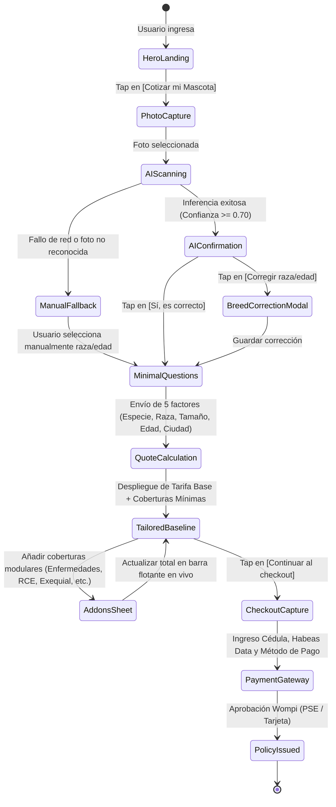

# Especificación Detallada del Flujo de Cotización en < 60 Segundos (Quote Flow)
## Plataforma Insurtech Digital Multi-Ramo (Manto 2.0)
**Rol:** Senior Product Designer + UX Architect  
**Versión:** 1.0.0  
**Fecha:** Septiembre 2026  

---

## 1. Desglose Temporal: El Reto de los 60 Segundos

Para lograr que un usuario promedio en un smartphone 4G en Bogotá o Medellín complete su cotización en **menos de 60 segundos**, cada segundo y cada interacción de la interfaz ha sido cronometrada y optimizada:

```
00s ───────── 10s ───────── 20s ───────── 30s ───────── 40s ───────── 50s ───────── 60s
 │             │             │             │             │             │             │
 ├─── T01 ─────┤             │             │             │             │             │
 │ Clic "Cotizar"            │             │             │             │             │
 │ y apertura cámara         │             │             │             │             │
 │             ├─── T02 ─────┤             │             │             │             │
 │             │ Carga foto  │             │             │             │             │
 │             │ + IA Scan   │             │             │             │             │
 │             │             ├─── T03 ─────┤             │             │             │
 │             │             │ Confirmar   │             │             │             │
 │             │             │ Raza/Edad   │             │             │             │
 │             │             │             ├─── T04 ─────┤             │             │
 │             │             │             │ 3 Preguntas │             │             │
 │             │             │             │ (Ciudad/Sex)│             │             │
 │             │             │             │             ├─── T05 ─────┤             │
 │             │             │             │             │ Ver Precios │             │
 │             │             │             │             │ y Planes    │             │
 │             │             │             │             │             ├─── T06 ─────┤
 │             │             │             │             │             │ Checkout    │
 │             │             │             │             │             │ y Pago      │
```

| Tramo Temporal | Acción del Usuario / Sistema | Optimización de UX para Eliminar Fricción |
| :---: | :--- | :--- |
| **00s - 10s** | Usuario pulsa `[Cotizar]` y toma/selecciona foto. | Integración nativa con `navigator.mediaDevices` para disparar cámara directa o selector de fotos sin pantallas intermedias. |
| **10s - 20s** | Subida en segundo plano y análisis de IA. | Indicador visual de escaneo elegante con micro-textos cambiantes que entretienen y reducen el tiempo percibido. |
| **20s - 30s** | Confirmación de Especie, Raza y Rango de Edad. | Inferencia pre-seleccionada; el usuario solo necesita pulsar `[Sí, continuar]` en el 90% de los casos. |
| **30s - 42s** | Captura de Nombre, Ciudad y Esterilización. | Cero dropdowns lentos; chips táctiles para las 3 ciudades principales y switch de 1 clic para esterilización con incentivo de descuento. |
| **42s - 55s** | Visualización de Tarifa Base Personalizada y Coberturas Mínimas. | Cálculo actuarial en API en $<100\text{ ms}$; el usuario ve su tarifa base a la medida (según especie, raza, tamaño, edad y ciudad), coberturas mínimas automáticas y control de deducible. |
| **55s - 60s+**| Selección de Add-ons Modulares y pase a Checkout. | Interruptores modulares con precios transparentes adicionales (ej. +$24.900/mes enfermedades, +$9.900/mes exequial) y barra flotante con total en vivo. |

---

## 2. Diagrama de Estados y Pantallas del Flujo de Cotización



---

## 3. Especificación Detallada Pantalla por Pantalla

### Paso 1: Captura de Foto (`PhotoCapture`)
* **Diseño Visual**:
  * Fondo cálido mineral (`#FAF8F5`).
  * Zona central punteada de gran tamaño con avatar de silueta amigable.
  * Texto principal: *"Empecemos con una foto de tu consentido"*.
  * Subtexto: *"Nuestra tecnología reconocerá su raza y edad para darte el mejor precio."*
* **Interacción**:
  * Dos botones táctiles gigantes en la zona inferior:
    * `[📷 Tomar Foto]` (Abre cámara del celular con lente trasera o delantera).
    * `[🖼️ Elegir de la Galería]`.
  * Enlace secundario inferior: *"No tengo una foto a la mano (Escribir datos)"*.
* **Manejo de Errores y Validaciones en Cliente**:
  * Si el archivo supera los 10 MB: Compresión automática en el navegador (Web Worker usando Canvas a máx 1920x1080px JPEG calidad 80%) antes de enviar a la API.
  * Formatos aceptados: `image/jpeg`, `image/png`, `image/webp`.

### Paso 2: Escaneo de IA (`AIScanning`)
* **Diseño Visual**:
  * La foto del usuario se muestra al centro con una animación de haz de luz (*shimmer*) que recorre la imagen de arriba a abajo.
  * Texto de estado dinámico que conmuta cada 700 ms:
    1. *"Detectando especie..."*
    2. *"Reconociendo características de la raza..."*
    3. *"Calculando rango de edad..."*
* **Métricas de Rendimiento**:
  * Latencia máxima esperada del endpoint `/v1/ai/pet-vision`: **1.8 segundos**.
  * Si el servidor no responde en 4 segundos: Despliega automáticamente la pantalla manual sin romper el flujo ni mostrar pantallas de error técnicas.

### Paso 3: Confirmación de la Inferencia (`AIConfirmation`)
* **Diseño Visual**:
  * Foto recortada en círculo elegante con anillo verde sutil de validación.
  * Titular:
    `"¡Qué hermoso ejemplar! Parece un Labrador Retriever de 2 a 3 años."`
  * Insignia informativa: `94% de coincidencia`.
* **Manejo de Casos Especiales (Ley 1801 de 2016 en Colombia)**:
  * Si la raza detectada es de manejo especial (ej. *American Pit Bull Terrier*, *Rottweiler*):
    * Se muestra una caja de aviso destacada en tono ámbar:
      > ℹ️ **Requisito Legal en Colombia (Ley 1801)**  
      > Los ejemplares de esta raza requieren por ley una póliza de Responsabilidad Civil Extracontractual (mín. 50 SMLMV).  
      > *La hemos pre-seleccionado en tu cotización para que cumplas con la norma ante la Alcaldía.*
* **Controles de Acción**:
  * Botón principal: `[Sí, continuar]` $\to$ Avanza inmediatamente al Paso 4.
  * Botón secundario: `[Cambiar raza o edad]` $\to$ Abre un panel inferior (*Bottom Sheet*) con selector predictivo instantáneo.

### Paso 4: Preguntas Mínimas de Ajuste Actuarial (`MinimalQuestions`)
* **Diseño Visual**:
  * Una sola pantalla limpia y vertical diseñada para responderse en menos de 12 segundos.
  * **Campo 1: ¿Cómo se llama?**
    * Campo de texto con auto-foco y teclado abierto automáticamente: `Ej. Milo, Luna, Ramón`.
  * **Campo 2: Tamaño / Categoría de Peso (Factor Actuarial Clave)**:
    * Chips táctiles horizontales pre-seleccionados por la IA según la raza detectada:
      `[Toy (≤5kg)]` `[Pequeño (5-10kg)]` `[Mediano (10-25kg)]` `[Grande (25-45kg)]` `[Gigante (>45kg)]`
    * Micro-texto: *"Pre-seleccionado por el análisis de IA. Puedes ajustarlo si tu mascota pesa más o menos."*
  * **Campo 3: ¿En qué ciudad vive?**
    * Grupo de 4 chips táctiles horizontales:
      `[📍 Bogotá]` `[📍 Medellín]` `[📍 Cali]` `[📍 Otra]`
  * **Campo 4: ¿Está esterilizado/a?**
    * Selector tipo switch animado:
      `[Sí, está esterilizado/a (Ahorras 5%)]` `[No]`
* **Botón de Avance**:
  * Botón fijo en el pie de página: `[Calcular mi Tarifa Base Personalizada →]`.

### Paso 5: Protección Base a la Medida y Expansión Modular (`TailoredBaseline`)
* **Diseño Visual y Arquitectura de Información**:
  * Encabezado: *"Protección Base a la medida de Milo"*
  * Subtítulo dinámico: *"Tarifa base calculada por nuestro actuario según especie (Perro), raza (Labrador Retriever), tamaño (Grande), edad (~2 años) y ubicación (Bogotá)."*
  * **Interruptor de Facturación**:
    * Segmented control: `[Mensual]` | `[Anual (1 mes gratis)]`.
  * **Control de Deducible Interactivo**:
    * Barra deslizante (*Slider*) con 3 paradas:
      `[10% (Menor gasto propio)]` - `[15% (Equilibrado)]` - `[20% (Menor cuota mensual)]`.
    * Al mover el deslizador, la tarifa base y el total se recalculan en tiempo real con transición suave.
  * **Tarjeta de Tarifa Base**:
    * Tarjeta principal con acento verde bosque suave (`#1B4332`), destacando el valor:
      `COP $31.800 / mes`
    * **Lista de Coberturas Mínimas Garantizadas (Sin costo adicional)**:
      * ✔️ Urgencias por accidente y trauma (Hasta COP $3.5M/año).
      * ✔️ Consultas médicas de urgencia (3 al año en red o reembolso).
      * ✔️ Cirugías y hospitalización por accidente.
      * ⚠️ Sublímite especializado para fenotipo (ej. osteoarticular para razas grandes o respiratorio para braquicéfalos).
      * ⚖️ *RCE Ley 1801 (50 SMLMV) anexada automáticamente si es raza de manejo especial*.
  * **Bandeja Integrada de Add-ons (Personaliza y Expande)**:
    * Módulos independientes activables con un solo toque:
      * `[+ $24.900/mes]` **Ampliación a Enfermedades Comunes e Infecciosas** (Cubre gastroenteritis, dermatitis, infecciones y cirugías por patología).
      * `[+ $12.900/mes]` **Medicamentos Recetados Ambulatorios** (Reembolso de fármacos recetados por médico veterinario).
      * `[+ $15.000/mes]` **Responsabilidad Civil Extracontractual (50 SMLMV)** (Obligatorio en Ley 1801; opcional para razas convencionales).
      * `[+ $9.900/mes]` **Asistencia Exequial y Cremación Individual** (Acompañamiento integral, eutanasia humanitaria y entrega de cenizas).
      * `[+ $6.900/mes]` **Telemedicina Veterinaria 24/7** (Videoconsultas ilimitadas con veterinarios certificados).
      * `[+ $4.900/mes]` **Guardería por Hospitalización del Tomador** (Alojamiento para tu mascota si sufres un evento de salud).
  * **Barra Flotante Inferior (Sticky Bottom Bar)**:
    * Visualización permanente de la suma dinámica:
      `Base ($31.800) + Add-ons ($34.800) = Total: COP $66.600 / mes | [Continuar al checkout →]`

---

## 4. Pruebas de Usabilidad y Gestión de Fallos (Edge Cases)

| Caso Límite / Error | Comportamiento de la Interfaz | Solución de UX |
| :--- | :--- | :--- |
| **Foto borrosa o no es una mascota** | El modelo de visión retorna `confidence < 0.50` o `UNKNOWN`. | Pantalla amable con ilustración de silueta: *"No pudimos ver bien a tu consentido. ¿Intentamos con otra foto o prefieres escribir su raza?"* |
| **Pérdida de conexión a internet** | Error de red durante la llamada al cotizador. | Estado de reintento automático silencioso con banner superior: *"Reconectando..."*; si persiste, botón manual `[Reintentar sin perder tus datos]`. |
| **Mascota supera la edad máxima (9+ años)** | La fecha de nacimiento indica más de 108 meses. | Mensaje empático y constructivo: *"Por políticas de suscripción de nuestro aliado asegurador, el ingreso para nuevos clientes es hasta los 8 años. ¡Déjanos tu correo para avisarte cuando habilitemos nuestro Plan Senior Especial!"* |
| **Tarjeta declinada en Checkout** | Rechazo de la pasarela Wompi. | Mensaje explicativo claro sin códigos de error bancarios crípticos: *"Tu banco no autorizó el cobro. Puedes probar con otra tarjeta o pagar fácilmente por PSE / Bancolombia en línea."* |
