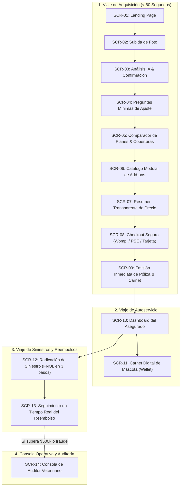

# Flujos de Usuario y Especificación de Pantallas (User Flows & Screen Catalog)
## Plataforma Insurtech Digital Multi-Ramo (Manto 2.0)
**Rol:** Senior Product Designer + UX Architect  
**Versión:** 1.0.0  
**Fecha:** Septiembre 2026  

---

## 1. Mapa General de Experiencia de Usuario (Customer Journey Ecosystem)

El ecosistema de Manto se estructura en tres viajes de usuario interconectados:
1. **Viaje de Adquisición y Cotización (Pre-compra)**: Desde la landing hasta la emisión de la póliza en menos de 60 segundos.
2. **Viaje de Protección y Autoservicio (Post-compra)**: Dashboard interactivo, gestión del carnet digital y consultas de cobertura.
3. **Viaje de Siniestros y Reembolsos (Momento de la Verdad)**: Radicación de facturas en 3 pasos y seguimiento de dispersión del dinero.

---

## 2. Catálogo Maestro de Pantallas del MVP

### 2.1 Pantallas de Adquisición y Cotización

#### `SCR-01: Landing Page (Home Principal)`
* **Objetivo de UX**: Transmitir confianza instantánea, empatía por la mascota y eliminar el miedo al trámite de seguros.
* **Componentes Clave**:
  * *Hero Section*: Titular contundente: *"El seguro que tu perro o gato merece. Sin enredos, sin letra menuda y con cotización en 60 segundos."*
  * *CTA Primario Destacado*: Botón grande: `[Cotizar con una foto]`.
  * *Micro-prueba Social*: *"Más de 1.500 mascotas protegidas en Bogotá, Medellín y Cali."*
  * *Calculadora Interactiva de 1 Clic*: Selector rápido de especie (Perro / Gato) que anticipa el precio estimado de partida.
  * *Garantía de Transparencia*: Resumen visual de lo que cubre (Urgencias, Cirugías, Medicamentos, Responsabilidad Civil) y lo que no cubre (Preexistencias no declaradas, cirugías estéticas).

#### `SCR-02: Subida de Foto de Mascota (Hero Visual Dropzone)`
* **Objetivo de UX**: Iniciar la experiencia con un gesto agradable y personalizado, activando la cámara del móvil o la galería.
* **Componentes Clave**:
  * Título: *"Muéstranos a tu consentido"*.
  * Zona de carga amplia y táctil con icono animado sutil de cámara.
  * Botones directos para móvil: `[Tomar foto ahora]` o `[Subir desde la galería]`.
  * Enlace discreto de escape: *"Prefiero escribir los datos manualmente"*.

#### `SCR-03: Análisis de IA y Pantalla de Confirmación`
* **Objetivo de UX**: Demostrar tecnología de vanguardia mientras se mantiene la humildad y el control en manos del usuario.
* **Estados de Pantalla**:
  1. *Estado de Carga Elegante (Skeleton/Shimmer)*: Escaneo visual sutil sobre la foto con micro-copia dinámica (*"Identificando especie...", "Reconociendo raza...", "Calculando edad aproximada..."*). Duración: 1.5 a 2.5 segundos.
  2. *Estado de Resultados*:
     * Tarjeta visual con la foto recortada en círculo y un mensaje amable:
       *"Tiene toda la pinta de ser un **Golden Retriever** de unos **2 a 3 años**."*
     * Indicador de confianza sutil (*"94% de coincidencia"*).
     * Dos botones de acción rápida:
       * `[Sí, es correcto]` (Avanza con un solo toque).
       * `[Corregir datos]` (Despliega campos para ajustar raza o fecha de nacimiento).
     * Alerta legal automática: Si la raza es clasificada bajo la Ley 1801 de 2016 (ej. Pitbull, Rottweiler), se muestra una insignia informativa: *"Raza de manejo especial en Colombia. Incluiremos la póliza obligatoria de RCE de 50 SMLMV."*

#### `SCR-04: Preguntas Mínimas de Ajuste Actuarial`
* **Objetivo de UX**: Recopilar o validar los datos indispensables en menos de 15 segundos:
* **Componentes Clave**:
  * *Nombre de la mascota*: Campo de texto con auto-foco (ej. *"Milo"*).
  * *Tamaño / Categoría de Peso*: Chips táctiles pre-seleccionados según la raza por la IA:
    `[Toy (≤5kg)]` `[Pequeño (5-10kg)]` `[Mediano (10-25kg)]` `[Grande (25-45kg)]` `[Gigante (>45kg)]`.
  * *Ciudad principal*: Chips de selección rápida en un toque (`[Bogotá]` `[Medellín]` `[Cali]` `[Otras]`).
  * *¿Está esterilizado/a?*: Switch animado: `[Sí (Ahorras 5%)]` / `[No]`.

#### `SCR-05: Protección Base a la Medida y Expansión Modular (Tailored Baseline)`
* **Objetivo de UX**: En lugar de encasillar al usuario en planes rígidos (Bronce/Plata/Oro), se presenta su **Protección Base Personalizada**, calibrada por el motor actuarial según el análisis de IA validado (Especie, Raza, Tamaño, Edad y Ubicación).
* **Componentes Clave**:
  * *Encabezado Personalizado*: *"El plan esencial para Milo, calculado para su raza y tamaño en Bogotá"*.
  * *Tarjeta de Tarifa Base*:
    * Precio base claro: ej. *"COP $31.800 / mes"* (con selector mensual/anual).
    * Selector deslizante de deducible interactivo (10%, 15%, 20%).
    * Lista de **Coberturas Mínimas Garantizadas**:
      * ✔️ Urgencias por accidente y trauma (Hasta $3.5M/año).
      * ✔️ Consultas médicas de emergencia (3 al año).
      * ✔️ Estabilización vital y cirugías por accidente.
      * ⚠️ Sublímite específico activado según fenotipo (ej. respiratorio para braquicéfalos / osteoarticular para gigantes).
      * ⚖️ *RCE Ley 1801 (50 SMLMV) anexada forzosamente si es raza de manejo especial*.
  * *Bandeja Integrada de Add-ons (Expande tu Cobertura)*:
    * El usuario puede añadir en un toque coberturas adicionales:
      * `[+ $24.900/mes]` Ampliación a Enfermedades Comunes e Infecciosas.
      * `[+ $12.900/mes]` Medicamentos Recetados Ambulatorios.
      * `[+ $9.900/mes]` Asistencia Exequial y Cremación Individual.
      * `[+ $6.900/mes]` Telemedicina Veterinaria 24/7.
  * *Barra Flotante Inferior (Sticky Bottom Bar)*:
    * Refleja el desglose en tiempo real:
      `Base ($31.800) + 2 Add-ons ($16.800) = Total: COP $48.600/mes | [Continuar al checkout →]`.

#### `SCR-06: Catálogo Modular de Coberturas Opcionales (Add-ons Tray)`
* **Objetivo de UX**: Permitir personalización sin fricción mediante interruptores de un solo toque con precios transparentes.
* **Componentes Clave**:
  * Lista de add-ons disponibles con micro-precios mensuales:
    * *Responsabilidad Civil Extracontractual (Ley 1801)*: Obligatorio si aplica por raza, opcional para las demás (+$15.000/mes).
    * *Asistencia Exequial y Cremación*: (+$9.900/mes).
    * *Telemedicina Veterinaria 24/7*: (+$6.900/mes).
    * *Guardería por Hospitalización del Dueño*: (+$4.900/mes).
  * Impacto en la prima actualizado en el pie de página flotante (*Sticky Bottom Bar*):
    `Total: COP $83.800/mes | [Continuar al checkout]`.

#### `SCR-07: Resumen Transparente y Captura de Tomador`
* **Objetivo de UX**: Presentar el desglose final y recopilar los datos del tomador requeridos por ley en Colombia.
* **Componentes Clave**:
  * Nombre completo y Cédula de Ciudadanía/Extranjería.
  * Celular y Correo electrónico.
  * Checkbox explícito de autorización de **Habeas Data (Ley 1581 de 2012)**.
  * Desglose financiero: Prima base + Add-ons - Descuentos = Total neto a pagar en COP.

#### `SCR-08: Checkout y Pasarela de Pagos (Wompi Tokenized)`
* **Objetivo de UX**: Completar el pago con el estándar más confiable y rápido en Colombia.
* **Componentes Clave**:
  * Pestañas de método de pago:
    * `[PSE - Débito Bancario / Bancolombia / Nequi]`
    * `[Tarjeta de Crédito / Débito]`
  * Formulario seguro integrado mediante Wompi Web SDK (cero almacenamiento de datos sensibles en servidores de Manto).
  * Botón de confirmación final: `[Pagar seguro y activar póliza]`.

#### `SCR-09: Pantalla de Celebración y Emisión de Póliza`
* **Objetivo de UX**: Entregar satisfacción y alivio emocional inmediato.
* **Componentes Clave**:
  * Animación de celebración sutil (confeti sobrio).
  * Mensaje: *"¡Felicitaciones! Milo ya tiene su seguro activo."*
  * Número de póliza visible: `MTO-PET-2026-000842`.
  * Botones de acción:
    * `[Agregar Carnet a Apple Wallet / Google Wallet]`.
    * `[Descargar Carátula Oficial (PDF)]`.
    * `[Ir a mi panel de mascota]`.

---

### 2.2 Pantallas de Autoservicio y Siniestros

#### `SCR-10: Dashboard del Asegurado (Panel de Mascota)`
* **Objetivo de UX**: Centro de control transparente que muestra la salud del seguro en todo momento.
* **Componentes Clave**:
  * Tarjeta de estado de la mascota con foto, raza y número de póliza.
  * Barra medidora de consumo de cobertura anual: *"Has utilizado $0 de tus $5.000.000 de cobertura anual"*.
  * Botón prioritario de emergencia: `[Pedir Reembolso Veterinario]`.
  * Historial de pagos mensuales y estado de cuenta.

#### `SCR-11: Carnet Digital de Mascota (Wallet Pass)`
* **Objetivo de UX**: Credencial digital accesible sin conexión para presentar en la clínica veterinaria.
* **Componentes Clave**:
  * Foto de la mascota, nombre, raza, especie.
  * Vigencia de la póliza y plan activo.
  * Línea de asistencia telefónica y WhatsApp veterinario 24/7.
  * Código QR único para validación de vigencia por parte de la veterinaria.

#### `SCR-12: Radicación de Siniestro en 3 Pasos (FNOL)`
* **Objetivo de UX**: Proceso guiado conversacional que elimina el estrés tras una urgencia médica.
* **Paso 1: ¿Qué le pasó a tu mascota?**:
  * Chips táctiles: `[Accidente / Urgencia]`, `[Enfermedad]`, `[Exámenes / Medicamentos]`, `[Daños a Terceros]`.
  * Breve descripción opcional en audio o texto.
* **Paso 2: Sube los soportes de la veterinaria**:
  * Zona de carga para: Factura Electrónica (con CUFE) e Historia Clínica/Epicrisis.
  * Reconocimiento y pre-validación visual instantánea con IA.
* **Paso 3: ¿Dónde te transferimos el dinero?**:
  * Selección de banco en Colombia, tipo de cuenta o billetera digital (Nequi / DaviPlata) y número.
  * Botón de envío: `[Radicar mi reembolso]`.

#### `SCR-13: Seguimiento del Siniestro en Tiempo Real (Claim Tracker)`
* **Objetivo de UX**: Eliminar la incertidumbre de "¿dónde está mi dinero?".
* **Componentes Clave**:
  * Línea de tiempo visual interactiva:
    `Radicado` $\to$ `Factura Validada con la DIAN` $\to$ `Reembolso Aprobado` $\to$ `Transferencia Bancaria Enviada`.
  * Desglose exacto del cálculo:
    * Total Factura: COP $420.000.
    * Deducible (15%): - COP $63.000.
    * **Monto depositado en tu cuenta: COP $357.000**.
  * Comprobante de transferencia bancaria descargable.

#### `SCR-14: Consola de Auditoría y Ajuste Veterinario (Backoffice)`
* **Objetivo de UX**: Permitir a los auditores veterinarios humanos resolver casos complejos con máxima ergonomía y velocidad.
* **Componentes Clave**:
  * Vista dividida: Factura original a la izquierda con bounding boxes resaltando el CUFE y las partidas; panel de decisión a la derecha.
  * Calculadora de cobertura en tiempo real con advertencias de periodos de carencia y preexistencias.
  * Acciones rápidas: `[Aprobar Liquidación]` / `[Pedir Epicrisis Ampliada]` / `[Objetar con Fundamento]`.
