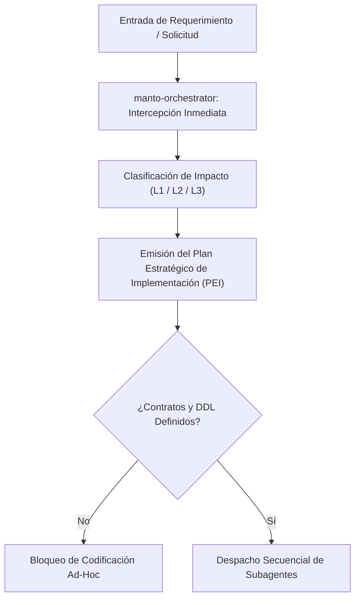
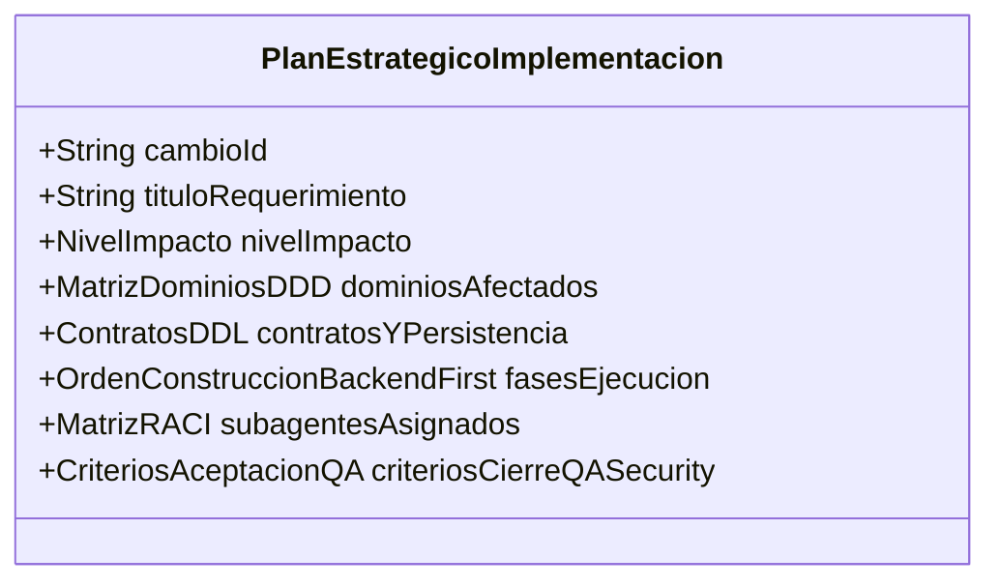
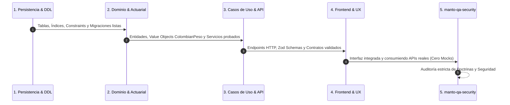
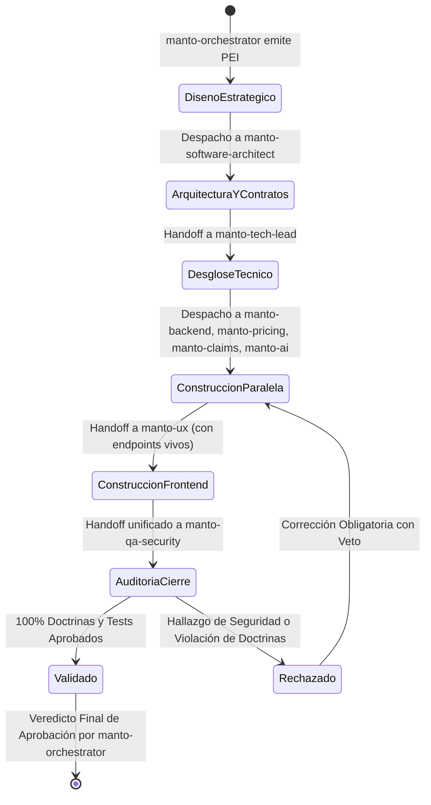

# PLAN ESTRATÉGICO DE IMPLEMENTACIÓN MAESTRO
## MANTO 2.0 — PLATAFORMA INSURTECH DE SEGUROS PARA MASCOTAS (COLOMBIA)
### Rol Emisor: CTO & Multi-Agent Orchestrator (`manto-orchestrator`)
**Fecha de Vigencia:** Septiembre 2026  
**Ámbito de Aplicación:** Mandatorio y automático para cualquier modificación, evolución, corrección de defectos o refactorización del sistema Manto 2.0.

---

## 1. DIRECTIVA DE ACTIVACIÓN INMEDIATA DEL ORQUESTADOR

### 1.1. Disparo Autónomo y Cero Intervención Manual
A partir de la presente directiva, **`manto-orchestrator` se activa de forma automática e inmediata** ante la entrada de cualquier requerimiento del usuario, issue técnico, cambio regulatorio o solicitud de feature.



#### Reglas de Activación Inmediata:
1. **Prohibición de Ejecución Huérfana o Ad-Hoc:** Ningún subagente de construcción (`manto-backend`, `manto-ux`, `manto-pricing`, `manto-claims`, `manto-ai`) puede generar código, editar componentes o modificar esquemas de base de datos sin un **Plan Estratégico de Implementación (PEI)** formalmente expedido y firmado por `manto-orchestrator`.
2. **Evaluación de Impacto Automática:** En el turno 1 de cualquier interacción, `manto-orchestrator` clasifica el requerimiento según su matriz de impacto:
   - **Nivel L1 (Cambio Trivial / Documental / Copy):** No altera tipos, esquemas, cálculos ni lógica de negocio. Requiere PEI abreviado y verificación básica.
   - **Nivel L2 (Funcionalidad / Integración Aislada):** Afecta de 1 a 2 dominios sin alterar el motor actuarial central ni el modelo relacional PII. Requiere PEI estándar, contratos Zod/OpenAPI y verificación QA.
   - **Nivel L3 (Crítico / Núcleo Actuarial / Legal / Financiero):** Impacta tarificación, razas especiales (Ley 1801), pagos Bre-B, Habeas Data (Ley 1581) o persistencia DDL. Requiere PEI completo, ADR mandatorio, revisión arquitectónica previa y auditoría de seguridad exhaustiva.
3. **Invarianza de Doctrinas Fundamentales:** El orquestador cancelará inmediatamente cualquier intento de derivación que viole las Doctrinas Inquebrantables de Manto 2.0.

---

## 2. ESTRUCTURA ESTÁNDAR DEL PLAN ESTRATÉGICO DE IMPLEMENTACIÓN (PEI)

Todo requerimiento procesado por `manto-orchestrator` producirá un documento formal que sigue de manera rigurosa la siguiente estructura canónica:



### 2.1. Ficha Técnica y Objetivos de Negocio
- **Identificador Único:** `PEI-[AÑO]-[ID_SECUENCIAL]` (e.g., `PEI-2026-0042`).
- **Nivel de Impacto:** `L1`, `L2` o `L3`.
- **Objetivo Estratégico:** Descripción concisa del valor de negocio o resolución técnica esperada.

### 2.2. Matriz de Dominios DDD Afectados
Identificación explícita de los Bounded Contexts involucrados y las reglas de integración:

| Dominio DDD | ¿Afectado? | Responsabilidad Central | Restricción Crítica |
| :--- | :---: | :--- | :--- |
| **Pricing & Actuarial** | Sí / No | Determinación de primas, recargos por edad/especie, deducibles. | **100% determinista en servidor**. Cero modelos de lenguaje o flotantes. |
| **Policy & Underwriting** | Sí / No | Expedición, estados de póliza, elegibilidad y validación de razas. | **Ley 1801/2016:** RCE $\ge 50$ SMLMV (\$87.545.250 COP en 2026) obligatoria para razas de manejo especial. |
| **Billing & Bre-B** | Sí / No | Facturación recurrente, dispersión y recepción vía SPI Bre-B. | Llaves Bre-B y transacciones en columnas dedicadas tipadas `ColombianPeso` (bigint). |
| **Identity & Habeas Data** | Sí / No | Gestión de tomadores, beneficiarios, mascotas y consentimiento. | **Ley 1581/2012:** PII fuera de JSONB. Endpoint y trazabilidad para `suprimirDatosPersonales`. |
| **Claims & Assistance** | Sí / No | Radicación, auditoría médica veterinaria y liquidación de siniestros. | La IA solo extrae datos documentales; la aprobación y liquidación financiera es puramente determinista. |
| **AI Triage & OCR** | Sí / No | Triage clínico de síntomas y extracción OCR de facturas veterinarias. | Guardrails de aislamiento: no computa dineros ni coberturas vinculantes. |
| **Frontend / UX** | Sí / No | Formularios de cotización, portal de usuario, dashboards. | **Backend-Driven Validation**: Ninguna regla actuarial o de negocio residirá en cliente. |

### 2.3. Contratos Formales y DDL Necesarios (Contract-First)
Antes de escribir cualquier línea de lógica de negocio, se deben definir y congelar los contratos:
1. **Esquema de Base de Datos (PostgreSQL DDL):**
   - Tipos de moneda en `BIGINT` (representando COP sin decimales).
   - Constraints `CHECK` relacionales obligatorios (e.g., `CHECK (cobertura_rce_cop >= 87545250)` si `es_raza_manejo_especial = TRUE`).
   - Columnas PII explícitas (`primer_nombre`, `primer_apellido`, `numero_identificacion`, `bre_b_llave`, `bre_b_tipo_llave`). Prohibido colocar estos campos dentro de `metadata JSONB`.
2. **Esquemas de Dominio y Validación (Zod / TypeScript):**
   - Branded Type unificado:
     ```typescript
     export type ColombianPeso = bigint & { readonly __brand: unique symbol };
     export const toColombianPeso = (value: number | string | bigint): ColombianPeso => {
       const b = BigInt(value);
       if (b < 0n) throw new Error("El monto en COP no puede ser negativo");
       return b as ColombianPeso;
     };
     ```
   - Serialización de transporte JSON/API: Representación como cadenas de texto numéricas (`"87545250"`) para evitar pérdida de precisión de enteros de 64 bits en motores JavaScript (`Number.MAX_SAFE_INTEGER`).
3. **Especificación de Eventos de Dominio:**
   - Payloads tipados inmutables para eventos como `PolizaCotizada`, `PolizaEmitida`, `SiniestroRadicado`, `DatosPersonalesSuprimidos`.

### 2.4. Orden de Construcción Backend-First
La secuencia cronológica de construcción es estrictamente serializada por capas:



1. **Fase 1: Persistencia (DDL & Migrations):**
   - Creación de tablas, llaves foráneas, índices de alta concurrencia y constraints de integridad legal.
2. **Fase 2: Dominio & Servicios Centrales (Domain Layer):**
   - Entidades inmutables, Value Objects (`ColombianPeso`, `RazaMascota`, `DocumentoIdentidad`), reglas de validación actuarial deterministas.
3. **Fase 3: Aplicación & API (Application & Infrastructure Layer):**
   - Casos de uso (Commands/Queries), controladores HTTP/tRPC, integración con pasarelas Bre-B, endpoints de Habeas Data.
4. **Fase 4: Presentación & UX (Frontend Layer):**
   - Vistas web/móvil consumiendo contratos reales de API. No se permite duplicar lógica de negocio en cliente ni mockear respuestas con retrasos artificiales (`setTimeout`).
5. **Fase 5: Auditoría y Verificación de Cierre (Auditoría `manto-qa-security`).**

### 2.5. Asignación de Subagentes & Matriz RACI
Cada tarea del plan cuenta con un subagente Responsable (R), Aprobador (A), Consultado (C) e Informado (I):

| Fase | Subagente Líder | Colaboradores | Entregables Requeridos |
| :--- | :--- | :--- | :--- |
| **Arquitectura & ADR** | `manto-software-architect` | `manto-tech-lead` | Documento ADR, Diagramas C4, Especificación de Contratos. |
| **Especificación Técnica** | `manto-tech-lead` | `manto-backend`, `manto-pricing` | Tareas atómicas, DDL script, Interfaces TypeScript/Zod. |
| **Motor de Tarifas** | `manto-pricing` | `manto-software-architect` | Algoritmos de cálculo puro determinista con tests unitarios 100% cobertura. |
| **Backend & Base de Datos** | `manto-backend` | `manto-tech-lead` | Migraciones DB, repositorios, endpoints de API, integración Bre-B. |
| **Asistencia & Triage IA** | `manto-ai` | `manto-claims`, `manto-backend` | Pipelines de extracción documental y OCR con guardrails de no intervención financiera. |
| **Gestión de Siniestros** | `manto-claims` | `manto-backend`, `manto-ai` | Workflow de aviso, auditoría médica y liquidación determinista. |
| **Frontend & Experiencia** | `manto-ux` | `manto-tech-lead` | Pantallas y componentes React/Tailwind alineados al Design System de Manto. |
| **Auditoría & Cierre** | `manto-qa-security` | Todos los subagentes | Reporte de Certificación de Seguridad y Doctrinas. |

### 2.6. Criterios de Aceptación para `manto-qa-security`
El cierre solo se declara exitoso si se cumple el siguiente checklist de verificación obligatoria:
- [ ] **Checklist Actuarial:** Cero cálculos de primas o deducibles en código de IA o en el cliente. Todo cálculo matemático es determinista y unitariamente probado.
- [ ] **Checklist Ley 1801:** Cualquier póliza con raza de manejo especial valida de forma estricta e inevadible una RCE mínima de \$87.545.250 COP (50 SMLMV 2026), tanto en código como en constraints DDL.
- [ ] **Checklist ColombianPeso:** Todo campo monetario utiliza `bigint` / `ColombianPeso` en backend y strings numéricos en JSON. Cero flotantes (`number` con punto flotante) para dinero.
- [ ] **Checklist Habeas Data (Ley 1581):** Cero PII o llaves Bre-B en campos `metadata JSONB`. El procedimiento de anonimización/supresión `suprimirDatosPersonales` opera correctamente sin romper la trazabilidad contable.
- [ ] **Checklist Cero Placeholders:** Análisis estático de código sin `TODO`, `FIXME`, stubs vacíos o datos estáticos simulados.
- [ ] **Checklist Documentación vs Código:** Si existieron variaciones de diseño, existe un ADR formalmente aprobado que las respalda.

---

## 3. COREOGRAFÍA Y COORDINACIÓN MULTI-AGENTE

### 3.1. Flujo de Handoffs y Protocolo de Comunicación
Para garantizar que ningún agente opere en silos o con información desactualizada, se establece el siguiente protocolo de paso de mensajes (`handoff`):



### 3.2. Roles y Matriz de Responsabilidades Inter-Agente

#### 1. `manto-orchestrator` (CTO & Multi-Agent Orchestrator)
- **Autoridad:** Máxima instancia ejecutiva y de diseño estratégico.
- **Acción:** Diseña el PEI maestro, asigna contexto a subagentes, supervisa la ejecución Backend-First y emite el veredicto final.

#### 2. `manto-software-architect` (Arquitecto de Software)
- **Autoridad:** Estructura de sistemas, patrones de diseño, contratos y ADRs.
- **Acción:** Define la arquitectura de dominios DDD, garantiza la segregación de PII para Habeas Data, redacta los esquemas DDL iniciales y especifica los contratos Zod/OpenAPI. Emite ADRs ante cualquier decisión técnica relevante.

#### 3. `manto-tech-lead` (Líder Técnico)
- **Autoridad:** Desglose de tareas operativas y control de calidad de código.
- **Acción:** Traduce la arquitectura y los contratos en paquetes de trabajo ejecutables para `manto-backend`, `manto-pricing`, `manto-claims`, `manto-ai` y `manto-ux`. Garantiza la política de **Cero Placeholders**.

#### 4. `manto-pricing` (Especialista Actuarial & Tarifación)
- **Autoridad:** Núcleo de cálculo de primas, recargos y deducibles.
- **Acción:** Implementa el motor de cotización 100% determinista en el servidor. Aplica los factores de riesgo por especie (canino/felino), edad, tamaño y tipo de plan. Codifica las tablas de tarifas y garantiza el cumplimiento matemático de la Ley 1801 de 2016.

#### 5. `manto-backend` (Ingeniero Backend & Base de Datos)
- **Autoridad:** Persistencia relacional, APIs, servicios e integraciones.
- **Acción:** Ejecuta las migraciones DDL con constraints `CHECK`, implementa los repositorios, orquesta los casos de uso, conecta las pasarelas del Sistema de Pagos Inmediatos Bre-B con llaves en columnas seguras y expone el protocolo de supresión de datos de Ley 1581.

#### 6. `manto-claims` (Especialista en Siniestros & Asistencias)
- **Autoridad:** Ciclo de vida del siniestro (radicación, triage, auditoría médica, liquidación).
- **Acción:** Modela los estados de reclamación (`RADICADO`, `EN_AUDITORIA_VET`, `LIQUIDADO_DETERMINISTA`, `PAGADO_BRE_B`, `OBJETADO`). Integra la liquidación financiera con el motor actuarial sin intermediación heurística.

#### 7. `manto-ai` (Especialista en IA & Procesamiento Documental)
- **Autoridad:** Extracción OCR, clasificación y asistencia contextual.
- **Acción:** Configura pipelines de procesamiento de facturas veterinarias y reportes clínicos mediante modelos multimodales. **Guardrail Inviolable:** Sus outputs son sugerencias estructuradas que el backend valida; **la IA jamás tiene acceso de ejecución para autorizar pagos, calcular primas o rechazar pólizas**.

#### 8. `manto-ux` (Diseño de Producto & Frontend)
- **Autoridad:** Interfaces web y móviles, experiencia de usuario y accesibilidad.
- **Acción:** Diseña e implementa pantallas reactivas usando React, Tailwind CSS y componentes de diseño de Manto 2.0. Consume endpoints vivos. Prohibido incluir lógica de cálculo actuarial en cliente: toda cifra proviene del backend formateada desde `ColombianPeso`.

#### 9. `manto-qa-security` (Auditor de Calidad, Cumplimiento y Seguridad)
- **Autoridad:** **Poder de Veto Vinculante** sobre el cierre del requerimiento.
- **Acción:** Ejecuta la batería de pruebas automatizadas, valida el linter de números flotantes para dinero, audita la ausencia de PII en JSONB, verifica el constraint de 50 SMLMV para razas especiales y confirma la ausencia total de placeholders. Ningún feature llega al usuario sin su certificación positiva explícita.

---

## 4. GUÍA RÁPIDA DE RESOLUCIÓN DE CONFLICTOS Y DIVERGENCIAS

1. **Conflicto entre Documentación Antigua y Necesidad de Código:**
   - Regla: **El Código y la Arquitectura Ejecutable Mandan**.
   - Procedimiento: `manto-software-architect` emite un ADR documentando la razón de la divergencia, actualiza la documentación y notifica a `manto-orchestrator`.
2. **Intento de Cálculo Actuarial o Decisión Financiera en `manto-ai`:**
   - Regla: **Bloqueo Inmediato**.
   - Procedimiento: `manto-qa-security` o el orquestador rechaza el PR/cambio y delega la lógica de cálculo exclusivamente a `manto-pricing` y la validación a `manto-backend`.
3. **Uso Accidental de Tipos Flotantes para Moneda:**
   - Regla: **Tolerancia Cero**.
   - Procedimiento: El código debe ser refactorizado de inmediato al branded type `ColombianPeso` (`bigint`), serializando como string numérico en JSON.

---
*Emitido por `manto-orchestrator`, CTO & Multi-Agent Orchestrator de Manto 2.0. Régimen de ejecución automática e ininterrumpida.*
