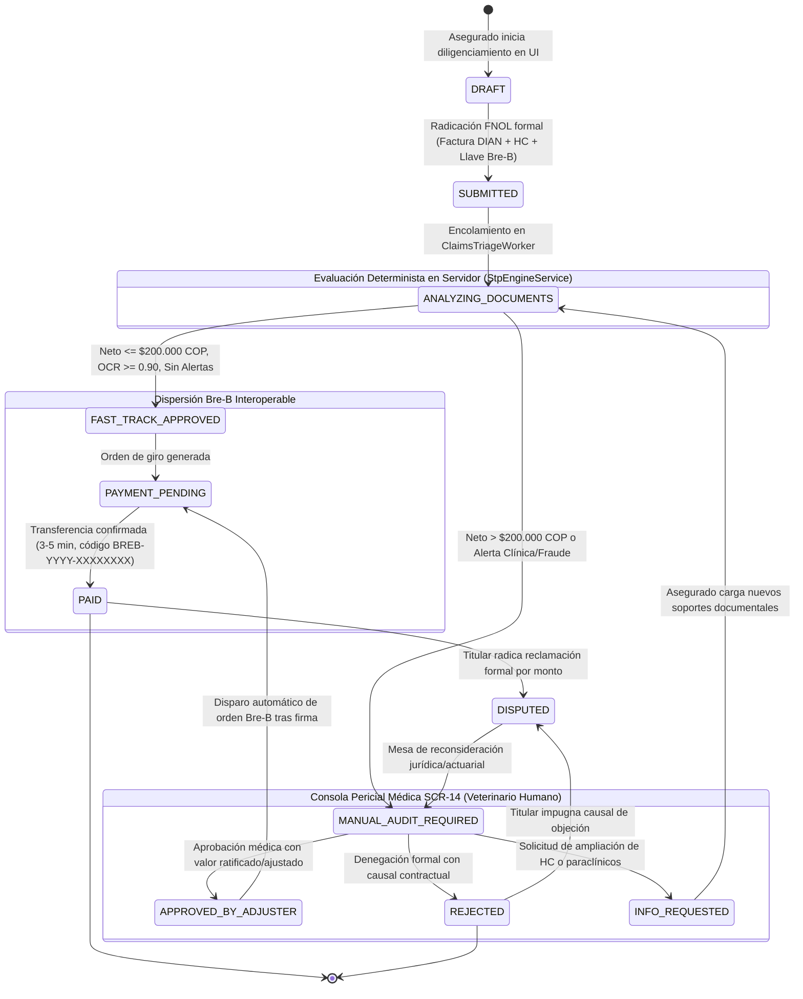

# Manto 2.0 — Especificación Formal de Arquitectura
## Máquina de Estados Finita (FSM) de Siniestros y Reembolsos: Sué ⚡

> **Versión:** 2.0.0  
> **Fecha:** 2026-09-25  
> **Autor:** `manto-software-architect`  
> **Estado:** Aprobado e Implementado en DDL PostgreSQL 16 y OpenAPI 3.1  
> **Referencias:** `AGENTS.md`, `CLAUDE.md`, Ley 1581 de 2012, Ley 1801 de 2016  

---

## 1. Resumen Ejecutivo y Doctrinas Fundacionales

La Máquina de Estados Finita (FSM) de **Sué ⚡** gobierna el ciclo de vida completo de las reclamaciones de reembolso veterinario en la plataforma Manto 2.0. El diseño garantiza total trazabilidad, cumplimiento regulatorio y certeza jurídica mediante tres principios irrenunciables:

1. **La IA NUNCA aprueba reembolsos ni gira dinero:**  
   Los modelos multimodales (Gemini Vision / Flash) operan exclusivamente como un **sensor periférico de extracción y normalización de datos estructurados** (OCR de facturas DIAN y extracción de anamnesis clínica). Las decisiones contractuales y financieras son **100% deterministas del lado del servidor**, ejecutadas por el motor actuarial (`StpEngineService`) o por un perito médico veterinario certificado (`AdjusterClaimConsole` en SCR-14).
2. **Tope de Bajo Riesgo STP: Exactamente $200.000 COP:**  
   - Si el valor neto indemnizable es **$\le \$200.000$ COP**, sin alertas clínicas de carencia ni sospecha de fraude, el siniestro califica para **Fast-Track** y se dispersa en **3 a 5 minutos** a través del sistema de pagos interoperables **Bre-B** del Banco de la República.  
   - Si el valor neto indemnizable es **$> \$200.000$ COP**, transiciona obligatoriamente a **Autenticación Pericial Médica en SCR-14**, con un SLA garantizado **$< 24$ horas hábiles** (Auditoría Express), eliminando los 15 a 30 días del mercado tradicional.
3. **Historia Clínica Obligatoria e Inevadible:**  
   No existe reembolso sin soporte médico veterinario formal. El cruce entre la fecha de inicio de síntomas declarada (`symptomsOnsetDate`) y el inicio de vigencia de la póliza (`effectiveDate`) es evaluado matemáticamente en servidor.
4. **Habeas Data (Ley 1581 de 2012):**  
   Los datos personales y llaves financieras Bre-B se persisten en columnas relacionales dedicadas (`bre_b_key_type`, `bre_b_key_value`, `pii_suprimida_en`), permitiendo el ejercicio del derecho de supresión sin corromper el expediente contable congelado.
5. **Tipado Monetario Estricto (`ColombianPeso`):**  
   CERO flotantes. En base de datos se usa `BIGINT` en pesos enteros, en TypeScript el tipo nominal `ColombianPeso` (`bigint`) y en DTOs números enteros validados con `@IsInt`.

---

## 2. Diagrama de Estados FSM (Mermaid)



---

## 3. Catálogo Formal de Estados

| Estado | Tipo | Descripción Funcional y Jurídica | Persistencia PostgreSQL |
| :--- | :--- | :--- | :--- |
| `DRAFT` | Inicial (UI) | Formulario en progreso en `ClaimsStepper`. Los soportes documentales se cargan en la bóveda vía URLs prefirmadas. | Estado volátil o en sesión |
| `SUBMITTED` | Transaccional | Siniestro radicado formalmente en la API (`POST /v1/claims`). Factura DIAN, Historia Clínica y Llave Bre-B validadas estructuralmente. | `status = 'SUBMITTED'` |
| `ANALYZING_DOCUMENTS` | Procesamiento | Encolado en `ClaimsTriageWorker`. Se ejecuta extracción OCR, verificación de CUFE, hash SHA-256 y cruce de carencias/preexistencias. | `status = 'ANALYZING_DOCUMENTS'` |
| `FAST_TRACK_APPROVED` | Aprobación | Reembolso aprobado automáticamente por el servidor. Cumple: neto $\le \$200.000$ COP, OCR $\ge 0.90$, sin alertas clínicas ni duplicidad. | `status = 'FAST_TRACK_APPROVED'` |
| `MANUAL_AUDIT_REQUIRED` | Mesa Médica | Asignado a la bandeja pericial de `AdjusterClaimConsole` (SCR-14) por superar \$200.000 COP o presentar alertas clínicas/fraude. | `status = 'MANUAL_AUDIT_REQUIRED'` |
| `STP_APPROVED` | Compatibilidad | Estado interno equivalente a `FAST_TRACK_APPROVED` para compatibilidad hacia atrás en backend. | `status = 'STP_APPROVED'` |
| `HUMAN_REVIEW` | Compatibilidad | Estado interno equivalente a `MANUAL_AUDIT_REQUIRED` para compatibilidad hacia atrás en backend. | `status = 'HUMAN_REVIEW'` |
| `APPROVED_BY_ADJUSTER` | Decisión Pericial | Aprobado por el médico veterinario auditor en SCR-14 tras análisis de la epicrisis y factura. | `status = 'APPROVED_BY_ADJUSTER'` |
| `REJECTED` | Terminal | Siniestro objetado formalmente con expresión clara de la causal contractual (carencia, preexistencia no cubierta o fraude). | `status = 'REJECTED'` |
| `INFO_REQUESTED` | Espera Asegurado | El perito médico requiere soportes adicionales (exámenes diagnósticos, radiografías, aclaración de anamnesis). | `status = 'INFO_REQUESTED'` |
| `PAYMENT_PENDING` | Dispersión | Instrucción de pago enviada a la pasarela interoperable Bre-B del Banco de la República. | `status = 'PAYMENT_PENDING'` |
| `PAID` | Terminal Exitoso | Dinero acreditado en la cuenta o billetera del asegurado. Comprobante con código de seguimiento `BREB-YYYY-XXXXXXXX`. | `status = 'PAID'` |
| `DISPUTED` | Excepción | El titular manifiesta inconformidad frente al monto liquidado o al rechazo motivado. | `status = 'DISPUTED'` |

---

## 4. Matriz de Transiciones, Guardas y Efectos Secundarios

| Estado Origen | Estado Destino | Evento / Disparador | Condición de Guarda (Guard) | Efecto Secundario (Action) |
| :--- | :--- | :--- | :--- | :--- |
| `DRAFT` | `SUBMITTED` | `SUBMIT_CLAIM` | Factura DIAN válida + HC obligatoria adjunta + Llave Bre-B presente + Gastos elegibles $> 0$ COP. Póliza en estado `ACTIVE`. | Registro en `insurance.claims` y registro inmutable en `claim_audit_logs`. |
| `SUBMITTED` | `ANALYZING_DOCUMENTS` | `ENQUEUE_TRIAGE` | Tarea tomada por el worker de procesamiento asíncrono. | Actualización de timestamp de inicio de análisis. |
| `ANALYZING_DOCUMENTS` | `FAST_TRACK_APPROVED` | `EVALUATE_RULES` | Monto neto liquidable $\le \$200.000$ COP **Y** Confianza OCR $\ge 0.90$ **Y** CUFE no duplicado **Y** Sin signos de preexistencias **Y** Carencia superada **Y** Fraude $< 10\%$. | Asignación de `sla_category = 'FAST_TRACK_MINUTES'`. Adjudicado por `STP_ENGINE_AUTOMATED`. |
| `ANALYZING_DOCUMENTS` | `MANUAL_AUDIT_REQUIRED` | `EVALUATE_RULES` | Monto neto liquidable $> \$200.000$ COP **O** Alerta de preexistencia **O** Carencia no superada **O** Microchip discrepante **O** CUFE sospechoso. | Asignación de SLA: `EXPEDITED_AUDIT_24H` ($<24$h) si fraude $<20\%$; `SPECIALIZED_REVIEW_48H` ($24-48$h) si hay alerta compleja. |
| `FAST_TRACK_APPROVED` | `PAYMENT_PENDING` | `INITIATE_PAYOUT` | Monto neto $> 0$ COP. (Si neto $= 0$ COP por deducible, se omite el giro). | Invocación de `ReimbursementsService.disburseClaimViaBreB()`. |
| `MANUAL_AUDIT_REQUIRED` | `APPROVED_BY_ADJUSTER` | `VET_APPROVE` | Sesión pericial autenticada con matrícula veterinaria. Monto aprobado $> 0$ COP. | Registro de `adjudicated_by`, notas periciales y fecha de resolución. |
| `APPROVED_BY_ADJUSTER` | `PAYMENT_PENDING` | `AUTO_TRIGGER_PAYOUT` | Aprobación pericial asentada con éxito. | Disparo automático e inmediato de la orden de dispersión Bre-B. |
| `PAYMENT_PENDING` | `PAID` | `BRE_B_CONFIRMED` | Respuesta exitosa de la red Bre-B con código de compensación ACH interoperable. | Almacenamiento de `disbursement_tracking_code` (ej: `BREB-2026-F9812A04`). Notificación al usuario. |
| `PAYMENT_PENDING` | `MANUAL_AUDIT_REQUIRED` | `BRE_B_FAILED` | Rechazo bancario por llave inválida, cuenta inactiva o fallo de pasarela. | Notificación al equipo de tesorería y alerta en auditoría. |
| `MANUAL_AUDIT_REQUIRED` | `REJECTED` | `VET_REJECT` | Expresión obligatoria y motivada de la causal contractual de objeción. | Generación de constancia de denegación motivada con soporte normativo. |
| `MANUAL_AUDIT_REQUIRED` | `INFO_REQUESTED` | `REQUEST_ADDITIONAL_INFO` | Detalle específico de los soportes clínicos requeridos. | Notificación de requerimiento al asegurado. Pausa de SLA contractual. |
| `INFO_REQUESTED` | `ANALYZING_DOCUMENTS` | `UPLOAD_ADDITIONAL_INFO` | Asegurado anexa los documentos solicitados antes de 15 días calendario. | Reanudación del reloj de SLA y re-triage automático. |

---

## 5. Matriz de Categorización de SLAs y Tiempos de Compromiso

```
                                  [Liquidación Neta Determinista]
                                                 │
                        ┌────────────────────────┴────────────────────────┐
                        ▼                                                 ▼
             Neto <= $200.000 COP                              Neto > $200.000 COP
                        │                                                 │
          ┌─────────────┴─────────────┐                                   ▼
          ▼                           ▼                        [Mesa Médica SCR-14]
     Sin Alertas              Con Alertas Clínicas             (Autenticación Pericial)
(OCR>=0.9, CUFE único)      (Preexistencia/Carencia)                      │
          │                           │                        ┌──────────┴──────────┐
          ▼                           ▼                        ▼                     ▼
   [FAST-TRACK STP]           [AUDITORÍA CLÍNICA]         Fraude < 20%         Fraude >= 20%
     (Sué ⚡ Bre-B)           (SLA Express < 24h)       (Express < 24h)     (Especializada 48h)
  SLA: 3 a 5 minutos          SLA: < 24h hábiles        SLA: < 24h hábiles   SLA: 24-48h hábiles
```

### Tabla de SLAs Contractuales

| Categoría de SLA | Código Técnico | Tiempo de Resolución Comprometido | Condiciones de Entrada | Canal de Notificación |
| :--- | :--- | :--- | :--- | :--- |
| **Fast-Track Automático** | `FAST_TRACK_MINUTES` | **3 a 5 minutos** | Neto $\le \$200.000$ COP, sin alertas clínicas ni duplicidad de CUFE. | Push + WhatsApp + SMS + LiveClaimTracker |
| **Auditoría Clínica Express** | `EXPEDITED_AUDIT_24H` | **$< 24$ horas hábiles** | Neto $> \$200.000$ COP, sin banderas de fraude crítico, historia clínica completa. | Push + Correo de seguimiento |
| **Revisión Médica Especializada** | `SPECIALIZED_REVIEW_48H` | **24 a 48 horas hábiles** | Alertas de preexistencia compleja, microchip dudoso o score de fraude $\ge 20\%$. | Contacto pericial asistido |

---

## 6. Blindaje de Integridad en PostgreSQL 16

La máquina de estados no depende únicamente del código en NestJS. La base de datos garantiza la integridad de estados mediante restricciones estructurales (DDL):

```sql
-- Restricción inquebrantable de estados admisibles
ALTER TABLE insurance.claims ADD CONSTRAINT claims_status_check
  CHECK (status IN (
    'DRAFT',
    'SUBMITTED',
    'ANALYZING_DOCUMENTS',
    'FAST_TRACK_APPROVED',
    'MANUAL_AUDIT_REQUIRED',
    'STP_APPROVED',
    'HUMAN_REVIEW',
    'APPROVED_BY_ADJUSTER',
    'REJECTED',
    'INFO_REQUESTED',
    'PAYMENT_PENDING',
    'PAID',
    'DISPUTED'
  ));

-- La Historia Clínica es OBLIGATORIA
ALTER TABLE insurance.claims ALTER COLUMN clinical_record SET NOT NULL;

-- El reembolso neto jamás puede superar el gasto elegible
ALTER TABLE insurance.claims ADD CONSTRAINT reembolso_no_excede_gasto
  CHECK (net_reimbursement_cop <= eligible_expenses_cop);

-- Datos personales de Bre-B protegidos bajo Ley 1581 (Habeas Data)
ALTER TABLE insurance.claims ADD CONSTRAINT llave_bre_b_completa
  CHECK (
    pii_suprimida_en IS NOT NULL OR (
      bre_b_key_type IS NOT NULL AND bre_b_key_value IS NOT NULL
    )
  );

-- Inmutabilidad de la bitácora pericial (Append-Only)
CREATE TRIGGER trg_proteger_claim_audit_logs
  BEFORE UPDATE OR DELETE ON insurance.claim_audit_logs
  FOR EACH ROW EXECUTE FUNCTION insurance.bloquear_modificacion_audit_logs();
```

---

## 7. Mapeo Canónico con la Interfaz de Usuario (SCR-13 y SCR-14)

### 7.1 Mapeo de Hitos en `LiveClaimTracker` (SCR-13)

| Hito Transaccional | Llave (`stepKey`) | Estados que lo Activan (`IN_PROGRESS`) | Estados que lo Completan (`COMPLETED`) |
| :--- | :--- | :--- | :--- |
| **1. Solicitud Recibida** | `SUBMITTED` | `DRAFT` | `SUBMITTED`, `ANALYZING_DOCUMENTS`, `FAST_TRACK_APPROVED`, `MANUAL_AUDIT_REQUIRED`, `APPROVED_BY_ADJUSTER`, `PAID` |
| **2. Triage & Cruce Clínico IA** | `ANALYSIS` | `ANALYZING_DOCUMENTS` | `FAST_TRACK_APPROVED`, `MANUAL_AUDIT_REQUIRED`, `APPROVED_BY_ADJUSTER`, `PAID`, `REJECTED` |
| **3. Liquidación Aprobada** | `DECISION` | `MANUAL_AUDIT_REQUIRED`, `INFO_REQUESTED` | `FAST_TRACK_APPROVED`, `APPROVED_BY_ADJUSTER`, `PAID` (`FAILED` si `REJECTED`) |
| **4. Plata en tu Cuenta Bre-B** | `PAYMENT` | `PAYMENT_PENDING` | `PAID` (`FAILED` si `REJECTED`) |

### 7.2 Consola de Ajustador Médico (`AdjusterClaimConsole` - SCR-14)

La mesa médica veterinaria consulta exclusivamente los siniestros en estado:
- `MANUAL_AUDIT_REQUIRED`
- `HUMAN_REVIEW`
- `INFO_REQUESTED`

Acciones habilitadas para el perito médico:
- **Aprobar y Pagar vía Bre-B:** Permite ratificar el monto propuesto o recortar ítems no cubiertos (`approvedAmountCop`), disparando en la misma transacción el giro instantáneo por Bre-B. Transiciona a `APPROVED_BY_ADJUSTER` $\rightarrow$ `PAYMENT_PENDING` $\rightarrow$ `PAID`.
- **Rechazar Siniestro:** Exige registrar la causal médica y legal en `rejectionReason`. Transiciona a `REJECTED`.
- **Solicitar Documentos:** Solicita exámenes paraclínicos o ampliación de historia clínica. Transiciona a `INFO_REQUESTED`.

---

*Especificación formalizada y registrada por manto-software-architect.*
