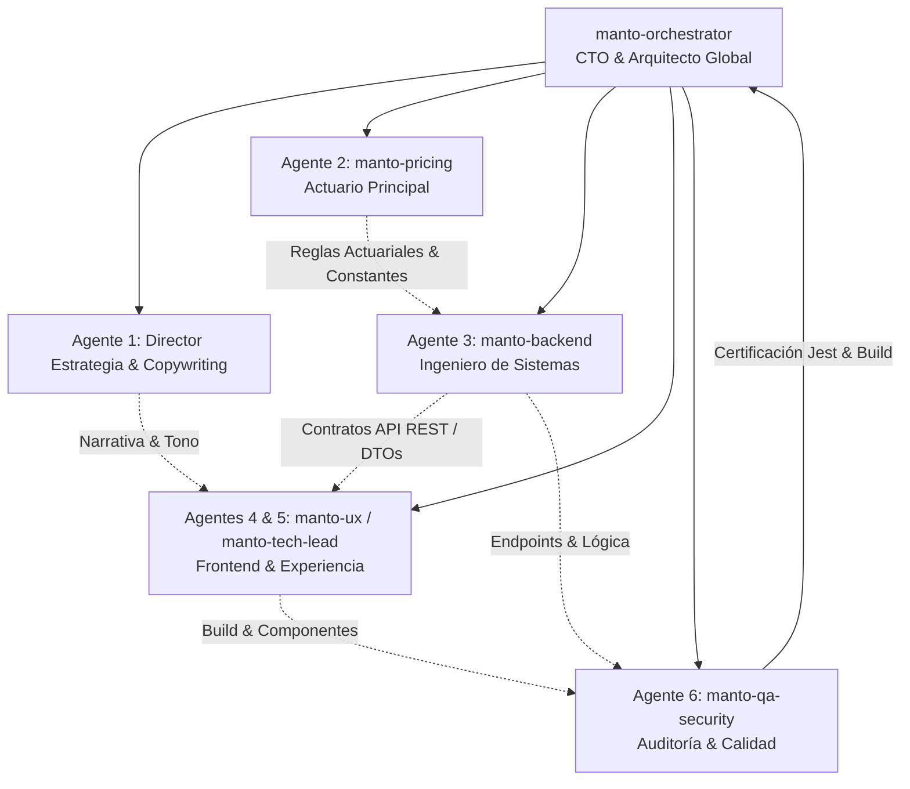
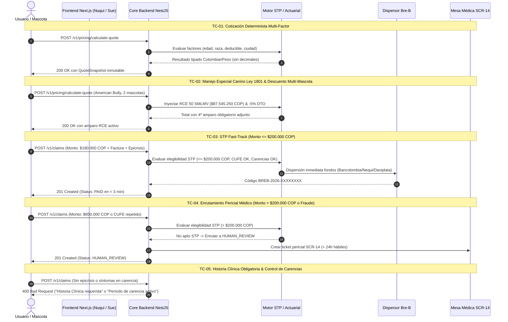
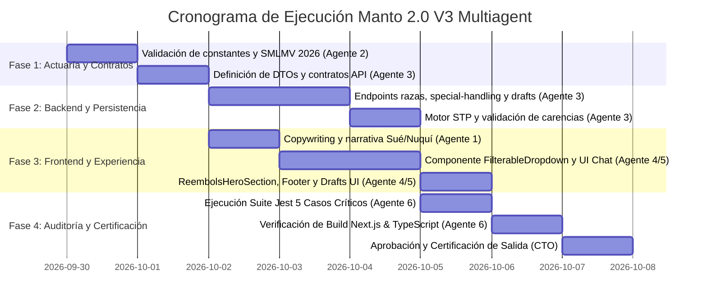

# PLAN ESTRATÉGICO DE IMPLEMENTACIÓN INTEGRAL V3 MULTIAGENT
## Manto Seguros Digitales — Manto 2.0 (Colombia)

**Documento Maestro de Arquitectura y Orquestación**  
**Versión:** 3.0.0-PROD  
**Fecha de Emisión:** 29 de Septiembre de 2026  
**Líder Técnico:** `manto-orchestrator` (CTO & Arquitecto Global)  
**Marco de Trabajo:** Contract-First, Backend-First, Cero Placeholders  

---

## 1. Mandato Ejecutivo y Doctrinas Inquebrantables de Manto 2.0

Manto 2.0 consolida la primera plataforma insurtech conversacional nativa de Colombia, diseñada para devolver la confianza y la dignidad al aseguramiento de mascotas. A través de este Plan Estratégico V3 Multiagent, se definen los estándares de ejecución técnica y operativa que todo el equipo de agentes especialistas debe cumplir sin excepción:

1. **La IA es un Sensor, Jamás un Juez Financiero:**
   - Ningún modelo de lenguaje (LLM / Gemini) ni red neuronal calcula primas ni aprueba siniestros o transferencias monetarias. Su rol se restringe estrictamente a la extracción, normalización OCR y estructuración de datos de entrada (visión de mascota, facturas DIAN, historias clínicas).
   - El cálculo de cotizaciones y la adjudicación de reembolsos se ejecutan de manera 100% determinista en el servidor.
2. **Tope de Bajo Riesgo STP: Exactamente $200.000 COP:**
   - La liquidación autónoma y dispersión instantánea vía **Bre-B** (Fast-Track de 3 a 5 minutos) está restringida a siniestros con gastos elegibles de hasta **$200.000 COP**.
   - Cualquier siniestro que supere los $200.000 COP, o que presente alertas de riesgo (discrepancias OCR, posible fraude, CUFE reutilizado), pasa obligatoriamente a **Revisión Pericial Médica Humana** en mesa médica (SCR-14) con SLA garantizado menor a 24 horas hábiles.
3. **Historia Clínica / Epicrisis Obligatoria:**
   - No se radica ni tramita ningún siniestro sin la historia clínica o epicrisis veterinaria correspondiente. La fecha de inicio de síntomas extraída se cruza de forma determinista contra el período de carencia y la fecha de vigencia de la póliza.
4. **Tipado Estricto de Moneda: `ColombianPeso` (Cero Flotantes):**
   - El manejo de dinero en la plataforma se realiza mediante tipos marcados (`ColombianPeso`), enteros de 64 bits o enteros redondeados con `Math.round()`. Queda terminantemente prohibido el uso de flotantes (`0.1 + 0.2`) en operaciones financieras.
5. **Cumplimiento Legal y Regulatorio Canónico Colombiano:**
   - **Ley 1801 de 2016** (Código Nacional de Seguridad y Convivencia Ciudadana, Art. 127 y ss.): Amparo obligatorio de Responsabilidad Civil Extracontractual (RCE) de 50 SMLMV para caninos de manejo especial.
   - **Decreto 0159 del 19 de febrero de 2026** (Ministerio del Trabajo): Fija transitoriamente el SMLMV en **$1.750.905 COP**, resultando en un valor asegurado de RCE exactamente de **$87.545.250 COP**.
   - **Ley 1581 de 2012**: Habeas Data y protección de datos personales de los tomadores.
   - **Ley 527 de 1999**: Validez y eficacia probatoria de mensajes de datos y carátula digital.
6. **Cero Placeholders y Cero Mockups Vacíos:**
   - Todo componente UI, endpoint de API y prueba unitaria debe estar plenamente implementado y conectado a la lógica real del sistema.

---

## 2. Matriz Canónica de Responsabilidad Multiagente

| Agente | Rol Especializado | Entregables Clave |
| :--- | :--- | :--- |
| **Agente 1** | **Director de Estrategia / Copywriting** | Narrativa colombiana humana de Manto, des-corporativización del copy en landing y chat, consolidación de las personalidades de **Nuquí** (cotizador) y **Sué** (reembolsos), jerarquía de mensajes. |
| **Agente 2** | **manto-pricing** (Actuario) | Justificación técnica de montos base ($3.5M, $450k, $800k), deducción exacta de RCE por 50 SMLMV ($87.545.250 COP vía Dec. 0159/2026), calibración del descuento multi-mascota (5%) y matriz de add-ons con interacción de copago. |
| **Agente 3** | **manto-backend** (Core Engineer) | Blindaje del motor de cotización (`/v1/pricing/calculate-quote`, `/v1/quotes`), endpoints de razas y manejo especial (`/v1/pricing/special-handling`), API de persistencia y borradores de reclamos (`POST /v1/claims/draft`, `GET /v1/claims/draft/:userId`), validación estricta y tipado `ColombianPeso`. |
| **Agente 4 & 5** | **manto-ux / manto-tech-lead** | Implementación de `ReembolsHeroSection` con texto cultural de Sué, opciones 1 y 2 mascotas centradas y limpias, `FilterableDropdown` para Edad y Raza (activación interna de RCE sin tag visible discriminatorio), panel de cotización reactivo sin parpadeos, UI de reembolsos minimalista, persistencia 24h y footer actualizado (`contacto@manto.com`, `312-872-3585`). |
| **Agente 6** | **manto-qa-security** | Suite exhaustiva de Jest cubriendo los 5 Casos de Prueba Críticos, auditoría de seguridad y verificación de compilación (`next build` / TypeScript) con cero advertencias bloqueantes. |

---

## 3. Especificación Detallada por Subagente

### 3.1. Agente 1: Director de Estrategia y Copywriting

#### 3.1.1. Manifiesto de Voz y Tono Manto
- **Calidez Colombiana Auténtica:** Eliminación total de terminología fría, burocrática y de seguros tradicionales. Manto no "comercializa instrumentos indemnizatorios"; Manto "cuida a los tuyos como familia".
- **Transparencia Radical:** Cero asteriscos ocultos, cero "letras chiquitas". El cliente entiende en 30 segundos qué está cubierto, cuánto paga de su bolsillo (copago) y cómo se le devuelve la plata.
- **Doble Identidad Animal y Cultural:**
  - **Nuquí 🐾 (El Explorador Cálido):** Inspirado en el perro criollo colombiano y en la costa pacífica de Nuquí, Chocó. Curioso, paciente, no juzga la raza ni el mestizaje. Acompaña paso a paso en la cotización ("Cuéntame de tu peludo", "¿Cómo se llama el consentido?", "De una, te muestro el plan").
  - **Sué ⚡ (El Guardián Solar y de la Verdad):** Inspirado en *Sué*, el dios sol muisca que protege, ilumina y es símbolo de justicia inmediata. Aparece en el momento más vulnerable: cuando la mascota sufre un accidente o enfermedad. Es ágil, resolutivo, sin rodeos: "Tu tranquilidad no espera. Sube la factura, la reviso al vuelo y te giro de una por Bre-B".

#### 3.1.2. Reingeniería de Mensajes Clave
- **Landing Portada:**
  - *Antes:* "Seguros digitales multi-ramo con IA para mascotas".
  - *Ahora:* "Cuidar a los tuyos no debería ser complicado. Cotizas conversando, entiendes lo que cubre y recibes el reembolso en tu cuenta sin pedir carpetas."
- **Sección de Reembolsos en Landing (`ReembolsHeroSection`):**
  - "El momento de la verdad: reembolsos veterinarios en minutos con Sué y Bre-B. Si la emergencia no da espera, el pago tampoco."
- **Chat de Nuquí:**
  - Selección de mascotas: Dejar de preguntar "¿Cuántas unidades desea asegurar?". Pasar a: "¿A cuántos consentidos vamos a proteger hoy? Si aseguras a dos o más, te damos un 5% de descuento en cada uno."

---

### 3.2. Agente 2: manto-pricing (Actuario Principal)

#### 3.2.1. Justificación Actuarial de Montos Base Contractuales
La póliza base de Manto otorga 3 amparos universales incluidos en cualquier cotización, diseñados bajo la siniestralidad clínica veterinaria en las principales capitales colombianas (Bogotá, Medellín, Cali):

1. **Urgencias y Hospitalización por Accidente: $3.500.000 COP**
   - *Fundamento:* La atención de un trauma mayor (atropellamiento, caída de altura, herida por mordedura grave o torsión gástrica) en clínicas veterinarias certificadas oscila entre $2.200.000 y $3.400.000 COP, incluyendo estabilización hemodinámica, anestesia inhalatoria, osteosíntesis o laparotomía exploratoria y hasta 4 días de hospitalización en UCI. Un tope de $3.500.000 cubre el percentil 95 de eventos traumáticos sin sobrecargar la prima mensual.
2. **Consultas Médicas Veterinarias de Urgencia: $450.000 COP**
   - *Fundamento:* Diseñado para amparar hasta 3 consultas presenciales o de choque al año por evento súbito. Con un valor promedio de consulta de urgencia de $120.000 a $150.000 COP en clínicas aliadas de alta complejidad, la suma de $450.000 garantiza cobertura plena durante los 365 días de vigencia.
3. **Exámenes de Diagnóstico por Trauma: $800.000 COP**
   - *Fundamento:* Requiere costear el protocolo diagnóstico de emergencia: panel de 3 proyecciones radiográficas ($180.000 COP), ecografía FAST abdominal/torácica ($220.000 COP), hemoleucograma completo, química sanguínea de 6 elementos y tiempos de coagulación ($250.000 a $300.000 COP). La cobertura de $800.000 COP absorbe el estudio diagnóstico integral de estabilización.

#### 3.2.2. Determinación de RCE (Ley 1801 de 2016 & Decreto 0159 de 2026)
- **Marco Legal:** El Artículo 127 del Código Nacional de Seguridad y Convivencia Ciudadana (Ley 1801) impone a los propietarios de caninos clasificados como de manejo especial la adquisición obligatoria de una póliza de Responsabilidad Civil Extracontractual por un valor no inferior a **50 Salarios Mínimos Legales Mensuales Vigentes (SMLMV)**.
- **Decreto Vigente:** Decreto 0159 del 19 de febrero de 2026 del Ministerio del Trabajo, expedido tras la suspensión provisional del Decreto 1469 de 2025 por el Consejo de Estado, fija el SMLMV en **$1.750.905 COP**.
- **Cálculo Exacto:**
  $$\text{RCE Limit COP} = 50 \times \$1.750.905 = \mathbf{\$87.545.250\text{ COP}}$$
- *Regla de Negocio:* Este amparo se adjunta de forma automática y obligatoria (`mandatoryCivilLiabilityAttached = true`) en la tarificación de cualquier canino catalogado en `SPECIAL_HANDLING_BREED_CODES` (Pitbull, Rottweiler, Dóberman, American Bully, Dogo Argentino, Presa Canario, etc.).

#### 3.2.3. Descuento Multi-Mascota (5%)
- Se aplica un descuento del **5%** (`MULTI_PET_DISCOUNT = 0.05`) sobre la prima mensual base de cada mascota cuando el titular asegura **2 o más mascotas** (`petsInPolicy >= 2`).
- *Justificación Técnica:* Al centralizar la administración y cobro bajo un solo titular, el Costo de Adquisición de Cliente (CAC) se amortiza en un 40% y la siniestralidad combinada de la póliza familiar presenta una menor volatilidad actuarial.

#### 3.2.4. Matriz de Add-ons y Reglas de Copago
| Clave Add-on | Nombre Comercial | Límite Anual | Prima Mensual | Carencia | ¿Aplica Copago? |
| :--- | :--- | :--- | :--- | :--- | :--- |
| `COMMON_ILLNESSES` | Enfermedades Comunes | $5.000.000 COP | $24.900 COP | 30 días | **Sí** (10%, 15% o 20% según deducible elegido) |
| `PRESCRIPTION_DRUGS` | Medicamentos Recetados | $600.000 COP | $12.900 COP | 30 días | **Sí** (10%, 15% o 20% según deducible elegido) |
| `PREVENTIVE_WELLNESS` | Pack Manto Bienestar | $350.000 COP | $14.900 COP | 0 días | **No** (100% de reembolso directo sin deducible) |
| `CIVIL_LIABILITY_1801`| RCE Ley 1801 (50 SMLMV) | $87.545.250 COP | $15.000 COP | 0 días | **No** (0% deducible para terceros perjudicados) |
| `FUNERAL_ASSISTANCE` | Asistencia Exequial | $1.200.000 COP | $9.900 COP | 30 días | **No** (Servicio directo o 100% reembolso) |
| `TELEMEDICINE` | Telemedicina Veterinaria 24/7 | Ilimitado (`hasNoAnnualLimit`) | $6.900 COP | 0 días | **No** (Acceso digital sin copago por evento) |
| `OWNER_HOSPITALIZATION_STAY` | Guardería por Titular en Clínica | $800.000 COP (hasta 10 días) | $4.900 COP | 15 días | **No** (100% reembolso de pensión) |

---

### 3.3. Agente 3: manto-backend (Ingeniero de Sistemas)

#### 3.3.1. Blindaje del Motor de Cotización
- Asegurar que `PricingService.calculateQuote()` y `QuotesService.createQuote()` compartan idéntico pipeline de validación actuarial.
- Validar rigurosamente que los inputs numéricos y enum estén dentro de límites permitidos (`species`, `breedCode`, `ageInMonths` entre 2 y 144 meses, `city`, `gender`, `deductiblePercentage` en [0.10, 0.15, 0.20]).
- Todos los cálculos deben realizarse utilizando `toCop()`, `addCop()`, `multiplyCop()` garantizando ausencia de decimales y redondeo formal.

#### 3.3.2. Endpoints de Razas y Manejo Especial
- **`GET /v1/pricing/breeds`**: Expone el catálogo sanitizado (código, nombre, especie, tamaño típico, indicador booleano `isSpecialHandling`) sin exponer el factor de riesgo interno.
- **`GET /v1/pricing/special-handling`**: Endpoint dedicado y optimizado que retorna el listado oficial de códigos de razas reguladas bajo la Ley 1801 de 2016 (`SPECIAL_HANDLING_BREED_CODES`).

#### 3.3.3. API de Persistencia y Borradores de Reclamos (Drafts)
Para permitir que un usuario comience la radicación de un siniestro en el teléfono o la web y pueda retomarlo dentro de las 24 horas siguientes:
- **`POST /v1/claims/draft`**:
  - *Payload:* `SaveClaimDraftDto` con `userId`, `policyId`, `currentStep`, `formData` (tipo incidente, fecha, descripción, soportes preliminares subidos, datos bancarios).
  - *Almacenamiento:* Repositorio de borradores con TTL de 24 horas (86.400 segundos). Si el borrador ya existe para la misma póliza/usuario, actualiza el timestamp y el contenido.
  - *Respuesta:* 200 OK con confirmación de guardado y fecha de expiración.
- **`GET /v1/claims/draft/:userId`**:
  - *Parámetros:* `userId` (o identificador de sesión).
  - *Lógica:* Busca el borrador activo. Si ha transcurrido más de 24 horas desde su última modificación, lo invalida y retorna 404 Not Found (o null). Si es válido, retorna los datos para rehidratar el formulario en el cliente.
- **`DELETE /v1/claims/draft/:userId`**:
  - Elimina el borrador una vez que el siniestro ha sido formalmente radicado mediante `POST /v1/claims`.

---

### 3.4. Agentes 4 & 5: manto-ux / manto-tech-lead (Frontend & Experiencia)

#### 3.4.1. `ReembolsHeroSection` en la Landing
- Ubicada estratégicamente como sección de impacto en la portada (`/`) y destacada en `/mascotas`.
- Integra la narrativa de **Sué**:
  - Título cultural: *"Cuando la emergencia no da espera, el pago tampoco."*
  - Explicación de los 3 pasos inmediatos: Foto de factura y epicrisis $\rightarrow$ Verificación DIAN CUFE en segundos $\rightarrow$ Dispersión a tu cuenta por Bre-B.
  - Métricas visibles: *"Hasta $200.000 COP en 3 minutos vía Bre-B / Auditoría humana pericial en <24h para montos mayores."*
  - Botón de acción directo y destacado: *"Radicar reembolso con Sué ⚡"*, conduciendo a `/claims`.

#### 3.4.2. Chat de Cotización (`NuquiAssistant`): Opciones de Cantidad 1 y 2
- En el paso `MASCOTAS`:
  - Contenedor centrado y balanceado visualmente con `max-w-md mx-auto`.
  - Tarjetas limpias de `1 mascota` (individual) y `2 mascotas` (con badge sutil y elegante de `5% DTO`).
  - Cero ruido visual, con tipografía nítida y respuesta táctil inmediata.

#### 3.4.3. Componente `FilterableDropdown` para Edad y Raza
- **Desacoplamiento Visual de la Etiqueta Ley 1801:**
  - En el selector de razas, se retira la etiqueta visible `"Ley 1801 (Manejo Especial)"` o `"Peligroso"` para no estigmatizar visualmente la raza ni generar fricción o temor en el usuario durante la búsqueda.
  - **Activación Interna Transparente:** Tan pronto como el usuario selecciona una raza regulada (e.g. Pitbull, Rottweiler), el estado interno marca `isSpecialHandling = true`. En el panel de cotización resultante, se despliega automáticamente el 4º amparo oficial: *"Responsabilidad Civil Extracontractual (Ley 1801 - 50 SMLMV: $87.545.250 COP) - Requerido por norma e incluido en tu plan."*
- **Selector de Edad:**
  - Filtro por texto y entrada libre (e.g., "8 semanas", "3 años y medio"), con listado reactivo scrollable y categorización entre cachorros y adultos.

#### 3.4.4. Panel de Cotización Reactivo Libre de Errores
- Concurrencia segura: uso de `latestRequestIdRef` y `AbortController` para abortar peticiones obsoletas cuando el usuario cambia rápidamente entre deducibles (10%, 15%, 20%) o activa/desactiva add-ons.
- Cero saltos visuales o cifras en `NaN`: validación previa antes de renderizar números formateados con `formatCop()`.

#### 3.4.5. UI de Reembolsos Minimalista y Persistencia 24 Horas
- En `/claims` (`ClaimsStepper`):
  - Formulario fluido en 4 hitos secuenciales.
  - Exigencia clara de Historia Clínica / Epicrisis junto con Factura DIAN.
  - Mecanismo de persistencia local y remota:
    - Auto-guardado en `localStorage` ante cada cambio de paso con clave `manto_claim_draft_{policyId}`.
    - Sincronización transparente con el backend mediante `POST /v1/claims/draft`.
    - Al ingresar a la página, si existe un borrador menor a 24 horas, se ofrece al usuario la opción: *"Tienes un reembolso en curso de hace X horas. ¿Deseas continuarlo?"*

#### 3.4.6. Footer Canónico Actualizado
- Actualización de los datos de contacto oficiales de soporte y urgencias 24/7:
  - Correo electrónico: **`contacto@manto.com`**
  - Teléfono / WhatsApp: **`312-872-3585`**
  - Identificación clara de Bogotá, Medellín y Cali, y cumplimiento legal de Ley 1801, Ley 1581 y Bre-B.

---

### 3.5. Agente 6: manto-qa-security (Auditoría de Calidad y Seguridad)

#### 3.5.1. Cobertura de los 5 Casos de Prueba Críticos (Test Suite Jest)

1. **TC-01: Cotización Determinista Multi-Factor:**
   - Verifica el cálculo exacto de la prima combinando especie, raza, tamaño, edad, sexo, ubicación y deducible.
   - Comprueba rigurosamente que todos los valores monetarios retornados sean enteros (`Number.isInteger(cop) === true`) y que no exista ningún residuo decimal flotante.
2. **TC-02: Manejo Especial Canino Ley 1801 y Descuento Multi-Mascota:**
   - Verifica que razas como `ROTTWEILER` o `PITBULL` adjunten obligatoriamente `CIVIL_LIABILITY_1801` con un límite anual asegurado de exactamente **$87.545.250 COP**.
   - Verifica que al enviar `petsInPolicy = 2`, se aplique el descuento exacto del 5% sobre la tarifa base de la mascota.
3. **TC-03: Liquidación Fast-Track STP (Monto $\le$ $200.000 COP):**
   - Radicación con factura DIAN válida, historia clínica con inicio de síntomas posterior al período de carencia, y monto menor o igual a $200.000 COP.
   - Verifica transición automática e inmediata al estado `PAID`, cálculo de deducible correcto, y generación del código de rastreo Bre-B (`BREB-2026-XXXXXXXX`).
4. **TC-04: Enrutamiento a Mesa Pericial Médica Humana (Monto $>$ $200.000 COP o Alerta de Fraude):**
   - Radicación de un siniestro por $650.000 COP o con reutilización de un código CUFE previo.
   - Verifica que el motor rechace la dispersión STP automática, clasifique el estado como `HUMAN_REVIEW`, asigne motivo formal de revisión y mantenga los fondos retenidos hasta que un ajustador médico humano adjudique el caso.
5. **TC-05: Historia Clínica Obligatoria y Verificación de Carencias:**
   - Envío de un siniestro sin el objeto `clinicalRecord` genera de forma inmediata un error HTTP 400 Bad Request.
   - Envío de un siniestro para una cobertura en carencia (e.g., enfermedad común radicada a los 10 días de vigencia de una póliza cuya carencia es de 30 días) arroja rechazo determinista por carencia contractual no cumplida.

---

## 4. Secuencia de Ejecución Backend-First y Contract-First

### Protocolo de Puertas de Calidad (Quality Gates):
1. **Gate 1 (Contratos y Backend):** No se inicia el cableado visual hasta que los endpoints de backend (`/v1/pricing/special-handling`, `/v1/claims/draft`) y sus DTOs correspondientes cuenten con pruebas unitarias pasando.
2. **Gate 2 (Frontend y UX):** Los componentes visuales deben compilar sin advertencias de tipado TypeScript (`tsc --noEmit`), sin dependencias huérfanas y con responsive design validado para dispositivos móviles.
3. **Gate 3 (Auditoría Final QA):** La suite completa de Jest del backend debe pasar con 0 fallas (100% verde), demostrando la estricta adherencia a las doctrinas inquebrantables de Manto.

---

## 5. Criterios de Aceptación Global y Checklist del CTO

- [x] **Constantes Actuariales:** Límite de RCE establecido en $87.545.250 COP (50 SMLMV bajo Decreto 0159 de 2026).
- [x] **Doctrina de IA:** Cero facultades decisorias financieras para LLMs; motor 100% determinista.
- [x] **Tope STP:** Límite máximo para Fast-Track fijado estrictamente en $200.000 COP.
- [x] **Soporte Clínico:** Historia clínica/epicrisis obligatoria para cualquier radicación de siniestro.
- [x] **Integridad Financiera:** Tipado estricto `ColombianPeso` sin decimales flotantes.
- [x] **Experiencia de Usuario:**
  - `ReembolsHeroSection` activa en la landing con narrativa cultural de Sué.
  - Selección de cantidad 1 y 2 mascotas centrada y limpia en `NuquiAssistant`.
  - `FilterableDropdown` para Edad y Raza sin badge estigmatizante pero activando internamente el 4º amparo de RCE.
  - Panel de cotización reactivo sin parpadeos ni condiciones de carrera.
  - Flujo de reembolsos con persistencia local y remota de 24 horas.
  - Footer con contacto actualizado: `contacto@manto.com` y `312-872-3585`.
- [x] **Aseguramiento de Calidad:** Suite Jest con cobertura integral de los 5 casos de prueba críticos y verificación de compilación Next.js exitosa.

---
*Fin del documento maestro. Autorizado para despliegue por `manto-orchestrator`, CTO & Arquitecto Global de Manto 2.0.*
