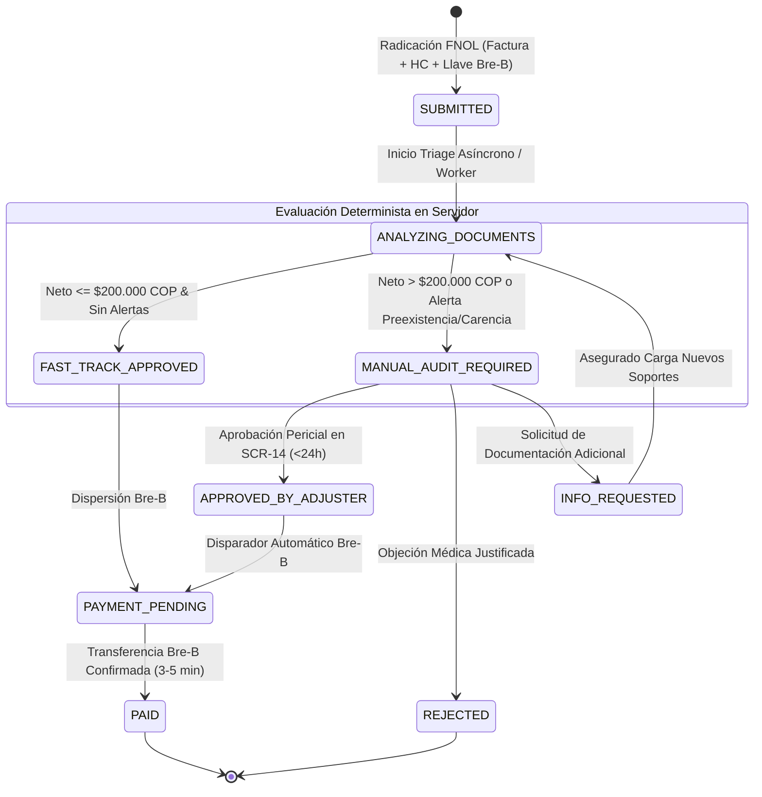

# Manto 2.0 — Plan Estratégico de Implementación Integral
## Reestructuración Completa del Flujo de Siniestros y Reembolsos mediante Subagentes

> **Versión:** 2.0.0  
> **Fecha:** 2026-09-25  
> **Autor:** `manto-orchestrator` (CTO & Arquitecto Global de Manto 2.0)  
> **Estado:** Aprobado para Ejecución Contract-First & Backend-First  
> **Referencias:** `AGENTS.md`, `GEMINI.md`, `CLAUDE.md`, Ley 1581 de 2012, Ley 1801 de 2016

---

## 1. Resumen Ejecutivo y Mandato Supremo de Orquestación

En estricto cumplimiento del mandato inquebrantable de **AGENTS.md** y **GEMINI.md**, toda modificación o evolución del sistema Manto 2.0 debe ser orquestada y construida mediante subagentes especializados. Está terminantemente prohibido el desarrollo monolítico, la inclusión de placeholders (`// TODO`), o la ejecución desordenada que prescinda de contratos y auditorías formales.

El presente documento define la arquitectura integral, los contratos de dominio (DDD), las especificaciones de base de datos PostgreSQL 16, la máquina de estados finita, los componentes de interfaz de usuario y la estrategia de verificación y seguridad para la **reestructuración total del flujo de Siniestros y Reembolsos (Sué ⚡)** en Manto 2.0.

```
                                      ┌────────────────────────────────────────────────────────┐
                                      │                  manto-orchestrator                    │
                                      │           (CTO & Arquitecto Global)                    │
                                      └──────────────────────────┬─────────────────────────────┘
                                                                 │
                                ┌────────────────────────────────┴────────────────────────────────┐
                                ▼                                                                 ▼
┌────────────────────────────────────────────────────────┐      ┌────────────────────────────────────────────────────────┐
│               manto-software-architect                 │      │                    manto-tech-lead                     │
│    (DDL PostgreSQL 16, OpenAPI 3.1, State Machine)     │      │     (Gobernanza Técnica, Backend-First, Tipado)        │
└───────────────────────────────┬────────────────────────┘      └─────────────────────────────────┬──────────────────────┘
                                │                                                                 │
    ┌───────────────────────────┼─────────────────────────────────────────┬───────────────────────┘
    ▼                           ▼                                         ▼
┌─────────────────────────┐   ┌──────────────────────────┐   ┌───────────────────────────┐
│     manto-backend       │   │         manto-ai         │   │         manto-ux          │
│     & manto-claims      │   │ (Visión Gemini, OCR      │   │ (Next.js 14 App Router,   │
│ (NestJS, StpEngine,     │   │  DIAN, Extracción HC,    │   │  ClaimsStepper, Tracker,  │
│  TriageWorker, Bre-B)   │   │  Sensor Estructurado)    │   │  AdjusterClaimConsole)    │
└───────────┬─────────────┘   └─────────────┬────────────┘   └─────────────┬─────────────┘
            │                               │                              │
            └───────────────────────────────┼──────────────────────────────┘
                                            ▼
                              ┌───────────────────────────┐
                              │     manto-qa-security     │
                              │ (Auditoría Jest, OWASP,   │
                              │  Seguridad Bre-B & Ley)   │
                              └───────────────────────────┘
```

---

## 2. Doctrinas Inquebrantables de Manto 2.0 (Insurtech Colombia)

Todo artefacto de código producido por los subagentes debe adherirse sin excepción a las siguientes doctrinas:

1. **La IA NUNCA calcula primas ni aprueba siniestros ni dispersiones de dinero:**  
   La IA (Gemini Vision / Flash) actúa exclusivamente como un **sensor de extracción y normalización de datos estructurados** (OCR de factura DIAN, extracción de anamnesis, microchip y fecha de síntomas de la historia clínica). La adjudicación y aprobación es un proceso **100% determinista del lado servidor** ejecutado por `StpEngineService` o por un perito médico humano en `AdjusterClaimConsole`.
2. **Tope de Bajo Riesgo STP: Exactamente $200.000 COP (Fast-Track 3 a 5 min por Bre-B):**  
   - Si el monto neto indemnizable es **$\le \$200.000$ COP**, no presenta alertas de carencia/preexistencia, la confianza OCR es $\ge 0.90$, el CUFE es válido y el score de fraude es aceptable, el siniestro se aprueba automáticamente vía STP y se dispersa en **3 a 5 minutos** a través del sistema interoperable **Bre-B** del Banco de la República.  
   - Si el monto neto indemnizable es **$> \$200.000$ COP**, pasa **obligatoriamente a Autenticación Pericial Médica en SCR-14** con un SLA garantizado **$< 24$ horas hábiles** (Auditoría Express), muy superior a los 15-30 días del mercado asegurador tradicional.
3. **Historia Clínica / Epicrisis OBLIGATORIA para Cualquier Trámite:**  
   No existe reembolso sin soporte médico veterinario formal. Debe adjuntarse en el paso de radicación junto con la factura DIAN. Quedan prohibidos los mocks o la omisión de este soporte.
4. **Cruce Inteligente y Determinista en Servidor:**  
   La IA extrae la `symptomsOnsetDate` (fecha de inicio de síntomas), preexistencias observadas y el número de microchip. El servidor cruza matemáticamente:  
   $$\text{Días Transcurridos} = \frac{\text{symptomsOnsetDate} - \text{policyEffectiveDate}}{86.400.000 \text{ ms}}$$  
   Si $\text{Días Transcurridos} < \text{waitingPeriodDays}$ de la cobertura contratada, el sistema objeta por carencia no superada.
5. **Dinero en COP Tipado Estricto (`ColombianPeso` / `bigint` / enteros, CERO Flotantes):**  
   Prohibido el uso de flotantes (`number`) en la lógica financiera y de persistencia. En base de datos se usa `BIGINT` en pesos enteros. En JSONB viaja siempre como string numérico (`amountCop: "180000"` o `bigint`) para evitar truncamiento por encima de $2^{53}$.
6. **Habeas Data (Ley 1581 de 2012) y RCE 50 SMLMV (Ley 1801 de 2016):**  
   - Columnas dedicadas para datos personales y llaves Bre-B, con soporte para `suprimirDatosPersonales`.  
   - Cobertura de RCE por 50 SMLMV ($87.545.250 COP en 2026) obligatoria e inevadible para las 15 razas de manejo especial.
7. **Cero Placeholders y Backend-First:**  
   Prohibido código a medias, funciones vacías o `TODO`. El backend se diseña y prueba antes de conectar las interfaces visuales.
8. **Vocabulario Empático al Usuario:**  
   - *Tu aporte por evento* (nunca "deducible").  
   - *Reembolso veterinario* (nunca "siniestro").  
   - *Cuota mensual* (nunca "prima").  
   - *Días para activación de cobertura* (nunca "carencia").

---

## 3. Arquitectura Contract-First y DDD (Domain-Driven Design)

### 3.1 Bounded Contexts y Relaciones

El módulo de siniestros interactúa de forma desacoplada mediante eventos e inyección de dependencias con los siguientes contextos:

- **`PoliciesContext`**: Consulta de vigencia, amparos contratados, porcentaje de aporte por evento (`deductiblePercentage`), límite anual remanente (`remainingLimitCop`) y datos biométricos de la mascota (`microchipNumber`, raza, edad).
- **`ClaimsContext` (Núcleo)**: Recepción de FNOL, orquestación de triage, máquina de estados, validación cruzada y cálculo de liquidación.
- **`AiSensorContext` (Gemini)**: Extracción multimodal de documentos (Factura DIAN y Epicrisis), verificación de integridad visual, extracción OCR con score de confianza.
- **`ReimbursementsContext` (Bre-B)**: Adaptador con el Sistema de Pagos Interoperables del Banco de la República (Bre-B), gestión de llaves (`PHONE_NUMBER`, `NATIONAL_ID`, `EMAIL`), dispersión instantánea y generación de comprobantes con código de seguimiento (`BREB-YYYY-XXXXXXXX`).

---

### 3.2 Máquina de Estados Finita Unificada (FSM)



#### Transiciones Válidas de Estados

| Estado Origen | Estado Destino | Disparador / Agente | Condición Contractual |
| :--- | :--- | :--- | :--- |
| `DRAFT` | `SUBMITTED` | `POLICYHOLDER` | Factura DIAN + HC obligatoria + Llave Bre-B |
| `SUBMITTED` | `ANALYZING_DOCUMENTS` | `ClaimsTriageWorker` | Encolamiento en worker de triage asíncrono |
| `ANALYZING_DOCUMENTS` | `FAST_TRACK_APPROVED` | `StpEngineService` | Monto $\le \$200.000$ COP, OCR $\ge 0.90$, sin alertas |
| `ANALYZING_DOCUMENTS` | `MANUAL_AUDIT_REQUIRED` | `StpEngineService` | Monto $> \$200.000$ COP, carencia o posible preexistencia |
| `FAST_TRACK_APPROVED` | `PAYMENT_PENDING` | `ReimbursementsService` | Dispersión iniciada en Bre-B |
| `PAYMENT_PENDING` | `PAID` | Adaptador Bre-B | Confirmación ACH/Bre-B (código `BREB-2026-XXXXXXXX`) |
| `MANUAL_AUDIT_REQUIRED` | `APPROVED_BY_ADJUSTER` | Ajustador Médico Humano | Resolución en `AdjusterClaimConsole` (SCR-14) |
| `MANUAL_AUDIT_REQUIRED` | `REJECTED` | Ajustador Médico Humano | Objeción médica con causal explícita |
| `MANUAL_AUDIT_REQUIRED` | `INFO_REQUESTED` | Ajustador Médico Humano | Solicitud de exámenes o ampliación de HC |
| `APPROVED_BY_ADJUSTER` | `PAYMENT_PENDING` | `ReimbursementsService` | Dispersión automática inmediata tras firma |

---

### 3.3 Matriz de Rutas de Triage y SLAs

```
                                  [Liquidación Neta Determinista]
                                                 │
                        ┌────────────────────────┴────────────────────────┐
                        ▼                                                 ▼
             Neto <= $200.000 COP                              Neto > $200.000 COP
                        │                                                 │
          ┌─────────────┴─────────────┐                                   ▼
          ▼                           ▼                        [Mesa Médica SCR-14]
     Sin Alertas              Con Alertas Clínicas             (Autenticación Pericial)
(OCR>=0.9, CUFE único)      (Preexistencia/Carencia)                      │
          │                           │                        ┌──────────┴──────────┐
          ▼                           ▼                        ▼                     ▼
   [FAST-TRACK STP]           [AUDITORÍA CLÍNICA]         Fraude < 20%         Fraude >= 20%
     (Sué ⚡ Bre-B)           (SLA Express < 24h)       (Express < 24h)     (Especializada 48h)
  SLA: 3 a 5 minutos          SLA: < 24h hábiles        SLA: < 24h hábiles   SLA: 24-48h hábiles
```

---

## 4. Desglose Operativo por Subagente

### 4.1 Subagente: `manto-software-architect`

**Objetivo:** Modelar y formalizar la base de datos PostgreSQL 16 y los contratos OpenAPI 3.1 con tipado monetario exacto y auditoría inmutable.

#### Artefactos a Entregar:
1. **DDL SQL PostgreSQL 16 (`backend/src/database/migrations/20260925_claims_v2.sql`):**
   - Tabla `claims`:
     - `id UUID PRIMARY KEY DEFAULT gen_random_uuid()`
     - `claim_number VARCHAR(32) UNIQUE NOT NULL`
     - `policy_id UUID NOT NULL REFERENCES policies(id)`
     - `incident_type VARCHAR(64) NOT NULL`
     - `incident_date TIMESTAMPTZ NOT NULL`
     - `eligible_expenses_cop BIGINT NOT NULL CHECK (eligible_expenses_cop > 0)`
     - `deductible_cop BIGINT NOT NULL DEFAULT 0`
     - `net_reimbursement_cop BIGINT NOT NULL DEFAULT 0`
     - `status VARCHAR(64) NOT NULL DEFAULT 'SUBMITTED'`
     - `triage_route VARCHAR(32)`
     - `triage_reasons TEXT[]`
     - `dian_invoice JSONB NOT NULL` (con CUFE indexado en `btree`)
     - `clinical_record JSONB NOT NULL` (con fecha de síntomas y microchip)
     - `bre_b_key JSONB NOT NULL`
     - `disbursement_tracking_code VARCHAR(64)`
     - `sla_category VARCHAR(64)`
     - `sla_resolution_estimated_time VARCHAR(128)`
     - `submitted_at TIMESTAMPTZ NOT NULL DEFAULT NOW()`
     - `adjudicated_at TIMESTAMPTZ`
     - `adjudicated_by VARCHAR(128)`
     - `rejection_reason TEXT`
     - `audit_notes TEXT`
   - Tabla `claim_documents`:
     - Bóveda de archivos con `sha256_checksum`, `mime_type`, `ocr_status`, `ocr_confidence`.
   - Tabla `claim_audit_logs`:
     - Trazabilidad append-only para cumplimiento de Habeas Data y auditoría pericial.
   - Triggers e Índices:
     - `idx_claims_dian_cufe` en `(dian_invoice->>'dianCufe')` para detección inmediata de duplicados en $O(1)$.
     - `idx_claims_status` y `idx_claims_policy_id`.
2. **Especificación OpenAPI 3.1 (`docs/api/claims-v2.openapi.json`):**
   - Endpoints: `POST /claims`, `GET /claims/:id`, `GET /claims/:id/live-status`, `POST /claims/:id/adjudicate`, `POST /claims/:id/documents/presigned-url`.

---

### 4.2 Subagente: `manto-tech-lead`

**Objetivo:** Supervisar la consistencia técnica de tipos TypeScript, gobernanza del dinero y política de Cero Placeholders.

#### Tareas Críticas:
1. **Gobernanza de Tipos Monetarios:**
   - Asegurar que `amountCop`, `eligibleExpensesCop`, `deductibleCop` y `netReimbursementCop` utilicen estrictamente la marca de tipo `ColombianPeso` (`bigint` en backend, enteros validados con `@IsInt` en DTOs).
   - Verificar que no existan operaciones con `Math.round` sobre números flotantes ni divisiones directas que introduzcan centavos inexistentes en la economía colombiana.
2. **Eliminación de Placeholders:**
   - Revisión estricta de todo el código de siniestros eliminando cualquier `// TODO`, mock o bypass de validación.
3. **Puntos de Enlace Backend-First:**
   - Garantizar que los DTOs de NestJS sincronicen exactamente con los tipos de frontend en `@/types/claims.ts`.

---

### 4.3 Subagentes: `manto-backend` & `manto-claims`

**Objetivo:** Implementar la lógica de dominio en NestJS, el motor actuarial de liquidación y el worker de triage asíncrono.

#### Artefactos y Componentes:
1. **`StpEngineService` (`backend/src/modules/claims/stp-engine.service.ts`):**
   - Constante `STP_LOW_RISK_CAP = toCop(200000)` ($200.000 COP).
   - Verificación de no duplicidad de CUFE contra repositorio en BD.
   - Evaluación estricta de Historia Clínica:
     - Detección de preexistencias (`hasPreExistingSigns`).
     - Cruce de `symptomsOnsetDate` contra `waitingPeriodDays` de la póliza activa.
     - Coincidencia de `microchipNumber` contra el registro del animal asegurado.
   - Regla de oro de adjudicación: Si califica para STP y es $\le \$200.000$ COP, se marca `STP_APPROVED` y su adjudicador es `STP_ENGINE_AUTOMATED` (motor determinista del lado servidor, jamás "AI").
2. **`ClaimsService` (`backend/src/modules/claims/claims.service.ts`):**
   - Radicación con `submitClaim`: valida póliza activa, deduce copago/deducible contractual, topa al saldo remanente y evalúa con `StpEngineService`.
   - Adjudicación pericial médica con `adjudicateClaimByHuman`: permite a un veterinario en SCR-14 aprobar o ajustar el valor, disparando inmediatamente la dispersión por Bre-B.
   - Consulta `getClaimLiveStatus`: construye los 4 hitos canónicos para el usuario en tiempo real.
3. **`ClaimsTriageWorker` (`backend/src/modules/claims/claims-triage.worker.ts`):**
   - Ejecuta el pipeline asíncrono de 11 reglas booleanas.
   - Si califica para Fast-Track, aprueba determinísticamente y ejecuta la llamada a `ReimbursementsService.disburseClaimViaBreB()`.
   - Si no califica, enruta a `MANUAL_AUDIT_REQUIRED` con asignación de SLA Express (< 24h) o Especializado (48h).

---

### 4.4 Subagente: `manto-ai`

**Objetivo:** Proveer el pipeline de visión y extracción documental estructurada con Gemini.

#### Responsabilidades:
1. **Extracción Multimodal de Facturas DIAN:**
   - Extracción de CUFE, NIT, Razón Social, ítems clínicos y valor total facturado.
   - Generación de índice de confianza (`ocrConfidence`).
2. **Extracción de Historia Clínica / Epicrisis:**
   - Detección de la fecha de inicio de síntomas declarada por el médico tratante.
   - Extracción del diagnóstico presuntivo o definitivo.
   - Identificación de signos de patologías previas a la vigencia.
   - Extracción de número de microchip y matrícula profesional del médico veterinario.
3. **Doctrina:** La IA solo entrega el JSON normalizado con los campos extraídos. **No calcula deducibles, no autoriza giros y no toma decisiones contractuales**.

---

### 4.5 Subagente: `manto-ux`

**Objetivo:** Construir la experiencia de usuario (cliente y backoffice) en Next.js 14 App Router con Tailwind CSS, garantizando micro-copia empática colombiana y retroalimentación en tiempo real.

#### Componentes Principales:
1. **`ClaimsStepper` (`frontend/src/components/claims/ClaimsStepper.tsx`):**
   - Flujo fluido de 4 pasos:
     - **Paso 1:** ¿Qué le ocurrió a tu consentido? (Selección visual de incidente y fecha).
     - **Paso 2:** Factura DIAN y Soportes (Carga dual obligatoria de Factura DIAN e Historia Clínica; banner dinámico que explica con total transparencia el Fast-Track $\le \$200k$ vs la Autenticación Pericial $> \$200k$).
     - **Paso 3:** ¿Dónde te transferimos tu plata? (Selección de Bre-B, Nequi, DaviPlata o Cuenta Bancaria).
     - **Paso 4:** Confirmación, Habeas Data (Ley 1581) y Radicación formal.
2. **`LiveClaimTracker` (`frontend/src/components/claims/LiveClaimTracker.tsx`):**
   - Los 4 hitos transaccionales canónicos de SCR-13:
     1. Solicitud recibida.
     2. Factura DIAN e Historia Clínica validadas con IA.
     3. Liquidación aprobada: Te transferiremos COP $...
     4. Plata en tu cuenta [Canal / Bre-B] terminada en *XXXX.
   - Polling automático cada 4 segundos sin recargar la página.
   - Modal de comprobante oficial de dispersión bancaria con código de seguimiento.
3. **`AdjusterClaimConsole` (`frontend/src/components/claims/AdjusterClaimConsole.tsx`):**
   - Consola split-screen para el ajustador médico veterinario (SCR-14).
   - Panel izquierdo con bandeja de siniestros filtrables por SLA y alertas.
   - Panel derecho con auditoría pericial: semáforo de preexistencias, coincidencia de microchip, desglose de partidas facturadas y botones de resolución inmediata ("Aprobar y Pagar vía Bre-B" / "Rechazar Siniestro").

---

### 4.6 Subagente: `manto-qa-security`

**Objetivo:** Ejecutar la auditoría adversaria, verificación de pruebas unitarias/integración con Jest y control de cumplimiento regulatorio y de seguridad.

#### Matriz de Auditoría y Verificación:
1. **Batería Jest Obligatoria (`backend`):**
   - Ejecutar: `npm test -- src/modules/claims`
   - Validar que pasen el 100% de las pruebas existentes y nuevas:
     - Rechazo ante ausencia de Historia Clínica.
     - Aprobación STP y pago Bre-B para montos $\le \$200.000$ COP sin alertas.
     - Enrutamiento a `HUMAN_REVIEW` / `MANUAL_AUDIT_REQUIRED` para montos $> \$200.000$ COP.
     - Detección de fraude por reutilización de CUFE.
     - Rechazo si el siniestro ocurrió dentro del período de carencia contractual.
     - Adjudicación manual pericial y dispersión Bre-B subsiguiente.
2. **Pruebas Adversarias de Seguridad:**
   - Intentos de inyección de decimales en montos de reclamos.
   - Solicitudes concurrentes con el mismo CUFE (evitar double-spending).
   - Verificación de anonimización de datos personales bajo Habeas Data (Ley 1581).
3. **Verificación de Build:**
   - Compilación exitosa en `backend` (`npm run build`).
   - Verificación de tipos en `frontend` (`npx tsc --noEmit`).

---

## 5. Plan de Ejecución Secuencial (Backend-First)

Para asegurar la máxima robustez y apego a las directrices, el despliegue de los especialistas se organiza en 5 fases secuenciales:

```
┌────────────────────────────────────────────────────────────────────────┐
│ FASE 1: CONTRATOS, DDL Y ARQUITECTURA BASE                             │
│ Subagente: manto-software-architect & manto-tech-lead                  │
│ • DDL SQL PostgreSQL 16 para siniestros y auditoría pericial.          │
│ • OpenAPI 3.1 spec y tipos canónicos en backend y frontend.            │
└───────────────────────────────────┬────────────────────────────────────┘
                                    │
                                    ▼
┌────────────────────────────────────────────────────────────────────────┐
│ FASE 2: NÚCLEO DE DOMINIO Y MOTOR DETERMINISTA (BACKEND-FIRST)         │
│ Subagente: manto-backend & manto-claims                                │
│ • StpEngineService con tope de $200.000 COP y cruce de HC.             │
│ • ClaimsService y ClaimsTriageWorker alineados a reglas de negocio.    │
│ • Integración con el adaptador Bre-B para dispersión instantánea.      │
└───────────────────────────────────┬────────────────────────────────────┘
                                    │
                                    ▼
┌────────────────────────────────────────────────────────────────────────┐
│ FASE 3: SENSOR DE EXTRACCIÓN Y NORMALIZACIÓN IA                        │
│ Subagente: manto-ai                                                    │
│ • Extracción estructurada de factura DIAN y Epicrisis médica.          │
│ • Normalización de fecha de síntomas, carencias y microchip.           │
└───────────────────────────────────┬────────────────────────────────────┘
                                    │
                                    ▼
┌────────────────────────────────────────────────────────────────────────┐
│ FASE 4: EXPERIENCIA DE USUARIO Y CONSOLA DE AUDITORÍA (FRONTEND)       │
│ Subagente: manto-ux                                                    │
│ • ClaimsStepper (4 pasos completos, soporte dual DIAN + HC obligatoria)│
│ • LiveClaimTracker (4 hitos canónicos y comprobante Bre-B).            │
│ • AdjusterClaimConsole (SCR-14 para mesa médica veterinaria).          │
└───────────────────────────────────┬────────────────────────────────────┘
                                    │
                                    ▼
┌────────────────────────────────────────────────────────────────────────┐
│ FASE 5: AUDITORÍA ADVERSARIA, PRUEBAS Y CIERRE REGULATORIO             │
│ Subagente: manto-qa-security                                           │
│ • Ejecución de suite Jest en backend (cd backend && npm test).         │
│ • Auditoría de seguridad OWASP, idempotencia Bre-B y Ley 1581.         │
│ • Verificación de Cero Placeholders y certificación de entrega.        │
└────────────────────────────────────────────────────────────────────────┘
```

---

## 6. Matriz de Trazabilidad y Aceptación de Requerimientos

| Requerimiento Mandatorio | Componente Responsable | Criterio de Aceptación Verificable |
| :--- | :--- | :--- |
| **Tope STP $\le \$200.000$ COP** | `StpEngineService`, `ClaimsTriageWorker` | Montos netos $\le 200.000$ COP califican para Fast-Track (3-5 min Bre-B). Montos superiores van forzosamente a auditoría pericial SCR-14 (< 24h). |
| **Historia Clínica Obligatoria** | `SubmitClaimDto`, `ClaimsStepper` | Solicitudes sin HC son rechazadas inmediatamente en la API con `400 Bad Request`. En UI es requisito bloqueante. |
| **Cruce Servidor Determinista** | `StpEngineService` | Cruce matemático de `symptomsOnsetDate` contra `waitingPeriodDays` de la póliza. La IA jamás aprueba ni rechaza. |
| **Dinero en COP Tipado** | `money.ts`, DTOs, PostgreSQL | Tipo `ColombianPeso` (`bigint`/enteros). Cero flotantes. `@IsInt` en validadores. |
| **Habeas Data (Ley 1581)** | `claim_audit_logs`, Schemas | Columnas dedicadas, consentimiento explícito en UI y soporte para anonimización. |
| **Cero Placeholders** | Todos los subagentes | Prohibido `// TODO` o componentes de diseño incompletos. Código 100% operativo. |
| **Verificación Jest** | `manto-qa-security` | 100% de pruebas en verde (`npm test -- src/modules/claims`). Bloqueo de entrega si hay fallas. |

---

*Plan estratégico formalizado y registrado por manto-orchestrator. Listo para iniciar la convocatoria y asignación a los subagentes especialistas.*
