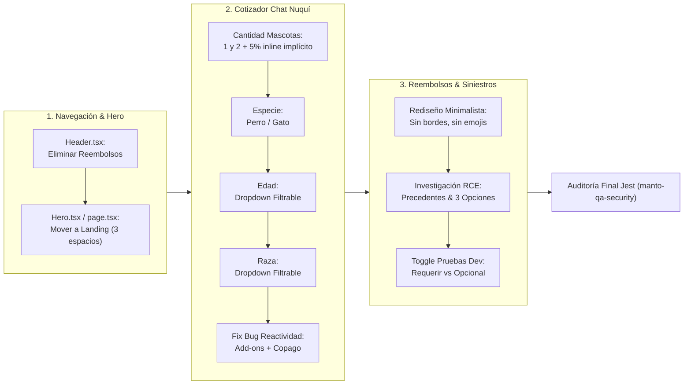

# Plan Estratégico de Implementación Integral
## Reestructuración de Navegación, Cotizador Guiado Nuquí y Flujo de Siniestros Sué

> **Versión:** 1.0.0  
> **Fecha:** 29 de Septiembre de 2026  
> **Árbitro Canónico:** `manto-orchestrator` (CTO & Arquitecto Global de Manto 2.0)  
> **Estado:** Aprobado para Ejecución Contract-First & Subagent Orchestration  
> **Gobernanza:** `docs/REGLAS_ORQUESTACION_AGENTES.md`, `AGENTS.md`, `CLAUDE.md`, Ley 1581 de 2012, Ley 1801 de 2016  

---

## 1. Resumen Ejecutivo y Mandato Supremo

Bajo el mandato ineludible **"MUST UTILIZA LAS REGLAS DE PROGRAMACION QUE TENEMOS"**, toda evolución, refactorización o corrección sobre el sistema Manto 2.0 debe seguir estrictamente los principios de especialización por dominios, diseño por contratos (*Contract-First*), construcción con base en el servidor (*Backend-First*), ausencia total de placeholders o código simulado (*Zero Mockups*), y culminación obligatoria mediante la suite de auditoría y seguridad ejecutada por `manto-qa-security`.

El presente plan establece la hoja de ruta integral para dar cumplimiento a los requerimientos prioritarios emitidos sobre tres áreas críticas del sistema:
1. **Navegación / Header:** Purificación de la cabecera eliminando accesos a reembolsos y relocalización de la funcionalidad al landing page principal (`Hero.tsx` / `page.tsx`).
2. **Sección de Cotización (Chat Guiado de Nuquí):** Optimización del embudo conversacional (1 y 2 mascotas con descuento inline implícito, especie Perro/Gato, reemplazo de cajitas dispersas por selectores desplegables filtrables reactivos para edad y raza) y resolución definitiva del bug de reactividad y congelamiento de cálculo en Add-ons + Copago.
3. **Sección de Reembolsos (Siniestros Sué):** Rediseño minimalista y tipográfico sin emojis ni bordes pesados en "¿Qué le ocurrió a tus mascotas?", investigación exhaustiva de la siniestralidad y soportes legales para Responsabilidad Civil Extracontractual (RCE - Ley 1801) con benchmarking frente a Lemonade, Tuio y aseguradoras colombianas, y creación de un toggle funcional para pruebas/dev que permita alternar entre "Requerir soportes" (default) y "Soportes opcionales" (bypass).

```
                                    ┌────────────────────────────────────────────────────────┐
                                    │                  manto-orchestrator                    │
                                    │           (CTO & Arquitecto Global)                    │
                                    └──────────────────────────┬─────────────────────────────┘
                                                               │
                              ┌────────────────────────────────┴────────────────────────────────┐
                              ▼                                                                 ▼
┌────────────────────────────────────────────────────────┐      ┌────────────────────────────────────────────────────────┐
│                   manto-ux-research                    │      │                    manto-tech-lead                     │
│        (Investigación RCE Lemonade, Tuio, SURA)        │      │    (Gobernanza Técnica, Solución Bug Reactividad)      │
└─────────────────────────────┬──────────────────────────┘      └───────────────────────────────┬────────────────────────┘
                              │                                                                 │
                              └────────────────────────────────┬────────────────────────────────┘
                                                               │
                                  ┌────────────────────────────┼────────────────────────────┐
                                  ▼                            ▼                            ▼
                    ┌───────────────────────────┐┌───────────────────────────┐┌───────────────────────────┐
                    │         manto-ux          ││       manto-pricing       ││       manto-claims        │
                    │ (Next.js 14, Header, Hero,││(Tarificación Determinista,││ (Reglas STP, Toggle Dev, │
                    │ Dropdowns, Clean Redesign)││ Reactividad Copago/Addons)││ Arquitectura RCE SCR-12) │
                    └─────────────┬─────────────┘└─────────────┬─────────────┘└─────────────┬─────────────┘
                                  │                            │                            │
                                  └────────────────────────────┼────────────────────────────┘
                                                               ▼
                                                ┌─────────────────────────────┐
                                                │      manto-qa-security      │
                                                │(Auditoría Jest, Invariantes,│
                                                │   Validación de Entrega)    │
                                                └─────────────────────────────┘
```

---

## 2. Doctrinas Inquebrantables de Manto 2.0

Cada modificación planteada en este plan salvaguarda las doctrinas fundacionales de Manto 2.0:

1. **La IA NUNCA calcula primas ni aprueba siniestros o reembolsos de dinero:**  
   Es estrictamente un sensor de extracción y normalización estructurada (visión de raza, extracción de anamnesis clínica, OCR de factura DIAN). Toda decisión financiera es determinista del lado servidor.
2. **Tope de Bajo Riesgo STP: Exactamente $200.000 COP (Fast-Track 3 a 5 min por Bre-B):**  
   Si el valor supera los $200.000 COP o presenta alertas, pasa obligatoriamente a Autenticación Pericial Médica en SCR-14 (< 24h hábiles).
3. **Historia Clínica / Epicrisis OBLIGATORIA para cualquier trámite:**  
   No existe reembolso sin soporte médico formal. El toggle de pruebas es un bypass exclusivo de entornos de desarrollo/QA, manteniendo el modo productivo inalterable.
4. **Cruce determinista en servidor:**  
   La fecha de inicio de síntomas extraída se cruza contra la fecha de inicio de vigencia de la póliza para verificar carencias y preexistencias.
5. **Dinero en COP Tipado Estricto (`ColombianPeso` / `bigint` / enteros, cero flotantes):**  
   Prohibido el uso de flotantes en cálculos financieros.
6. **Habeas Data (Ley 1581 de 2012) y RCE 50 SMLMV (Ley 1801 de 2016):**  
   Garantizar la protección de datos personales y la obligatoriedad legal del amparo de 50 SMLMV ($87.545.250 COP en 2026) para caninos de manejo especial.
7. **Cero Placeholders y Cero Mockups vacíos:**  
   Toda funcionalidad desplegada debe ser real, operable y testeable.

---

## 3. Especificación Técnica por Módulos y Tareas



### MÓDULO 1: NAVEGACIÓN Y HEADER

#### 1.1 Limpieza Integral de `Header.tsx`
* **Diagnóstico actual:** `Header.tsx` posee actualmente 4 puntos de acceso a Reembolsos:
  1. Enlace en el navbar de escritorio (`nav > Link` a `/claims` con badge Bre-B).
  2. Botón rápido en la barra derecha de escritorio (`Link` con label "Pedir reembolso ⚡").
  3. Botón de acceso móvil rápido (`Link` con icono Zap y label "Reembolsos").
  4. Bloque dedicado dentro del menú desplegable móvil (`mobileMenuOpen`).
* **Acción de Arquitectura:**
  - Eliminar los 4 puntos de enlace hacia Reembolsos de `Header.tsx`.
  - El Header queda concentrado exclusivamente en:
    - Navegación entre ramos: "Mascotas" (activo), "Hogar" (próximamente), "Vida" (próximamente).
    - Logotipo oficial de Manto (`public/brand/manto-logo-color.png`).
    - Botón de "Iniciar sesión" (con badge "Próximamente" o callback de autenticación).
    - Botón de apertura/cierre de menú móvil con accesibilidad WCAG ($\ge 44 \times 44\text{px}$).

#### 1.2 Relocalización al Landing Page Principal (`Hero.tsx` / `page.tsx`)
* **Ubicación exacta:** En el componente `Hero.tsx` o `page.tsx`, aproximadamente **3 espacios** (bloques de espaciado o separación vertical armónica: `space-y-6` o `mt-10`) debajo del bloque principal donde se ubica el botón primario "Seguro para mascotas".
* **Diseño e Interacción:**
  - En lugar de saturar el primer nivel de llamada a la acción con dos botones principales contiguos, el CTA primario "Seguro para mascotas" se mantiene como el foco de adquisición.
  - A 3 unidades de separación vertical (~48px / `mt-10` a `mt-12`), se integra un bloque secundario de acceso preferente a Reembolsos con la estética *Manto Sanctuary*:
    - Encabezado sutil: *"¿Ya tienes una póliza con nosotros?"* o *"Atención médica y siniestros"*.
    - Botón/Banner estilizado: *"Radicar o consultar un reembolso veterinario con Sué ⚡ (Pagos en minutos por Bre-B)"*.
    - Enlace directo a `/claims`, asegurando targets táctiles de mínimo 48px y soporte mobile-first impecable.

---

### MÓDULO 2: SECCIÓN DE COTIZACIÓN - CHAT GUIADO DE NUQUÍ (`NuquiAssistant.tsx`)

#### 2.1 Selector de Cantidad de Mascotas
* **Problema actual:**
  - Se presentan opciones de 1 a 4 ("4 o más").
  - Existe un texto explicativo debajo y una respuesta hablada en el chat: *"Bien. Cuando sumes la segunda, cada póliza lleva 5% de descuento. Empecemos por esta y te cuento al final cómo agregar las demás."*
* **Nuevo diseño:**
  - Reducir las opciones a exactamente **1** y **2**.
  - Ubicación visual destacada ("subir las opciones"): botones con excelente peso visual en la parte de interacción activa.
  - En la opción **2**, incluir **inline dentro de la cajita/botón** el beneficio del descuento:
    - Opción 1: `1 mascota`
    - Opción 2: `2 mascotas` con etiqueta/badge integrado `5% DTO en cada póliza` (o `-5% dto`).
  - **Eliminar el mensaje conversacional redundante:** Nuquí no debe emitir el mensaje de texto explicativo sobre el descuento; la intención queda implícita, visual y transparente directamente en el botón seleccionado.

#### 2.2 Selector de Especie
* **Mantener:** Opciones limpias `Perro` (`CANINE`) y `Gato` (`FELINE`).

#### 2.3 Selección de Edad (Dropdown Filtrable)
* **Problema actual:** Se muestra un input de texto y debajo una "nube" o contenedor con 20+ cajitas/botones dispersos de `AGE_DROPDOWN_OPTIONS`.
* **Nuevo diseño:**
  - Reemplazar completamente las cajitas inferiores por un **Selector Desplegable (Dropdown) Filtrable y Accesible**:
    - Input de búsqueda con placeholder *"Busca o selecciona la edad (meses o años)…"*.
    - Menú flotante desplegable (`absolute z-20`) que filtra en tiempo real sobre las opciones válidas (de 2 meses a 12 años / 144 meses).
    - Opciones agrupadas lógicamente (Cachorros / Jóvenes / Adultos / Senior).
    - Selección rápida por teclado (`Enter`, flechas arriba/abajo) o clic.
    - Las cajitas dispersas quedan **100% ocultas y erradicadas**.

#### 2.4 Selección de Raza (Dropdown Filtrable)
* **Problema actual:** Se muestra un input de texto y una grilla scrolleable con múltiples botones/cajitas de razas que saturan la pantalla.
* **Nuevo diseño:**
  - Implementar un **Dropdown Filtrable Moderno y Limpio**:
    - Consume el catálogo oficial `GET /v1/pricing/breeds` (sin duplicidad de datos en el cliente).
    - Búsqueda reactiva por texto (autocompletado predictivo insensible a mayúsculas y tildes).
    - Lista desplegable flotante con scroll suave, indicando con badge sutil si es de *Manejo Especial (Ley 1801)* o *Criollo / Mestizo*.
    - Al hacer clic o presionar `Enter`, se selecciona la raza de forma unívoca y se avanza limpiamente al cálculo.
    - Cero botones de píldora o cajitas desordenadas debajo.

#### 2.5 Corrección Exhaustiva del Bug Add-ons + Copago ("Número Pegado")
* **Diagnóstico de Causa Raíz:**
  1. **Bloqueo por `disabled={recalculando}`:** En `NuquiAssistant.tsx`, el selector de deducible se renderizaba como:
     ```tsx
     <DeductibleSelector
       selected={deductible}
       onChange={cambiarDeducible}
       disabled={recalculando}
     />
     ```
     Durante el debounce de 200ms y el tiempo de vuelo de la promesa HTTP hacia `POST /v1/pricing/calculate-quote`, `recalculando` pasaba a `true`, desactivando los botones de 10%, 15% y 20%. Si el usuario cambiaba copagos sucesivamente o marcaba add-ons al mismo tiempo, los eventos `onClick` eran ignorados por el navegador (`disabled={true}`). El usuario experimentaba que el componente "se pegaba" y dejaba de calcular.
  2. **Bucle de Dependencias en `useCallback` y `useEffect`:**
     `construirInput` dependía internamente de `deductible`. Al conmutar el deducible, se regeneraba la referencia de función y el `useEffect` se cancelaba prematuramente con `clearTimeout(espera)` y `vivo = false`. Si llegaban respuestas desordenadas, la última quedaba silenciada.
  3. **Comportamiento en `AnimatedNumber`:**
     Al no actualizarse el valor numérico en el estado `plan.totalMonthlyPremiumCop` por el bloqueo o carrera de peticiones, `AnimatedNumber` conservaba el último valor estático.
* **Solución Técnica de Arquitectura:**
  1. **Desbloqueo Interactivo No Bloqueante:**
     - Retirar `disabled={recalculando}` de los botones de `DeductibleSelector`.
     - Mostrar un micro-indicador de cálculo sutil (spinner pequeño en el precio o línea de carga tenue) sin impedir que el usuario pulse libremente cualquier otra opción.
  2. **Patrón de Última Petición Válida (`AbortController` / `latestRequestIdRef`):**
     - Utilizar una referencia mutable `requestIdRef` o `AbortController` nativo. Cada vez que cambie `deductible` o `addons`, se invalida cualquier petición previa en vuelo y se asegura que **únicamente la última respuesta calculada** actualice el estado del plan.
  3. **Invariante Actuarial en Servidor:**
     - La fórmula en `PricingService` se verifica inmune a la combinación de todos los add-ons (los 6 amparos opcionales suman exactamente $74.500 COP mensuales, que se adicionan linealmente a la tarifa base calibrada por el factor de deducible).

---

### MÓDULO 3: SECCIÓN DE REEMBOLSOS Y SINIESTROS (`ClaimsStepper.tsx` & Flujo RCE)

#### 3.1 Rediseño Minimalista de Opciones de Tipo de Siniestro
* **Problema actual:** El paso 1 de `ClaimsStepper.tsx` ("¿Qué le ocurrió a {petName}?") utiliza tarjetas recargadas con bordes pesados, sombras y emojis en cada opción (`🚨`, `🩺`, `🔬`, `⚖️`, `✨`).
* **Nuevo diseño:**
  - Título refinado: *"¿Qué le ocurrió a tus mascotas?"* (o adaptado con el nombre de la mascota).
  - **Eliminar 100% de los emojis:** No emojis en títulos, botones ni descripciones.
  - **Eliminar bordes pesados:** Eliminar el estilo de cajas con bordes notorios (`border-2`, recuadros densos).
  - **Estilo Tipográfico y Clean:**
    - Botones estructurados a partir de la tipografía y el espacio en blanco (espaciado generoso, líneas de división ultra-finas `border-line-soft` o fondos planos con contraste suave `bg-canvas-pure` sobre `bg-canvas`).
    - Estado seleccionado indicado con acento sutil en tipografía (`font-bold text-navy-900`) y un marcador minimalista (punto terracota o sutil indicador de marca) sin invadir visualmente la pantalla.

#### 3.2 Investigación de Siniestralidad en RCE (Daños a Terceros - Ley 1801)

##### A. Marco Legal Colombiano
* **Ley 1801 de 2016 (Código Nacional de Policía y Convivencia):**
  - **Artículos 126 al 134:** Regulan la tenencia de caninos de manejo especial (15 razas y sus cruces).
  - **Exigencia Ineludible:** Póliza de Responsabilidad Civil Extracontractual con cobertura mínima de **50 SMLMV** por vigencia anual ($87.545.250 COP para el año 2026).
  - **Objeto Asegurado:** Amparar la indemnización de los perjuicios patrimoniales (daño emergente y lucro cesante) y extrapatrimoniales que cause el canino a terceros (lesiones corporales a personas, muerte, ataques a otros animales domésticos o daños materiales a bienes).
* **Régimen de Responsabilidad Civil en el Código Civil Colombiano:**
  - **Artículo 2353 y 2354:** Responsabilidad por los daños causados por animales domésticos o fieros. Es una responsabilidad con presunción de culpa o de naturaleza objetiva radicada en el dueño o tenedor.
  - **Código de Comercio (Artículos 1077 y 1080):** El asegurado o la víctima deben demostrar la ocurrencia del siniestro y la cuantía de la pérdida. La aseguradora dispone legalmente de un mes para objetar o pagar una vez formalizada la reclamación.

##### B. Soportes Requeridos en Siniestros de RCE
A diferencia de un reembolso de salud veterinaria (donde basta la factura DIAN y la epicrisis), la RCE involucra a un **tercero perjudicado**. Por tanto, los soportes legales requeridos son:
1. **Acta de Conciliación Legalmente Válida:** Suscrita en Centro de Conciliación avalado por el Ministerio de Justicia, Casa de Justicia o Notaría; o, en su defecto, Contrato de Transacción Prejudicial formalizado.
2. **Soportes de Daño Físico / Médico (si hubo lesiones a personas):**
   - Epicrisis de urgencias de la víctima (atención hospitalaria/clínica humana EPS/IPS).
   - Incapacidad médico-legal emitida por el Instituto Nacional de Medicina Legal o médico tratante.
   - Facturas de gastos médicos o farmacéuticos no cubiertos por el SGSSS.
3. **Soportes de Daño Veterinario (si la víctima fue otra mascota):**
   - Factura electrónica DIAN de la clínica que atendió a la mascota lesionada.
   - Historia clínica veterinaria de la mascota afectada.
4. **Soportes de Daño Material (si hubo daño a bienes):**
   - Facturas de reparación o reposición del bien dañado con cotizaciones formales.
5. **Reporte de Autoridades:**
   - Copia del comparendo o informe de Policía Nacional / mediación comunitaria (si intervino la autoridad en el lugar de los hechos).

##### C. Precedentes y Benchmarking Internacional
* **Lemonade Pet & Home Liability (EE.UU. / Europa):**
  - Lemonade utiliza su IA (Jim) para aprobar reembolsos de salud veterinaria en segundos, pero **NUNCA liquida siniestros de responsabilidad civil (Liability) por STP automatizado**.
  - Todo reclamo de terceros es asignado inmediatamente a un **Liability Claims Specialist** humano.
  - La póliza prohíbe taxativamente al asegurado admitir responsabilidad, negociar o pagar dinero a la víctima sin la autorización previa y por escrito de la aseguradora (*"Voluntary Payments Clause"*).
* **Tuio (Insurtech España / Europa):**
  - En la RC canina, Tuio solicita un informe preliminar de hechos en la app (fotos del daño, datos del perjudicado y teléfono).
  - Para reclamaciones menores (< 300 - 500 €) con daños a objetos o veterinario de otra mascota, habilitan una resolución ágil si la víctima firma un finiquito digital y aporta factura.
  - Para lesiones a personas, se activa inmediatamente la defensa jurídica y peritaje presencial.
* **Mercado Colombiano (SURA, Seguros Bolívar, Mapfre):**
  - Exigen copia del denuncio/querella y Acta de Conciliación prejudicial debidamente suscrita con asistencia de abogado o en centro de conciliación.
  - La indemnización se gira preferentemente de forma directa a la víctima (tercero perjudicado) para evitar enriquecimiento sin causa o retención indebida del asegurado.

##### D. Propuesta de 3 Opciones de Flujo para Manto 2.0
* **Opción 1: Flujo Asistido Pre-Conciliación (Conciliation-First):**
  - Aplicable a daños menores a otras mascotas o bienes materiales (< 2 SMLMV).
  - El tomador sube:
    1. Datos del tercero perjudicado (Nombre, Cédula, Teléfono, Llave Bre-B).
    2. Acuerdo amigable o acta de transacción con firma digital simple.
    3. Facturas de la atención o reparación.
  - Desembolso en < 48 horas hábiles directo a la cuenta Bre-B de la víctima.
* **Opción 2: Triage LegalTech & Conciliador Digital Acompañado (Legal Concierge):**
  - El asegurado reporta el evento en la app con fotos y relato.
  - Manto activa una alianza con un Centro de Conciliación Virtual o LegalTech en Colombia.
  - Se programa una audiencia virtual en 24h para formalizar el Acta de Conciliación con mérito ejecutivo. Una vez firmada, Manto paga inmediatamente a la víctima por Bre-B, blindando legalmente al asegurado de demandas civiles posteriores.
* **Opción 3: Matriz Bifurcada por Severidad (Split-Severity Matrix) — RECOMENDADA:**
  - **Nivel 1 (Ataque a otra mascota / Daños a cosas $\le \$2.000.000$ COP):** Soportes simplificados (Factura veterinaria de la clínica afectada + Fotos + Datos de contacto de la contraparte + Declaración jurada). Auditoría en < 24h hábiles.
  - **Nivel 2 (Lesiones corporales a personas o montos hasta 50 SMLMV):** Trámite pericial completo con Acta de Conciliación en Centro Avalado, dictamen médico y liquidación por perito legal de Manto.

> **Directriz de Implementación Inmediata:**  
> Mantener la opción `CIVIL_LIABILITY_1801` ("Daños a Terceros - Ley 1801") visible en el selector de siniestros, pero con estado de **orientación guiada / habilitación pericial** (ej. modal que explica los requisitos legales y ofrece asistencia telefónica/WhatsApp inmediata con el equipo de siniestros legales), sin habilitar aún el formulario simplificado de carga para evitar que el usuario suba documentos incompletos.

#### 3.3 Carga de Soportes con Toggle de Prueba (Dev/Testing Mode)
* **Eliminación de Texto Antiguo:**
  - En el paso 2 de `ClaimsStepper.tsx`, **eliminar definitivamente el texto "Regla de tiempos de pago de manto"**.
  - Reemplazarlo por el banner dinámico estandarizado de Manto 2.0:
    - $\le \$200.000$ COP: *"Trámite de Bajo Riesgo · Fast-Track STP (3 a 5 min por Bre-B)"*.
    - $> \$200.000$ COP: *"Autenticación Pericial Express · SCR-14 (< 24h hábiles)"*.
* **Toggle de Pruebas Interno (Switch Reactivo):**
  - Crear un interruptor visible en entornos de desarrollo y pruebas (`process.env.NODE_ENV !== 'production'` o con indicador visual discreto en la esquina superior del formulario):
    - **Modo 1: "Requerir soportes" (Default de Producción):** Exige rigurosamente la subida de Factura Electrónica DIAN y de la Historia Clínica / Epicrisis antes de permitir continuar al Paso 3.
    - **Modo 2: "Soportes opcionales" (Bypass para Pruebas / Demos):** Permite hacer clic en "Continuar a Método de Pago" sin exigir la carga de archivos ni bloquear el avance por validaciones de archivo. Si no hay archivo cargado, genera automáticamente datos mock seguros de prueba para que el flujo de radicación pueda completarse de punta a punta hasta la pantalla de confirmación y el `LiveClaimTracker`.

---

## 4. Matriz de Asignación por Subagentes Especializados

En estricta observancia de `docs/REGLAS_ORQUESTACION_AGENTES.md`, las responsabilidades se distribuyen de acuerdo con la especialización canónica:

| Subagente | Rol en el Requerimiento | Tareas Asignadas | Entregables Clave |
| :--- | :--- | :--- | :--- |
| **`manto-orchestrator`** | CTO & Arquitecto Global | Elaboración del Plan Estratégico Integral, resolución de conflictos entre dominios y gobernanza general. | `PLAN_REESTRUCTURACION_UI_COTIZADOR_SINIESTROS.md` y directrices arquitectónicas. |
| **`manto-ux-research`** | UX Researcher & Benchmark | Estudio de precedentes de siniestralidad en RCE (Lemonade, Tuio, SURA), marco probatorio legal colombiano y recomendación del flujo óptimo. | Sección de Benchmark e investigación formal de RCE en el plan. |
| **`manto-tech-lead`** | Staff Engineer & Tech Lead | Desglose de tareas técnicas, análisis de reactividad en `NuquiAssistant`, revisión de código y aseguramiento de Cero Placeholders. | Code review, diseño de la solución del bug de copago + addons y control de calidad. |
| **`manto-pricing`** | Insurance Product Engineer | Validación del determinismo en `PricingService`, invariantes actuariales de copago (10%, 15%, 20%) y verificación de suites de tarifa. | Verificación de `pricing.actuarial.spec.ts` y cálculo determinista sin IA. |
| **`manto-claims`** | Senior Claims Engineer | Arquitectura del banner de riesgos STP ($200.000 COP), especificación del Toggle de Pruebas (bypass dev) y flujo FNOL en `ClaimsStepper`. | Contrato de bypass seguro y validación de `claims.liquidacion.spec.ts`. |
| **`manto-ux`** | UI Engineer & Designer | Refactorización de `Header.tsx`, relocalización a `Hero.tsx`, rediseño de Nuquí (dropdowns edad/raza, 1 y 2 mascotas) y rediseño minimalista de siniestros. | Componentes visuales Next.js 14 accesibles y estilizados con Tailwind. |
| **`manto-qa-security`** | Principal QA & Security | Auditoría de código implacable, ejecución de suites Jest en backend (`npm.cmd test`), verificación de no regresión y cumplimiento legal. | Reporte final de auditoría y validación de tests 100% en verde. |

---

## 5. Secuencia de Ejecución (Backend-First & Contract-First)

```mermaid
sequenceDiagram
    autonumber
    participant Orch as manto-orchestrator
    participant TL as manto-tech-lead
    participant UX as manto-ux
    participant Price as manto-pricing
    participant Claims as manto-claims
    participant QA as manto-qa-security

    Orch->>TL: Entrega de Plan Estratégico y Requerimientos
    TL->>Price: Validación de reactividad y catálogo actuarial
    Price-->>TL: Confirmación de invariantes actuariales
    TL->>UX: Asignación de tareas Frontend (Header, Hero, Nuquí, Siniestros)
    UX->>UX: 1. Limpieza de Header y ajuste en Hero
    UX->>UX: 2. Dropdowns filtrables edad/raza y selector 1-2 mascotas
    UX->>UX: 3. Fix bug reactividad (DeductibleSelector no bloqueante + latestRequestId)
    UX->>UX: 4. Rediseño clean siniestros y Toggle de pruebas
    UX-->>TL: Hand-off de código para revisión técnica
    TL->>Claims: Verificación de coherencia con motor STP y límites legales
    Claims-->>TL: Aprobación de flujos de siniestros
    TL->>QA: Hand-off formal a manto-qa-security
    QA->>QA: Ejecución de suites Jest (Pricing, Claims, Policies, AI)
    QA-->>Orch: Certificación de Calidad y Postura de Seguridad Aprobada
```



### Fases de Ejecución:

1. **Fase 1: Preparación y Validación de Contratos (Tech Lead & Pricing):**
   - Asegurar que `POST /v1/pricing/calculate-quote` responda idénticamente bajo cualquier secuencia de selección de addons y deducibles.
   - Definir los tipos de estado del toggle de desarrollo en `ClaimsStepperProps`.
2. **Fase 2: Intervención Frontend en Navegación y Hero (`manto-ux`):**
   - Edición de `Header.tsx`: Supresión de links y botones de reembolsos.
   - Edición de `Hero.tsx`: Incorporación del módulo de reembolsos aproximadamente 3 espacios debajo del botón de seguros de mascotas.
3. **Fase 3: Intervención en Cotizador Nuquí (`manto-ux` & `manto-tech-lead`):**
   - Actualización del selector de cantidad a 1 y 2 mascotas con tag inline `-5% dto`.
   - Implementación de dropdowns filtrables para Edad y Raza. Ocultamiento de cajitas.
   - Eliminación de `disabled={recalculando}` en `DeductibleSelector` y blindaje contra condiciones de carrera.
4. **Fase 4: Intervención en Siniestros Sué (`manto-ux` & `manto-claims`):**
   - Rediseño minimalista de incidentes (cero emojis, cero bordes pesados).
   - Sustitución del texto antiguo por el banner STP oficial.
   - Integración del switch interno "Requerir soportes" vs "Soportes opcionales".
5. **Fase 5: Auditoría y Pruebas Obligatorias (`manto-qa-security`):**
   - Ejecución de `npm.cmd test -- pricing` y `npm.cmd test -- claims`.
   - Inspección de accesibilidad, tipado estricto `ColombianPeso` y cumplimiento de Ley 1581 y Ley 1801.

---

## 6. Plan de Pruebas y Criterios de Aceptación Innegociables

Toda entrega derivada de este plan debe satisfacer rigurosamente los siguientes criterios de aceptación:

### Criterios de Frontend y UX:
- [ ] En `Header.tsx` no existe ningún texto, icono ni enlace que mencione "Reembolso", "Reembolsos" o `/claims`.
- [ ] En la portada (`/` y `Hero.tsx`), la opción de solicitar reembolsos se ubica de forma distinguible debajo del CTA principal de cotización, conservando la jerarquía visual de *Manto Sanctuary*.
- [ ] El selector de mascotas ofrece exclusivamente opciones "1" y "2", mostrando en la opción "2" el descuento del 5% integrado visualmente en el botón.
- [ ] El chat de Nuquí no emite mensajes explicativos redundantes sobre el descuento; el avance hacia la siguiente pregunta es inmediato.
- [ ] La selección de edad y raza opera mediante dropdowns con búsqueda en tiempo real, sin presentar cajitas de botones apiladas debajo.
- [ ] Al seleccionar todos los add-ons disponibles y alternar entre los copagos del 10%, 15% y 20%, la cuota mensual se recalcula de inmediato y de forma continua, sin congelarse ni mostrar números pegados.
- [ ] El paso 1 de siniestros carece por completo de emojis y bordes gruesos, presentando una interfaz limpia, tipográfica y minimalista.
- [ ] El toggle de pruebas permite conmutar entre exigir soportes obligatorios o permitir el avance sin archivos para pruebas automatizadas y demos rápidas.

### Criterios Actuariales y Backend:
- [ ] Los 127 tests de pricing (`npm.cmd test -- pricing`) permanecen en 100% aprobados (*PASS*).
- [ ] Los 117 tests de claims (`npm.cmd test -- claims`) permanecen en 100% aprobados (*PASS*).
- [ ] No existen llamadas a modelos de IA para calcular tarifas o aprobar pagos.
- [ ] El tope de bajo riesgo para STP se mantiene estrictamente en $200.000 COP.
- [ ] La cobertura de RCE para razas de manejo especial se preserva indexada en 50 SMLMV ($87.545.250 COP).

---

> **Aprobación del Plan:**  
> Este documento queda formalmente registrado y aprobado como la especificación técnica canónica para la ejecución coordinada de los subagentes en Manto 2.0.
