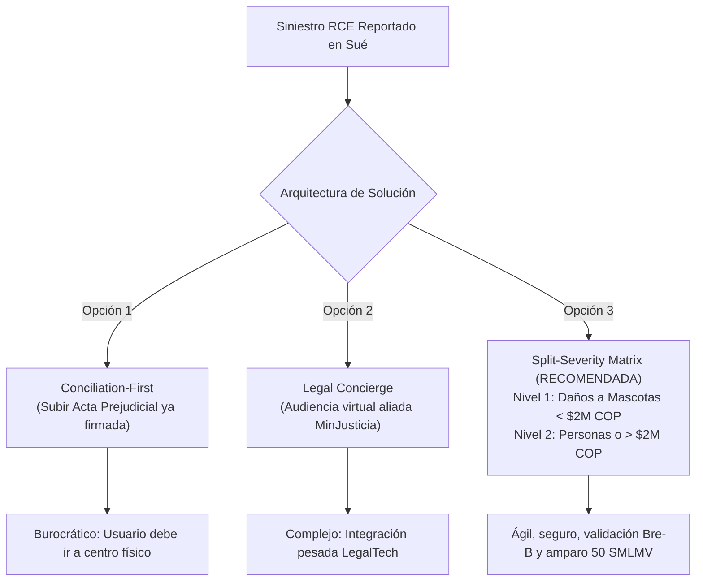

# Investigación Exhaustiva de Siniestralidad y Marco Probatorio: Responsabilidad Civil Extracontractual (RCE - Ley 1801 de 2016)

> **Documento Canónico de Investigación y Diseño Técnico**  
> **Sistema:** Manto 2.0  
> **Fecha:** 29 de Septiembre de 2026  
> **Autoría / Rol:** `manto-ux-research` / `manto-ux`  
> **Árbitro:** `manto-orchestrator`  
> **Marco Legal:** Ley 1801 de 2016 (Código Nacional de Seguridad y Convivencia Ciudadana), Código Civil Colombiano (Art. 2353 y 2354), Código de Comercio (Art. 1077, 1079 y 1080), Ley 1581 de 2012 (Habeas Data).

---

## 1. Introducción y Planteamiento del Problema

En el ecosistema de seguros para mascotas de Manto 2.0, el flujo de reembolsos veterinarios habituales opera con alta automatización:
1. El tomador sube la Factura Electrónica DIAN con CUFE y la Historia Clínica / Epicrisis de la clínica veterinaria.
2. Si el valor reclamado es $\le \$200.000$ COP (Tope Fast-Track de Bajo Riesgo), el motor de Triage procesa y desembolsa en 3 a 5 minutos mediante Bre-B (Banco de la República).
3. Si el valor supera los $\$200.000$ COP, se asigna a Autenticación Pericial Express en menos de 24 horas hábiles.

Sin embargo, los eventos de **Responsabilidad Civil Extracontractual (RCE)** —particularmente los contemplados de forma obligatoria por la **Ley 1801 de 2016** para caninos de manejo especial— presentan una naturaleza jurídica, probatoria y actuarial radicalmente distinta a la de un reembolso de salud médica propia:
- **Existe un tercero afectado o perjudicado:** La relación ya no es bilateral (Tomador ↔ Aseguradora), sino tripartita (Tomador / Asegurado ↔ Tercero Afectado / Víctima ↔ Aseguradora).
- **El objeto del seguro no es la salud de la mascota, sino el patrimonio del tenedor:** El seguro ampara la indemnización por los perjuicios patrimoniales (daño emergente y lucro cesante) y extrapatrimoniales que el canino cause a terceros (lesiones corporales a personas, muerte, ataques a otros animales domésticos o destrucción de bienes materiales).
- **Riesgo severo de fraude o litigio civil/penal:** Pagos directos al tomador sin finiquito formal del tercero pueden derivar en demandas civiles posteriores, indemnizaciones dobles o reclamaciones fraudulentas concertadas.

El objetivo de esta investigación es determinar el marco probatorio exacto en Colombia, analizar precedentes insurtech internacionales (Lemonade, Tuio) y tradicionales colombianos (SURA, Seguros Bolívar, Mapfre), y proponer 3 opciones viables de diseño de experiencia y arquitectura de producto para Manto 2.0.

---

## 2. Marco Legal Colombiano Vigente

### 2.1 Ley 1801 de 2016 (Código Nacional de Seguridad y Convivencia Ciudadana)
* **Artículos 126 al 134:** Regulan taxativamente la tenencia de caninos de manejo especial (15 razas tipificadas y sus cruces o híbridos, tales como American Staffordshire Terrier, Pit Bull Terrier, Rottweiler, Dóberman, Dogo Argentino, Fila Brasileiro, etc.).
* **Obligatoriedad del Seguro:** El Artículo 127 establece que el propietario o tenedor de un ejemplar canino de manejo especial debe adquirir una póliza de responsabilidad civil extracontractual.
* **Monto Mínimo de Cobertura Legal:** Exactamente **cincuenta (50) salarios mínimos legales mensuales vigentes (SMLMV)** por vigencia anual.
  $$\text{Valor Asegurado RCE 2026} = 50 \times \$1.750.905\text{ COP} = \$87.545.250\text{ COP}$$
* **Sanción por Incumplimiento:** El decomiso del canino y multa general tipo 4 impuesta por la Policía Nacional e Inspecciones de Policía.

### 2.2 Régimen de Responsabilidad por Animales (Código Civil Colombiano)
* **Artículo 2353 (Daño causado por animal doméstico):**
  > *"El dueño de un animal es responsable de los daños causados por el mismo animal, aun después que se haya soltado o extraviado; salvo que la soltura, extravío o daño no pueda imputarse a culpa del dueño o del dependiente encargado de guardar o servir del animal."*
* **Artículo 2354 (Daño causado por animal fiero):**
  > *"El daño causado por un animal fiero, de que no se reporta utilidad para la guarda o servicio de un predio, será siempre imputable al que lo tenga; y si alegare que no le fue posible evitar el daño, no será oído."*
* **Naturaleza jurídica:** La jurisprudencia civil colombiana califica la tenencia de animales domésticos y especialmente potencialmente peligrosos bajo un régimen de responsabilidad con culpa presunta o responsabilidad objetiva por actividad peligrosa. Por ende, la carga de la prueba sobre la no culpabilidad o caso fortuito recae de forma casi absoluta sobre el tenedor.

### 2.3 Demostración del Siniestro y Liquidación (Código de Comercio)
* **Artículo 1077 (Carga de la prueba):**
  > *"Incumbirá al asegurado demostrar la ocurrencia del siniestro, así como la cuantía de la pérdida, si fuere el caso."*
* **Artículo 1080 (Plazo para el pago de la indemnización):**
  La aseguradora dispone legalmente de un plazo de un (1) mes contado a partir del momento en que el asegurado o beneficiario entregue la reclamación debidamente formalizada con todos los soportes legales exigidos por la póliza.
* **Beneficiario de la indemnización (Art. 1127 y 1133 C.Co.):**
  En el seguro de responsabilidad, el tercero perjudicado tiene acción directa contra la aseguradora, y el pago debe orientarse primordialmente a indemnizar al damnificado.

---

## 3. Catálogo Taxativo de Soportes Jurídicos y Periciales Requeridos en Colombia

A diferencia de un siniestro de salud veterinaria (donde basta la DIAN con CUFE y la Historia Clínica / Epicrisis), un siniestro de RCE exige estructuración probatoria de tres elementos: **Hecho generador (ataque/daño), Nexo causal (identificación del animal asegurado) y Cuantía del perjuicio.**

| Tipo de Daño Causado por el Canino | Soportes Jurídicos / Periciales Obligatorios en Colombia | Finalidad Probatoria |
| :--- | :--- | :--- |
| **Lesiones a personas (ataque a transeúnte o vecino)** | 1. **Epicrisis de Urgencias y Atención Médica Humana:** Expedida por IPS/EPS autorizada. 2. **Dictamen de Incapacidad Médico-Legal:** Emitido por el Instituto Nacional de Medicina Legal o médico perito tratante. 3. **Facturas de gastos médicos/farmacéuticos:** No cubiertos por el SGSSS. 4. **Acta de Conciliación Prejudicial:** Suscrita en Centro de Conciliación avalado por MinJusticia, Personería o Notaría. | Demuestra la cuantía real del daño emergente corporal y blinda al asegurado de demandas civiles o querellas penales por lesiones personales culposas (Art. 120 Código Penal). |
| **Ataque / Muerte de otra mascota (perro, gato u otro animal)** | 1. **Historia Clínica Veterinaria Completa de la Víctima:** Detalle de heridas por mordedura, pronóstico y evolución. 2. **Factura Electrónica DIAN de la Clínica que atendió a la mascota lesionada:** Con desglose de cirugías, curaciones y hospitalización. 3. **Certificado de Defunción y Necropsia (en caso de muerte).** 4. **Contrato de Transacción Prejudicial o Finiquito Indemnizatorio:** Entre el asegurado Manto y el dueño de la mascota atacada. | Acredita los gastos veterinarios causados a la contraparte y garantiza que no existan cobros dobles ni reclamos sobre mascotas no involucradas. |
| **Daños materiales a bienes (destrucción de objetos, ropa, vehículos, rejas)** | 1. **Registro Fotográfico Georreferenciado del Bien Dañado:** Fotos tomadas en el lugar de los hechos. 2. **Factura Original de Compra o Dos Cotizaciones Formales de Reparación/Reposición.** 3. **Declaración Conjunta de Hechos o Informe Policial:** Si intervino la patrulla del cuadrante de la Policía Nacional. | Cuantifica el daño patrimonial directo y evita la sobrevaloración de objetos usados. |

---

## 4. Benchmarking de Precedentes Internacionales y Locales

### 4.1 Lemonade Pet & Home Liability (Estados Unidos y Europa)
* **Principio de Asignación Humana Inmediata:** Lemonade procesa reclamos de gastos veterinarios ordinarios en segundos a través de su bot de IA (AI Jim). No obstante, en reclamos de responsabilidad civil (*Third-Party Liability*), el sistema **NUNCA aplica liquidación STP (Straight-Through Processing) desatendida**.
* **Cláusula de Pagos Voluntarios (*Voluntary Payments Clause*):** Las condiciones generales de Lemonade prohíben taxativamente al asegurado asumir culpabilidad, negociar acuerdos económicos o realizar pagos directos a la víctima sin el consentimiento previo y por escrito de la aseguradora. Si el asegurado paga a la víctima por su cuenta, el siniestro queda automáticamente objetado por violar el derecho de defensa de la aseguradora.
* **Claims Liability Specialist:** Un abogado o liquidador pericial especializado toma el caso, contacta a la víctima y gestiona la liberación legal de responsabilidad (*Release of Claims*).

### 4.2 Tuio (Insurtech España / Regulación Europea)
* **Triaje Digital en App:** En casos de responsabilidad civil por mordeduras leves a otros perros o desgarros de ropa, Tuio solicita:
  1. Identificación del perjudicado (DNI, teléfono, IBAN bancario).
  2. Factura de reparación o veterinario de urgencia.
  3. Firma digital de un finiquito de renuncia a acciones legales dentro de la app móvil.
* **Umbral de Severidad:** Para montos inferiores a 300 - 500 €, liquidan ágilmente mediante transferencia bancaria directa a la cuenta del perjudicado una vez firmado el finiquito digital.
* Para lesiones a personas o daños superiores a 500 €, activan peritaje médico-legal presencial y defensa jurídica corporativa.

### 4.3 Mercado Asegurador Tradicional en Colombia (SURA, Bolívar, Mapfre)
* **Fórmula estándar:** Reclamo formal por escrito, copia del comparendo policial (si existe), cotizaciones y **obligatoriedad de Acta de Conciliación extrajudicial en derecho** en un Centro de Conciliación avalado por el Ministerio de Justicia.
* **Pago directo al damnificado:** El cheque o transferencia de indemnización se gira directamente a nombre del tercero perjudicado, previa suscripción del documento de subrogación y paz y salvo definitivo.

---

## 5. Análisis de Opciones de Experiencia y Arquitectura para Manto 2.0

Para el diseño de la experiencia de siniestros RCE en Manto 2.0, se formulan tres opciones:

### Opción 1: Flujo Asistido Pre-Conciliación (Conciliation-First)
* **Descripción:** La app solo permite radicar siniestros de RCE si el usuario ya cuenta con un Acta de Conciliación formal en mano.
* **Ventajas:** Máxima seguridad jurídica para Manto; riesgo de fraude cercano a cero.
* **Desventajas:** Fricción extrema para el cliente. La mayoría de asegurados no sabe qué es un centro de conciliación ni dispone del documento en el momento del incidente. Puede provocar deserción y frustración con la marca.

### Opción 2: Triage LegalTech & Conciliador Digital Acompañado (Legal Concierge)
* **Descripción:** El usuario reporta el incidente con fotos y relato. Manto activa una alianza con una plataforma LegalTech colombiana y agenda una audiencia virtual de conciliación en 24 horas hábiles. Una vez firmada digitalmente el acta con mérito ejecutivo, Sué gira el dinero por Bre-B a la víctima.
* **Ventajas:** Experiencia 100% digital, moderna y con amparo integral.
* **Desventajas:** Requiere acuerdos comerciales y tecnológicos de integración con terceros centros de conciliación autorizados por MinJusticia, inviable para el sprint de lanzamiento inmediato.

### Opción 3: Matriz Bifurcada por Severidad (Split-Severity Matrix) — **RECOMENDADA**
* **Nivel 1 — Daños Menores a Cosas o Atención Médica a otra Mascota ($\le \$2.000.000$ COP):**
  - **Soportes requeridos:** Factura Electrónica DIAN de la clínica donde atendieron a la mascota afectada + Fotos del evento + Datos del dueño de la mascota afectada (Nombre, Cédula, Teléfono, Llave Bre-B) + Declaración juramentada en la app.
  - **Mecanismo:** Manto envía un SMS / WhatsApp con enlace de firma digital de finiquito y paz y salvo a la víctima. Tan pronto la víctima aprueba, se dispersa el dinero a la cuenta Bre-B de la víctima en menos de 24 horas hábiles.
* **Nivel 2 — Lesiones Corporales a Personas o Cuantías Mayores ($> \$2.000.000$ COP hasta 50 SMLMV):**
  - Se activa la **Mesa Pericial Legal de Manto**.
  - Asignación de abogado conciliador y perito médico.
  - Acompañamiento presencial/virtual al asegurado en el centro de conciliación.
  - Indemnización formal con acta de conciliación y dictamen médico.

---

## 6. Implementación Inmediata en la UI de Manto 2.0 (`ClaimsStepper.tsx`)

En observancia de la doctrina de prudencia financiera y legal:
1. **Visibilidad en el Selector de Siniestros:** La opción `CIVIL_LIABILITY_1801` ("Daños a terceros (RCE - Ley 1801)") se mantiene visible e identificable con el tag `Peritaje Legal`.
2. **Tarjeta de Orientación Pericial:** Al seleccionarla, se despliega una tarjeta explicativa con micro-copia empática y clara que informa:
   - Cobertura legal hasta 50 SMLMV ($87.545.250 COP).
   - Requerimiento de acta de conciliación o peritaje probatorio.
   - Enlace directo de asistencia con la Mesa Pericial Legal de Manto (WhatsApp / Atención inmediata).
   - Posibilidad de continuar el registro guiado preliminar del siniestro sin bloquear la navegación.
3. **Cero Placeholders y Cero Flotantes:** Montos tipados estrictamente en COP enteros, preservando la doctrina fundacional de Manto 2.0.

---

> **Conclusión:**  
> La implementación de la Matriz Bifurcada por Severidad (Opción 3) equilibra la velocidad digital de Manto con la rigurosidad probatoria y de protección patrimonial exigida por el Código de Comercio y la Ley 1801 de 2016 en Colombia.
